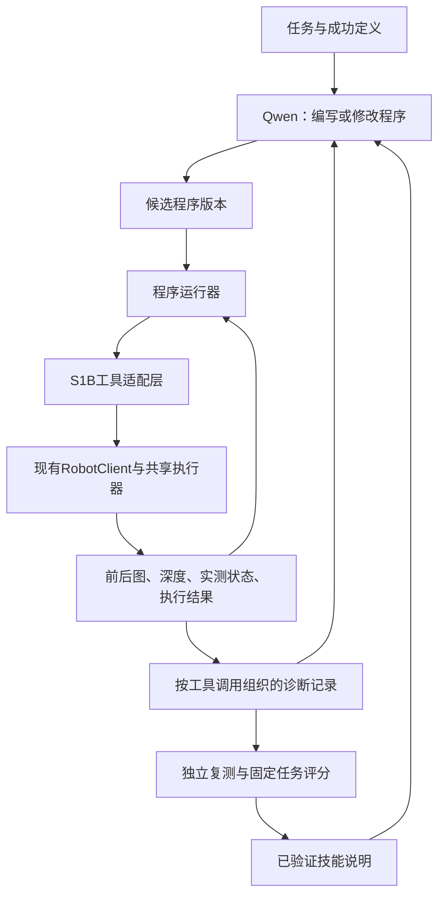

# PressButton 接入 ASPIRE 的具体方案

日期：2026-11-02，北京时间。状态：设计建议，尚未实现或执行。本文依据当前工作树与ASPIRE官方代码/论文，将研究机制对应到S1B现有接口；本轮只新增本文，没有启动服务、下载模型、请求推理或执行机器人动作。

**建议先实现一个沿用现有S1B执行器的ASPIRE方法适配版：Qwen开发短控制程序，程序通过统一接口执行，执行证据支持程序修订，独立复测后保留技能。** 后续需要统一运行上游基准时，再完成ASPIRE原生EnvironmentAdapter接入。

## 1. 引入之后，哪些事情会改变

当前direct路线主要是：当前图片/状态/历史 → Qwen生成单次动作 → 执行 → 下一次Qwen决策。

拟新增路线有两个循环：

- **任务执行循环：** 已生成的短程序读取观测、调用感知/运动工具、检验效果、继续或返回失败。低层250 Hz仍由S1B执行器负责。
- **程序改进循环：** Qwen读取失败相关的工具调用、前后图和实测轨迹，提出程序修改，重新执行验证；成功的可复用方法进入技能库。

这对应ASPIRE的iterative debugging和skill library。第一阶段可不做多分支evolutionary search；先验证单程序修复是否带来收益。模型权重不更新，变化的是程序、参数、技能说明和上下文。[论文§2](https://arxiv.org/html/2607.00272v2)。



Qwen可以继续负责阶段和异常判断；局部数值运算和已知重复流程可放进程序。若细定位仍调用Qwen，它仍产生模型时延，程序化本身不保证变成实时视觉控制。

## 2. 当前项目已有的基础与缺口

| 部分 | 当前可复用的实现 | 接入时需要做的事 |
|---|---|---|
| 观测 | `RobotClient.observe/download`；双图、完整右腕深度、状态、观测ID | 统一包装为程序可读结果，保留相机身份、时间、单位与原始证据路径 |
| 运动 | `RobotClient.execute` → Service → SDKBackend → `CommandExecutor` | 在其前方建立可信工具适配层；生成程序不能直接拿机器人HTTP地址/SDK对象 |
| 完成反馈 | 命令起终点、`state_trace`、`final_state`、动作后观测 | 保留“发送完成”，另列实测误差、视觉进展和任务证据 |
| 当前视觉判读 | `localization.py`、`perception.py`、`grounding.py` | 包装成带来源与不确定性的感知工具；模型估计不能变成传感器真值 |
| 进展/前推检查 | `progress.py`、`view_acquisition.py`、`forward_guard.py` | 保留已选检查范围，通过适配层调用；另为程序学习组织失败证据 |
| 示范/日志 | `demonstration.py`、`failure_case.py`、`outputs/agent_web` | 按失败调用检索相关示范和前后变化；保存原程序与修复diff |
| 自动任务评分 | 有模型判断、部分人工复盘 | 固定本次触发及撤回的证据标准，保留unknown；初期可人工评分 |
| 程序与技能学习 | 当前主要是模型动作调用 | 新增短程序运行器、候选版本、诊断循环、技能提出/复测/发布 |

源码入口：[客户端](../../src/pressb/agent_loop/client.py)、[服务](../../src/pressb/agent_loop/service.py)、[SDK适配](../../src/pressb/agent_loop/sdk_backend.py)、[共享执行器](../../scripts/s1b_keyboard_control.py)。

当前Agent已保存 `right_depth_raw.npy` 和 `depth_metadata.json`，其中包含传感器内参、深度尺度及深度到彩色的内部外参。这为离线RGB-D对齐和相机坐标几何提供了基础；仍不能把它当作腕相机到手腕/底盘的手眼标定。`tcp_pose`、`tcp_surface_gap_mm`当前为null，真实接触点、手眼及完整真机FK/IK验收仍需补齐。[标定状态](../astribot/planar_control/calibrated_control.md)。

## 3. 第一版提供什么工具

以下为拟议API名称，不是当前可调用接口。先暴露真实已有能力，绝对位姿、力控和碰撞规划待条件具备后添加。

| 工具 | 输入 | 输出与作用 |
|---|---|---|
| `observe()` | 相机需求 | 新观测ID、HEAD/WRIST图、可用深度、时间与状态 |
| `get_state()` | 无 | 实测末端与命令末端、头角、关节、执行状态 |
| `inspect_button(obs_id)` | 当前观测 | 按钮框、物理指端、可见性、灯态、unknown和证据；结果标为模型估计 |
| `compare_effect(before_id, after_id)` | 两个实际观测与期间动作 | 图像变化、实测位移、目标是否更可见/更接近、可比较性 |
| `move_xyz_mm(...)` | 当前观测ID、XYZ增量 | 经现有检查执行；返回实测状态、发送状态、新图与错误 |
| `set_head_deg(...)` | 当前观测ID、绝对角度 | 头部动作与实测响应；避免把绝对角当增量 |
| `set_gripper_key(...)` | 当前观测ID、现有键值 | 沿用键盘夹爪语义 |
| `get_trace(call_id)` | 工具调用ID | 对应输入/输出/前后图/命令和实测状态 |
| `finish_candidate(evidence)` | 本次动作证据 | 提交待评分结果，不把模型自报完成变成真成功 |

需要明确的执行语义：

1. XYZ当前相对上一**命令位姿**累加，而不是相对最新实测位姿。两者都给程序看，不能把目标欠跟踪误认为新的位移依据。
2. 机器人侧坐标为chassis，+X前/+Y左/+Z上，平移mm；位姿存储m、四元数xyzw。上游部分接口为m、wxyz，任何转换必须显式。
3. 前推检查目前在Agent客户端，Service不验证这一许可。生成程序只调用可信broker；broker获取独立判读、绑定当前观测及完整XYZ，再调用`RobotClient.execute`。不能让程序构造或传入“allowed=true”的许可字典。
4. `command_id`由broker管理，并持久保存 `execution_id + call_id → command_id/task_id/result`。当前客户端只保证一次HTTP提交重试时ID不变，不能保证整个生成程序重跑时不重复运动；新账本需补齐这一点。状态轮询失败时先查原动作；同一逻辑调用重试恢复原结果，真正下一次试验或新动作使用新调用ID。动作串行且共享现有停止信号。
5. 现有前推检查只检查腕图横向条件；本设计不把它悄悄扩大为高度、力或三维对齐条件。新技能的前后条件需要单独记录和比较。

这里的broker是拟议的统一动作入口，可以封装现有客户端；生成程序不持有裸客户端或传输能力。程序运行边界还需要限制资源与可访问能力，不能仅以“Python语法检查通过”当作隔离保证。

仅调用`RobotClient.execute`也不足以继承全部现有行为：取景阶段的动作可用性、进展复核等还在`Conversation`和启动循环中。应提取共享的动作策略状态，使旧direct路径与新broker共同经过“观测绑定 → 当前阶段动作权限 → 进展复核 → 正X检查 → 提交 → 新结果更新”。已知取景停滞另作候选修改和对照，不通过更换运行器静默绕过；策略规则也不由任务程序自行解除。

## 4. 一次按按钮实验会怎样工作

以现有“下降后按钮反而退出腕图”的失败为例，下面是预期流程，而非已验证修复：

1. **准备任务。** 提供目标按钮、起始条件、允许使用的工具、示范、已有技能和本次成功标准。先做一个固定面板/准备位的末段按压任务，再扩展初态范围。
2. **生成候选v1。** Qwen编写“观察 → 判断缺少的信息 → 对齐 → 接近 → 验证 → 撤回”的程序。程序中每次运动都必须消费当前观测，并检验实际效果。
3. **执行并记录。** 一次下降后，工具记录实际Z变化，以及按钮从腕图上边缘退出；程序返回“观测效果与预期不符”。同时保留头图、腕图、所用接触点和程序分支。
4. **诊断。** Qwen只读取相关调用的证据，分别检查：动作是否真实发生、指端身份是否正确、腕图中物体运动与手部运动是否被混淆、历史理由是否覆盖当前观测。
5. **修改v2。** 候选可改成“遇到效果反向时先重新定位，使用已验证的局部运动映射”，或增加恢复分支。下降导致出画并不足以直接证明此时应上移；方向仍要由当前几何和可信动作关系支持。
6. **独立复测。** 在预定开发初态上比较v1/v2，保留失败和退化。候选程序通过后，再提炼可迁移技能，由独立验证会话仅根据技能说明重新实现并复测。
7. **保存并测试。** 冻结选定程序与技能库，在新的初态上运行；后续类似任务检索经过验证的处理方法。

同一机制也可处理持续低头：如果头部实测没有跟上命令，优先返回执行问题；若角度已变化但仍没有新信息，则改取景策略。两者不能都归结为“再增加pitch”。

## 5. 两类产物要分开保存

- **任务程序 `policy.py`：** 当前任务的可执行实现、依赖的工具版本、配置、来源和变更记录。
- **可复用技能说明：** 问题特征、适用条件、所需证据、处理方法、退出条件、反例及验证记录。可以含短代码片段，但不等同于一串固定XYZ。

例如技能“腕图目标出画后的恢复”应说明如何判断目标从哪条边退出、怎样核对实际运动、什么条件下能使用局部方向映射，以及无法确认时如何返回unknown。不要只记“向上移动某个固定距离”。ASPIRE的技能库主要存储这类可检索的修复知识。[论文§2.2](https://arxiv.org/html/2607.00272v2)。

拟议日志结构：

```text
outputs/aspire_s1b/<campaign>/
  protocol.json                 # 固定评分、初态分组、预算
  candidates/v001/policy.py      # 候选代码及配置
  trials/<trial>/calls.jsonl     # 每次工具调用及关联证据
  trials/<trial>/outcome.json    # 执行状态、任务评分、证据来源
  revisions/v001_to_v002.json    # 假设、diff、对照结果
  skill_candidates/              # 尚未通过验证的知识
  accepted_skills/               # 已独立复测的版本
```

现有观测文件保持原样，以ID和路径引用；每份记录区分人工标签、模型估计和实测量。评分器、测试初态与原始记录不由修复Agent改写。单机器人上的试验串行；离线候选生成可以并行。

## 6. 怎样分阶段实施

| 阶段 | 具体产物 | 这一阶段要回答什么 |
|---|---|---|
| P0 执行与评分整理 | 修复任务快照竞态；核实头部响应；定义动作状态与任务状态；建少量人工复核样本 | 失败反馈能否可靠归因？ |
| P1 适配与离线运行 | `S1BTools`、可信broker、程序runner、记录器、日志读取器；在fake和保存数据上运行 | 程序能否正确使用单位/观测ID/错误与停止接口？ |
| P2 单任务执行闭环 | 已知准备位上的单按钮任务；受限的初态范围；人工复位和评分 | 程序化Agent能否完成且纠错？ |
| P3 自动程序修复 | 固定开发场景、候选diff、配对比较、失败分类 | 修改是否真正改善可重复执行？ |
| P4 技能与留出验证 | 技能提炼、独立复测、冻结后新初态评估 | 经验能否迁移，是否优于直接会话基线？ |
| P5 可选原生上游接入 | S1B EnvironmentAdapter、能力注册、记录与runner对接 | 是否需要复用完整ASPIRE生态和统一基准？ |

建议新增模块为 `src/pressb/aspire_s1b/{tools,broker,runner,traces,critic,campaign}.py` 与独立启动入口；这些路径是实施建议，当前没有创建。初期使用现有Qwen服务接收工具文档、产出程序/补丁；需要补文件编辑、运行和日志查询循环，不能假设现有动作JSON客户端或上游Claude Code配置已经完成这一接入。

针对接入后的运动路径，应验证旧观测拒绝、当前观测前推检查、同ID重试不重复运动、动作后采图失败、程序停止和错误结果保留。离线回放只能检查过去轨迹，不能通过换一条动作模拟它未发生过的物理后果。

基线与新方案固定模型revision、图像条件、底层执行能力和评分；比较首次成功、限定重试成功、误按/误报、耗时、调用数、人工接管、开发成本。跨模型比较作为单独实验，避免把框架和模型变化混在一起。

## 7. 原生移植ASPIRE还需要哪些工作

上游当前真机路径是YAM站点、标定RGB-D、SAM3、Mink/cuRobo和CAP会话。S1B需要新的环境/执行适配，不能只替换机器人IP或复用YAM启动配置。YAM启动流程还有自己的归位与夹爪行为，本项目应有独立初始化流程。[上游运行文档](https://github.com/NVlabs/ASPIRE/blob/main/docs/system2.md)。

原生接入需要核对EnvironmentAdapter、embodiment/动作类型、工具注册、程序runner、记录器和server构造。上游的真实System 2工具接口与仿真Python程序执行接口是两条表面；不能假设已有MCP提供任意Python上传执行。可在研究确定后复用其程序执行核心，但必须保持本机单一执行器和相机所有者。[上游API](https://github.com/NVlabs/ASPIRE/blob/main/docs/api-reference.md)、[日志规范](https://github.com/NVlabs/ASPIRE/blob/main/docs/run-artifacts.md)。

第一版可以只使用现有相机判读和XYZ工具。要进一步加入SAM3点云定位、一般六维目标位姿、碰撞规划或接触力控制，需要分别完成传感器对齐、手眼/TCP、机器人模型和对应接口验收。ASPIRE提供组织和改进方式，这些底层能力仍由本机工具提供。

可以进一步核对上游的[`run_program_with_api`](https://github.com/NVlabs/ASPIRE/blob/main/src/cap_harness/run.py)作为已有机器人会话的嵌入入口，以及[程序运行器](https://github.com/NVlabs/ASPIRE/blob/main/src/cap_harness/runtime.py)和[环境协议](https://github.com/NVlabs/ASPIRE/blob/main/src/cap_harness/protocols.py)。这些是代码复用候选，不表示当前S1B类型和工具已经满足上游契约。

**第一版应交付的最小结果：同一任务、同一Qwen和同一S1B执行能力下，产生一个可重复执行的候选程序，完整记录失败，完成一次有对照的程序修订，并在未参与修改的初态上评估。** 这能直接回答引入ASPIRE机制是否对PressButton有价值。
