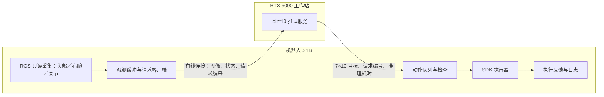

# S1B 真机部署实现计划 v1.0：RTX 5090 推理＋有线机器人控制

创建日期：2026-10-26。状态：P0 / P1 已实现并完成 RTX 5090 本机离线验收；P2～P5 尚未验收。详见 [P0/P1 实测报告](results_p0_p1_20261026.md) 和 [本机操作手册](operations_p0_p1.md)。此次未连接机器人、未申请控制权、未下发运动。

## 目标与交付范围

在 RTX 5090 工作站运行真机 joint10 VLA，由网线连接的 Astribot S1B 采集图像／实测状态并执行模型目标。完成离线推理、实时只预测、延迟分析、受控运动和按键闭环验证。保留第 2,000／8,000 步权重切换与结果对照能力。

首版不做在线训练、强化残差、主动转头、多任务语言泛化或底盘导航。不把当前“保持示范头部姿态”的数据解释为任意头部姿态恢复能力。

| 文档 | 用途 |
|---|---|
| [implementation.md](implementation.md) | 模型适配、机器人桥接、消息接口、时序调度及故障行为 |
| [validation.md](validation.md) | 分阶段开发任务、测试矩阵、进入运动阶段的条件与结果记录 |

## 当前资产与缺口

- 两份真机权重均位于 `models/s1b_real_joint10_8000_v1/checkpoints/`，分别为 `step_002000`、`step_008000`。权重 SHA-256 和 10 维接口形状已核验，尚未进行本机推理或真机闭环验收。
- 同目录包含 processor、原始 HPC 配置、`config.local.yaml`、实际训练 runtime、训练数据契约及验证报告。未下载 `training.pt`，推理不需要优化器状态。
- 本机已检测到 RTX 5090 约 32 GB 显存。实际峰值显存、首帧及稳定推理延迟待测，不能用训练显存推断推理是否可用。
- SSH 别名 `S1B` 对应 `astribot@192.168.0.11`。SDK 安装在机器人端，初始化控制客户端会申请控制权；纯采集必须走独立只读路径。
- 既有推理服务限制 joint8／仿真 state32，且右腕图像尺寸与本次真机数据不同，禁止直接拿来下发这次模型输出。
- HDF5 时间字段的记录时间来源已有离线探针证据，但实际曝光、执行时刻及跨主机时钟关系未标定。部署必须测端到端延迟并记录这一局限。

## 架构

机器人端负责控制权、时间基准、动作节拍、目标约束和故障处理；5090 不直接管理底层伺服循环。SSH 用于管理及首版端口隧道，持续观测／动作使用常驻 HTTP 连接。具体协议见实现文档。

## 开发顺序与完成定义

1. **P0 契约与配置**：核对权重、processor、10 维名字／单位，建立部署配置模板及空值阻止启用规则。
2. **P1 离线 joint10 推理**：加载两份权重，用验证集及合成边界样本测输出、数值、显存和延迟。
3. **P2 只读采集与桥接**：获取真机双路图像、实测状态及时间信息，打通有线数据链路。
4. **P3 影子模式与调度测试**：实时预测但不创建控制客户端，用假执行器验证动作时效、队列和所有退出路径。
5. **P4 受控执行**：填写并核验 SDK 控制方式、关节与速率限制、停止行为；人工启用后做小幅动作验证。
6. **P5 按键闭环对比**：相同初始条件分别测试 2,000／8,000 步权重，记录成功／失败与人工中止。

“代码能运行”“数据契约一致”“可以进入运动试验”“按键任务有效”分别验收。不能用离线 MAE 或头部常量预测误差替代真实按键成功率、保持误差和停止能力。

## 参数与版本约定

已固定：state/action 顺序与单位、二值夹爪解码、训练 processor、30 Hz 目标网格、7 步动作 horizon、只读与执行路径分离、默认影子模式、过期响应拒绝。

需实测后填写：采集时间映射、控制客户端调用频率、SDK `control_way/use_wbc/add_default_torso`、各关节目标与速率限制、头部保持允许误差、停止与控制权释放的具体操作。它们不是由开发者随意猜测的默认值；没有核验记录时 `execute` 必须拒绝启动。阈值模板中给出的候选值均需标记为工程初值。

版本 1.1 可补充实现结果与经验证参数；消息字段、时序、动作语义改变时同步升级协议及部署契约，重新执行相关验收。

参考：[模型资产列表](../../assert/assert_list.md)、[真机训练入口](../../../training/s1b_real/README.md)、[数据转换规则](../astribot_s1b_real_finetune/conversion_rules_v1.md)、[S1B SDK 核查](../../astribot/s1b_contract_20261025/README.md)。
