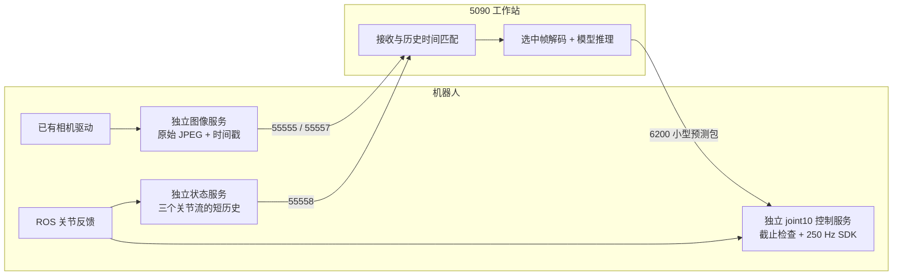

# S1B 分离式图像、状态、推理与控制

`scripts/start_s1b_inference.py` 现在默认启动这套链路。旧 `s1b_robot_bridge.py` 保留用于旧日志复现，不再由默认启动器调用。



## 运行

原执行命令兼容，模型预热完成后仍按 S 开始控制权交接和执行：

```bash
cd /home/js/robot/VLA/PressButton
.venv-astribot-inference/bin/python scripts/start_s1b_inference.py \
  --checkpoint 2000 --mode execute \
  --operator-present --estop-ready --request-control-handover
```

只读端到端验证可免按键运行，机器人控制服务处于 shadow，不实例化 SDK、不获取控制权、不下发目标：

```bash
.venv-astribot-inference/bin/python scripts/start_s1b_inference.py \
  --checkpoint 2000 --mode shadow --auto-start --duration 60
```

`--auto-start` 在 execute 模式下会被拒绝。`--checkpoint 8000` 同样受模型身份校验保护。运行时长从控制端初始化完成、工作站准备发送新观测预测后计算，不包含模型加载、预检或 SDK 初始化。

无需在机器人上另开终端启动服务；工作站通过 SSH 自动完成。启动器同步本项目模块和服务脚本到 `/home/astribot/pressb_readonly_p2`，按次启动和清理服务，不注册开机自启。相机启动前先订阅配置中的两个 ROS 图像话题，验证连续 JPEG、尺寸及时间戳；已有图像可用时直接复用。若缺图像，仅补启动不存在的采集/压缩进程，使用该目录内已准备好的驱动副本；已运行的系统驱动不会仅因安装路径不同而被拒绝。实际图像不满足预检、同名驱动重复运行或服务端口被占用时，会在 SDK 初始化前退出。清理只针对携带本次 `PRESSB_LIVE_TOKEN` 的远端 PID；已运行的相机驱动不属于本次进程时不关闭。

## 进程、端口和依赖

| 进程 | 所在机器 | 监听端口 | 数据 |
| --- | --- | --- | --- |
| `s1b_observation_service.py --kind images` | S1B | 55555、55557 | 头部、右腕 JPEG，附帧号和机器人时间 |
| `s1b_observation_service.py --kind states` | S1B | 55558 | arm/gripper/head_state 历史 |
| `s1b_control_service.py` | S1B | 6200 | `/health`、`/start`、`/prediction`、`/stop` |
| `s1b_policy_server.py --warmup` | 工作站 | 8796 | 模型身份与本地推理 |
| `s1b_split_inference.py` | 工作站 | 无监听 | 对齐、解码、请求模型、返回预测 |

服务均绑定 `127.0.0.1`。启动器创建图像、状态、控制三条独立 SSH 连接；头部和右腕共用图像连接。显式禁用 SSH ControlMaster 复用，避免图像和动作通过同一条 SSH TCP 连接。端口可通过 `--head-port`、`--right-port`、`--state-port`、`--control-port`、`--policy-port` 修改，五者必须不同。

两端的新增依赖固定为 `pyzmq==27.2.0`，见 `configs/s1b_split_requirements.txt`。工作站安装到推理 venv；机器人安装到专用 `deps/split`，不替换系统 NumPy/ROS/SDK：

```bash
.venv-astribot-inference/bin/python -m pip install -r configs/s1b_split_requirements.txt
ssh S1B 'python3 -m pip install --target /home/astribot/pressb_readonly_p2/deps/split pyzmq==27.2.0'
```

启动器会检查依赖，但不会在每次运行时自动升级。SDK 环境只注入 execute 控制进程；图像和状态进程只订阅 ROS。参考 `astribot_image_service` 的原始 JPEG 转发、最新值缓存和独立发送方式，未引入其 25D/16D 动作或 legacy 最后目标保持行为。

## 时间与传输契约

- 图像在回调中仅复制压缩字节，保留 ROS source 时间、映射到机器人单调时钟的时间、机器人回调接收时间、帧号、service/session ID 和 Linux boot ID。单条消息包含元数据和 JPEG；不依赖多段消息与 CONFLATE 的组合。
- 每路发送缓存只保存最新包，ZMQ 发送与接收高水位为 1，慢消费者不积压旧图像。工作站已接收的图像保留有界历史，用于选择最新可对齐观测。
- 状态进程约每 20 ms 发布最近 128 条/流的历史，250 Hz 时覆盖约 512 ms。每个包同时携带三个流；即使旧包被替换，工作站仍能匹配延迟到达图像的历史关节状态。状态形状、有限值、序号和时间单调性均检查。
- 工作站通过控制服务单调时钟建立跨主机偏移区间，使用偏移上界保守计算图像年龄；定期校准运行在独立线程和连接上。校时 RTT 超过 50 ms 的采样不接纳；运行中保留上一次仍有效的校准并重试健康检查。时钟跳变、校准超过 10 s、boot/service 身份变化仍会报错。跨主机时间估计仅用于观测筛选，执行期限最终在机器人本地核验。
- 80 ms 图像接收新鲜度、10 ms 关节源时间匹配、40 ms 右相机源时间匹配保持不变；解码与编码后再次检查新鲜度。拒绝后不会复用已提交的头部帧。
- 模型推理仍使用原尺寸 RGB、原预处理、固定 joint10、7 点和原 30 Hz 偏移。动作包包含原机器人观测时间，截止时间始终是该时间加偏移，不从预测抵达时间重新计时。
- 图像和状态走 ZMQ，动作走小型 NPZ/HTTP。动作连接在 0.5 s 空闲后主动重建，服务端空闲超时 2 s；不自动重试不确定的动作提交。控制服务先响应身份与校时请求；SDK 初始化由独立的 `/start` 握手触发，必须先完整发送 HTTP 确认。初始化期间的慢健康响应不会用于校时，初始化完成后取得快速响应再恢复新观测推理。
- execute 复用现有 `LiveExecution`、`ExecutionRunner`、guard、看门狗与停止核验。预测供给耗尽时的行为由执行配置的 `queue_exhausted_action` 决定：默认 `stop` 锁存停止；当前 VLA 配置按用户 2026-10-26 要求设为 `hold`，保持最后一个已校验目标并等待新预测，不重发或续期已过期预测点。状态过期、驱动错误、控制权丢失、命令看门狗、Ctrl-C 与急停等故障路径仍锁存停止。第一次新预测超时仍会停止；重连不能自动恢复同一执行会话。

## 日志和验收

每次运行目录是 `outputs/s1b_deployment/live_<checkpoint>_split_<token>/`：

- `launch.json`：端口、模式、会话、机器人输出目录。
- `images.log` / `states.log`：来源计数、发布计数、错误。
- `inference.log` / `workstation/requests.jsonl`：解码、模型耗时、状态和帧对应关系、动作确认。
- `workstation/observation_*.npz`：按原配置每 10 秒保存用于推理的完整 RGB/状态观测，异步写入，遵守原图像存储预算。
- `robot/control/events.jsonl` / `ticks.jsonl`：机器人接收预测时刻、原始截止时间和实际/模拟控制事件。
- `workstation/summary.json`：输入字节量、有效预测率、剩余 horizon 分位数、完整性。
- `robot/control/summary.json`：`coverage_gaps` 和 `max_coverage_gap_ms` 衡量相邻预测之间原始 horizon 的供给空档；还包括最大预测到达间隔、执行/停止结果。
- `robot/images/summary.json` / `robot/states/summary.json`：来源错误、发布情况和 `sdk_imported`。

停止或故障后也会尝试收集机器人日志。`complete=true` 表示请求的测试时长完成且未报工作站错误；是否有预测供给空档还需检查控制摘要，不能仅凭推理次数判定闭环稳定。shadow 不证明实际 SDK 调度、驱动状态或停止反馈已通过。

第一轮 30 秒测试完成 264 次预测，暴露了主线程定期校时造成的 9 次供给空档（最大约 104 ms）。随后改为独立校时线程，并复用小型控制连接。后续验证结果记录于运行日志和本页末尾；该轮问题不计为通过。

## 启动握手修复前的 shadow 验证（2026-10-26）

当时的运行目录：`outputs/s1b_deployment/live_2000_split_1793013876080544625`。

| 项目 | 实测结果 |
| --- | ---: |
| checkpoint / 模式 | 2000 / shadow |
| 工作站运行时长 | 60.08 s |
| 有效预测 / 机器人接受 | 863 / 863 |
| 平均预测率 | 14.36 Hz |
| 相邻预测原始 horizon 覆盖空档 | 0 |
| 最大预测到达间隔 | 111.09 ms |
| 剩余 horizon 最小 / 中位数 | 89.29 / 147.73 ms |
| 本地模型请求 RTT 中位数 / p99 | 58.26 / 61.12 ms |
| 工作站图像解码中位数 / 最大 | 1.68 / 2.79 ms |
| 图像与状态流合计载荷吞吐 | 24.55 Mbps（不含 SSH/TCP 开销） |
| 工作站/机器人服务 SDK 导入 | false |
| 下发 SDK 指令 | 0 |
| 图像/状态回调错误 | 0 |
| 服务退出 / 日志收集错误 | 0 |

`summary.json` 的 `complete=true`、`shadow_coverage_verified=true`、`cleanup_errors=[]`。控制调度器的 uncovered ticks 包含首批预测到达前的启动窗口及离散 30 Hz shadow 采样；供给空档按机器人接收时刻与上一观测末点原始截止时间单独计算。这里的 14.36 Hz 是完整模型请求频率，30 Hz 是动作序列时间网格，250 Hz 是 execute 时本地 SDK 发送目标，三者含义不同。

前一轮 60 秒已达到 0 供给空档，但退出时发现 ROS 默认信号处理与显式 shutdown 竞态。最终版图像/状态进程使用应用自己的停止信号和单次 ROS 关闭；控制进程也显式管理 ROS 信号。启动器会检查服务退出码，记录 `cleanup.json`，清理失败返回非零。最终实测图像、状态、控制、推理进程均正常退出，并复查机器人相关进程和四个服务监听端口均已清理。

174 项 S1B 测试通过，覆盖真实 ZMQ/HTTP、压缩图像像素等价、状态历史补齐、跨机时钟估计与过期、错误 session/boot/model 身份、动作连接空闲重建且不自动重试、慢校时与动作接收隔离、替身 SDK 下原 horizon 耗尽停止，以及既有 guard/看门狗/日志/停止路径。

本轮没有申请真实控制权或运行 SDK 运动，未重新验证原驱动错误或 `stop_did_not_settle_within_budget`。60 秒 shadow 通过不代表 250 Hz 实机执行、物理停止或按键任务闭环已经验收。

## execute 启动超时修复（2026-10-26）

失败会话 `live_2000_split_1793014292206495713` 中，控制端收到预测 0 次、发送模型指令 0 次，发送了 238 次启动保持指令后触发 `first_fresh_prediction_timeout`。原来的顺序是控制端先初始化 SDK、获取控制权并启动 1 秒首预测计时，然后工作站才完成校时和观测订阅。此前 shadow 不启动这个执行计时器，因此没有覆盖该故障。

现在的启动顺序：

1. 控制端进入 `WAITING_FOR_CLIENT`，可响应健康检查和校时，不申请 SDK 控制权。
2. 工作站完成校时、双相机与状态订阅、观测匹配及一次预检推理；向 `/start` 提交带会话、模型、boot 身份和原始期限的预检结果。
3. 控制端验证预检结果，完整发送 HTTP 202 确认，再触发 SDK 初始化。预检结果不进入执行队列。
4. 初始化完成后，记录 `accept_observations_after_ns` 并启动原有 1 秒首预测计时。工作站重新获得快速校时响应，选取初始化之后收到的新观测，再推理并提交 `/prediction`。
5. 控制端拒绝重复预检帧号及初始化前的观测。首预测超时、运行中预测耗尽、看门狗和故障锁存均保留；没有增大首预测保护时间。

新增测试运行实际工作站脚本、真实 ZMQ/HTTP 套接字、替身模型和替身 SDK。SDK 初始化分别持有 Python GIL 1.3 秒和 10.2 秒，覆盖 HTTP 确认先后顺序、初始化超过校时有效期、恢复后新预测和正常停止。另覆盖无预检不获取控制权、无效预检拒绝、初始化中取消、旧预测拒绝、客户端消失后首预测超时停止，以及停止和控制线程交错时不掩盖其他真实故障。

启动器在失败时也收集工作站与机器人摘要，优先展示控制端日志；服务退出错误与清理错误分开记录，避免将原始控制故障只显示为 `control_exit_255` 清理异常。

修复后的验证结果：

- `.venv-astribot-inference/bin/python -m pytest tests/test_s1b*.py -q`：188 项通过（34.24 秒）。
- 新版 60 秒 shadow：`outputs/s1b_deployment/live_2000_split_1793015583452135984`，实际 60.08 秒，904 次预测全部接受，15.05 Hz，原始 horizon 供给空档 0，最大到达间隔 109.16 ms，剩余 horizon 最小 126.78 ms。
- `complete=true`、`shadow_coverage_verified=true`，服务运行错误、清理错误、来源回调错误均为空，SDK 导入为 false，SDK 指令为 0。
- 实测后的端口预检查修复了 TIME_WAIT 导致的立即重启误报；使用与实际监听服务一致的地址复用，并调用 listen 确认没有其他监听者。真实套接字测试同时覆盖旧连接关闭后可重启和活动端口仍被拒绝。
- 退出后复查机器人服务进程均已退出；机器人四个端口、工作站五个端口可重新监听。19 个远端服务与模块文件的 SHA256 与本地一致。

此次 execute 路径验证使用替身 SDK；未获取真实控制权，也未运行真实机器人运动。慢初始化启动竞态已通过回归验证，实际 SDK 执行频率、驱动状态及物理停止仍需现场 execute 验证。

## 执行期间校时与停止核验修复

详见 [本次故障分析与验证边界](../../astribot/sdk_execution_review_20261026/clock_stop_failure.md)。194 项测试通过；真实 SDK 调度及物理停止尚待现场验证。机器人当前另有用户正在使用的图像/控制服务占用 6200，本项目没有关闭或接管该服务。

## 系统相机驱动复用修复（2026-10-26）

`live_2000_split_1793017388309169232` 在检查压缩进程路径时退出，没有进入 VLA 执行。旧启动器只允许私有 `camera_minimal` 目录，错误地拒绝系统路径中的 `astribot_camera_sub`。

新版记录已有相机 PID 和路径，按实际输入验证兼容性：头部 1280×720、右腕 640×360、可解码 JPEG、连续递增的源时间戳，每路至少三帧且接收新鲜度不超过现有 80 ms 限制。探测程序只订阅 ROS，不导入 SDK。实际图像已经就绪时不启动额外驱动；否则仅补缺少的进程，然后再次检查图像。模型加载及 SDK 初始化发生在图像预检通过之后。

本次检查时系统压缩进程 PID 121919 仍在，但采集主进程已不存在，两个图像话题均无帧。验证使用原系统压缩进程，只由本次启动器启动私有采集主进程；不重启或关闭原压缩进程。复用底层 ROS 相机驱动不等于复用 `astribot_image_service.server` 的网络服务，6200 控制端口冲突检查仍然保留。

本次验证：203 项 S1B 测试通过（41.91 秒）。新版 shadow 运行目录为 `outputs/s1b_deployment/live_2000_split_1793017676541909577`：30.08 秒完成 455 次预测，机器人全部接受，预测覆盖空档 0，服务和清理错误均为空。控制服务 SDK 导入为 false、SDK 指令为 0。退出后原系统压缩进程 PID 121919 仍在，本次创建的采集、观测和控制进程已退出，四个服务端口可重新监听。该结果验证了系统压缩驱动复用及生命周期，不表示真实 execute 或物理停止已经通过。

## 当前 VLA 自定义检查策略

用户随后明确要求将未受控部件漂移和停止稳定性检查改为 warning。默认模型配置已改为 `uncontrolled_drift_action=warn`、`stop_feedback_action=warn`，不再因这两项超限中断测试或把正常结束标为失败；真实测量和未稳定结果仍保留。详情见 [执行配置](operations_execute.md)。前文停止核验阻断的描述属于修改前的历史记录。
