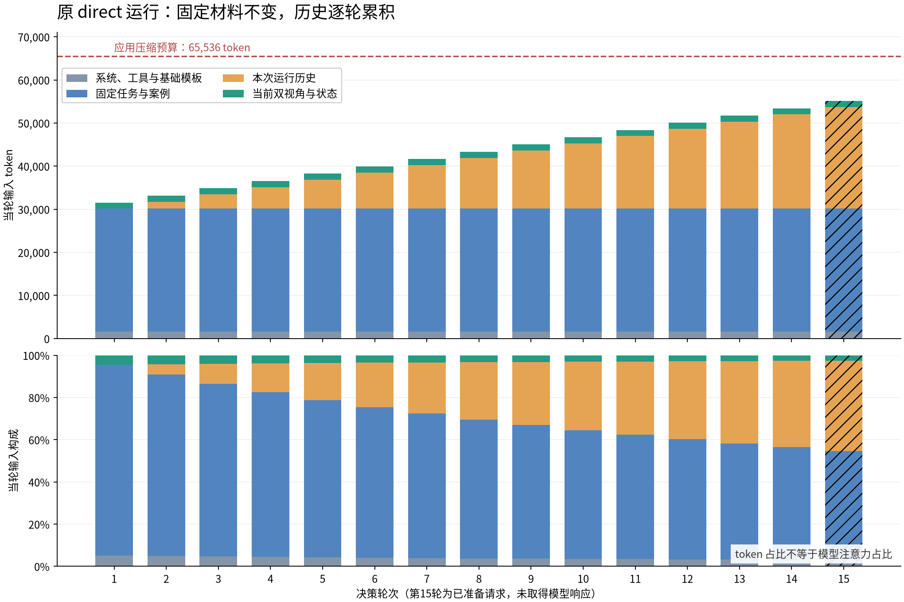

# 各轮上下文占用与增长：实测统计

连续1–15轮数据来自原 `20261101_211122_639d06d8` 的 direct 运行；另列 separated 第12–14轮只读回放。两组是不同请求，不能混为同一连续运行。

本次只读取日志、调用模型服务 `/tokenize` 做计数，没有生成新动作，也没有连接机器人。

## 口径

- 应用上下文预算：65,536 token，达到预算后由程序整理/压缩历史。模型服务注册的窗口上限为262,144 token。下文“预算占比”均指输入token / 65,536。
- 不含本次输出预留的512 token，不代表GPU显存使用率、计算耗时或注意力权重。图片已计入服务返回的输入token，不能用图片张数比例代替token比例。
- 第1–14轮总数取实际响应 `usage.prompt_tokens`；第15轮中断，没有响应，取保存的精确tokenize计数。全部15轮均用当前服务重新计数并与原记录完全一致。
- 模块拆分采用带相同工具和聊天模板的前缀计数差分。系统/工具单独计数时模板要求存在user消息，故补一个空user；这一桶包含基础消息模板开销。相邻消息边界开销归入对应增量。
- 所有原请求哈希和分项数据见 [analysis.json](analysis.json)。全程压缩代次均为0。

## 原direct运行逐轮总量

| 轮次 | 消息 | 图片 | 输入token | 较前轮增加 | 占应用预算 | 占模型窗口 |
|---|---:|---:|---:|---:|---:|---:|
| 1 | 3 | 16 | 31,538 | — | 48.12% | 12.03% |
| 2 | 6 | 18 | 33,166 | 1,628 | 50.61% | 12.65% |
| 3 | 9 | 20 | 34,848 | 1,682 | 53.17% | 13.29% |
| 4 | 12 | 22 | 36,540 | 1,692 | 55.76% | 13.94% |
| 5 | 15 | 24 | 38,232 | 1,692 | 58.34% | 14.58% |
| 6 | 18 | 26 | 39,926 | 1,694 | 60.92% | 15.23% |
| 7 | 21 | 28 | 41,619 | 1,693 | 63.51% | 15.88% |
| 8 | 24 | 30 | 43,312 | 1,693 | 66.09% | 16.52% |
| 9 | 27 | 32 | 45,008 | 1,696 | 68.68% | 17.17% |
| 10 | 30 | 34 | 46,694 | 1,686 | 71.25% | 17.81% |
| 11 | 33 | 36 | 48,379 | 1,685 | 73.82% | 18.46% |
| 12 | 36 | 38 | 50,053 | 1,674 | 76.37% | 19.09% |
| 13 | 39 | 40 | 51,728 | 1,675 | 78.93% | 19.73% |
| 14 | 42 | 42 | 53,410 | 1,682 | 81.50% | 20.37% |
| 15* | 45 | 44 | 55,091 | 1,681 | 84.06% | 21.02% |

*第15轮为已准备请求的精确计数，未取得模型响应。



## 原direct运行的构成

| 轮次 | 系统/工具/模板 | 固定任务与案例 | 本次运行的历史 | 当前观测 |
|---|---:|---:|---:|---:|
| 1 | 1,622（5.14%） | 28,500（90.37%） | 0（0.00%） | 1,416（4.49%） |
| 2 | 1,622（4.89%） | 28,500（85.93%） | 1,625（4.90%） | 1,419（4.28%） |
| 3 | 1,622（4.65%） | 28,500（81.78%） | 3,312（9.50%） | 1,414（4.06%） |
| 4 | 1,622（4.44%） | 28,500（78.00%） | 5,000（13.68%） | 1,418（3.88%） |
| 5 | 1,622（4.24%） | 28,500（74.54%） | 6,692（17.50%） | 1,418（3.71%） |
| 6 | 1,622（4.06%） | 28,500（71.38%） | 8,387（21.01%） | 1,417（3.55%） |
| 7 | 1,622（3.90%） | 28,500（68.48%） | 10,078（24.21%） | 1,419（3.41%） |
| 8 | 1,622（3.74%） | 28,500（65.80%） | 11,768（27.17%） | 1,422（3.28%） |
| 9 | 1,622（3.60%） | 28,500（63.32%） | 13,465（29.92%） | 1,421（3.16%） |
| 10 | 1,622（3.47%） | 28,500（61.04%） | 15,152（32.45%） | 1,420（3.04%） |
| 11 | 1,622（3.35%） | 28,500（58.91%） | 16,839（34.81%） | 1,418（2.93%） |
| 12 | 1,622（3.24%） | 28,500（56.94%） | 18,516（36.99%） | 1,415（2.83%） |
| 13 | 1,622（3.14%） | 28,500（55.10%） | 20,191（39.03%） | 1,415（2.74%） |
| 14 | 1,622（3.04%） | 28,500（53.36%） | 21,871（40.95%） | 1,417（2.65%） |
| 15 | 1,622（2.94%） | 28,500（51.73%） | 23,553（42.75%） | 1,416（2.57%） |

固定前缀合计30,122 token，其中系统/工具/模板1,622，任务/配置/案例28,500。当前双视角和状态稳定在约1,414–1,421 token。每轮平均增加1682.4 token。

增长公式（未压缩时）：

```text
第n+1轮输入 = 第n轮输入 + 第n轮动作调用与执行结果 + 第n+1轮新观测
输入量约 = 31,538 + 1,682 × (轮次 - 1)
图片数 = 14张固定案例 + 2 × 轮次
消息数 = 3 × 轮次
```

动作调用和执行结果的新增贡献平均264.6 token（范围209–277）；其余增量主要是新观测。旧观测在下一轮成为历史，依然保留。

单次请求长度近似线性增长；累计提交的输入量会叠加每轮的整个前缀。前14次有响应的请求累计594,453输入token。该数不等于实际重复计算量：前缀缓存可能减少计算，usage没有提供缓存命中明细。

## 当前展示的separated回放

第12轮对应此前展示的37条消息与38张图；第13/14轮继续回放，不是真机执行新建议。

| 来源轮次 | 动作请求输入 | 占应用预算 | 独立判读请求输入 |
|---|---:|---:|---:|
| 12 | 50,715 | 77.38% | 3,682 |
| 13 | 52,733 | 80.46% | 3,690 |
| 14 | 54,758 | 83.55% | 3,693 |

独立判读是单独请求，只包含前后两次观测的4张图片和必要元数据；其输入长度不随完整历史持续增长。判读的输出文字被加入动作上下文。两个请求的输入不能相加后当作同一上下文窗口占用。

| 动作上下文组成 | 第12轮 | 第13轮 | 第14轮 |
|---|---:|---:|---:|
| 系统/工具/模板 | 1,960（3.86%） | 1,960（3.72%） | 1,960（3.58%） |
| 固定任务与案例 | 28,500（56.20%） | 28,500（54.05%） | 28,500（52.05%） |
| 此前运行历史 | 18,516（36.51%） | 20,539（38.95%） | 22,559（41.20%） |
| 当前双视角与状态 | 1,415（2.79%） | 1,415（2.68%） | 1,417（2.59%） |
| 当前独立判读文字 | 324（0.64%） | 319（0.60%） | 322（0.59%） |

这里动作输入第12→13轮增加2,018 token，第13→14轮增加2,025 token，比direct多出的主要是逐轮判读文字和回放反馈格式。第12轮相对原direct多662 token，其中系统/工具/模板增加338，当前判读增加324。不能把差额全部归为视觉判读输出。

## 文件与复现

- [全量原始计数与来源](analysis.json)、[原运行CSV](rounds.csv)、[分离回放CSV](separated_rounds.csv)。
- [PNG图](context_growth.png)、[SVG图](context_growth.svg)。
- 在仓库根目录运行 `.venv-data-review/bin/python docs/report/20261101_context_growth/analyze.py` 重新计数；这只访问模型的models/tokenize接口。
- 图表使用已有img2pos环境中的matplotlib：`/home/js/miniconda3/envs/img2pos/bin/python docs/report/20261101_context_growth/plot.py`。没有安装新依赖或更改控制流程。
