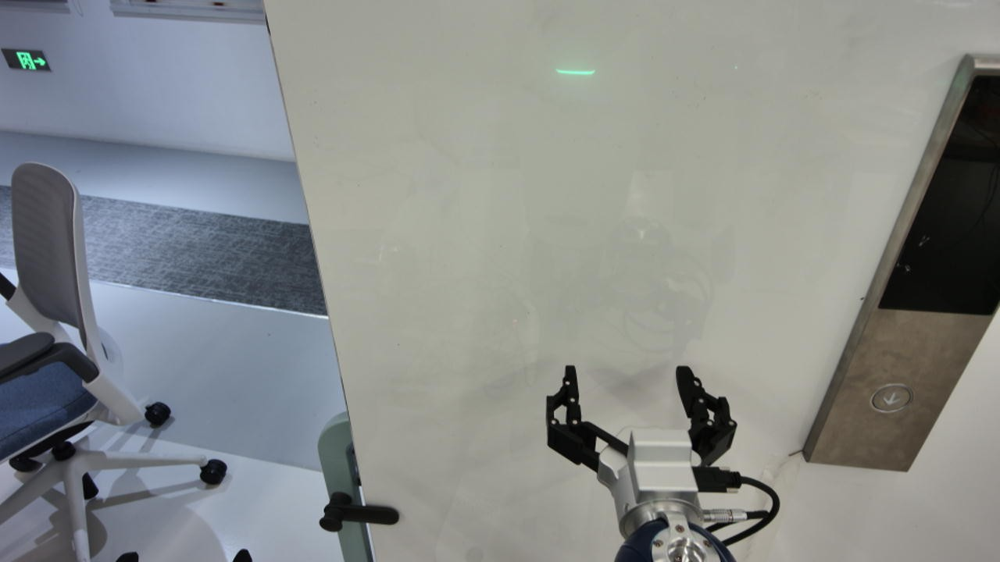
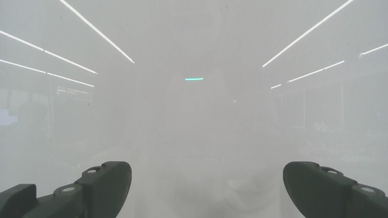

# 会话层实际发送案例：第12轮保存观测的 separated 回放

这是已经发给模型并收到响应的一份真实请求，不是示意伪代码。来源为 `outputs/perception_validation_20261101/separated/0000/`，基于原运行 `20261101_211122_639d06d8` 的第12轮观测。

本次回放未连接机器人、未执行建议。请求中的前11轮动作及结果来自原真实运行的历史；新增独立判读仅针对当前第12轮，不能理解成前11轮也都经过了独立判读。消息中 LIVE 表示所回放的当前观测，不表示此刻在线摄像头。

建议先打开 [动作请求全文：文字＋所有图片](action_request.md)。也可看 [完整JSON阅读版](action_request.readable.json)，它保留全部消息字段与原始文字字符串，仅把Base64图片换为相对路径。

| 实际消息 | 内容 | 图片 |
|---|---|---:|
| `messages[0]` | 系统规则＋独立判读的使用规则 | 0 |
| `messages[1]` | 任务、机器人会话配置、成功案例文字与11张拼图、失败案例文字与3张拼图 | 14 |
| `messages[2]` 至 `[34]` | 前11轮观测、原动作及对应执行结果，按原顺序排列 | 22 |
| `messages[35]` | 当前第12轮实测状态、命令目标、深度和双视角原图 | 2 |
| `messages[36]` | 当前独立视觉判读，以user消息注入 | 0 |

动作请求合计37条消息、38张图片，输入50715 token；`compression_generation=0`，未压缩。因此这个案例中没有旧历史摘要，不能将“只保留最近5轮”的压缩规则套到这份请求上。

独立判读是另一次先行模型调用：见 [判读请求全文](perception_request.md) 和 [判读请求JSON](perception_request.readable.json)。它只有2条消息、4张图片（前一观测＋当前观测的头部/腕部图），没有成功/失败案例，也没有前面模型的动作理由。

- [完整系统提示词](system_prompt.txt)
- [完整动作工具定义](tools.json)
- [当前状态数据](current_observation.json)
- [实际注入动作请求的独立判读](assessment_in_action_request.json)
- [本次动作模型的返回建议](proposal.json)
- [模型完整响应与用量](response-0.json)
- [上下文状态](decision_context.json)

这份真实判读并不完全正确：`head_relation` 描述按钮在夹爪右侧且远离手指；腕部文字称按钮不清晰，但 `wrist_visibility` 填了 `partial`，并给出很宽的框。动作响应仍然提出 `[5,0,0]` 前推，并声称腕图按钮位于两指之间。这里保留这些原始矛盾，用于展示“实际发送了什么”，不把它们改写成理想结果。

两个JSON阅读版的图片恢复后均与源请求对象逐项一致；原图字节没有修改。源文件与归档哈希见 [manifest.json](manifest.json)。本次仅整理已有记录，没有调用模型或修改控制代码。
