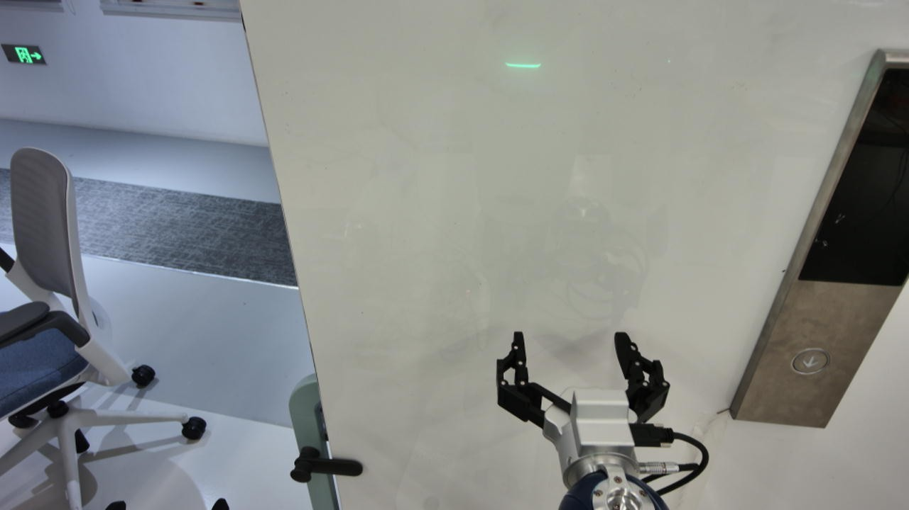
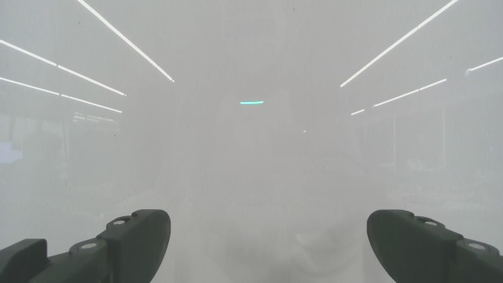

# 面板右移后不纠偏：输入、模型判读与控制链路调查

日期：2026-11-01。**目前最有证据的问题，是当前视觉状态在复杂判读和带历史的动作请求中被错误表述，而且正确判读也未必能约束动作。没有发现执行器把右移变成前推的证据。** 同一个模型具备看出目标偏右、编码右移命令的子能力，但当前组合并未形成可靠的视觉纠偏。

本次核对原运行全部 14 轮输入、服务配置和官方资料，新增 **11 次仅模型请求**。没有连接机器人、执行建议、修改正式提示词或启动默认配置。所有新动作对照均关闭 thinking、没有失败参考、只保留成功第 8、9、10 步；部分条件仍有这次运行自身的过程历史。

## 1. 当前图像与已排除的问题

原运行：`20261101_211122_639d06d8`。本次新增模型对照集中于第 12 轮，观测 `facfb77c2dd54fe6b3a20ebf26b15a7d`。





头图能看到按钮位于夹爪右侧，腕图只有墙面、反光和手指。这里描述的是图像关系，不是已标定的毫米误差或三维接触关系。

| 排查项 | 已核实结果 | 能排除到什么程度 |
|---|---|---|
| 当前图片传入错误、陈旧图片、相机交换 | 14 轮 28 张图片与对应原始观测逐字节一致；head 1280×720、wrist 640×360 | 没有客户端送错图、镜像或裁切证据 |
| 图像／状态长时间错位 | 头腕最大差 46.956 ms；RGB／状态最大差 33.6 ms | 不能解释静止场景下连续多轮虚构按钮在两指间 |
| XYZ 轴交换或符号错误 | 参数沿共享执行器原样传递；第 8 条 `-Y20` 实测约 `-Y19.24 mm` | 横向运动路径有效；不等于完整物理标定 |
| 模型完全不知道机器人右是 -Y | 既有六方向编码全部正确 | 不支持“完全不会编码右移”解释 |
| thinking 没生效 | 既有开启实验出现实际 reasoning token，但仍持续 +X | 开关有效，开启并未修复这些帧 |
| 加载成纯文本模型／工具 parser 别名错 | 当前多模态配置和模板一致；本机 qwen3_coder 与 qwen3_xml 为同一解析器 | 暂无这两类服务错误证据 |

逐轮图像哈希、时差、执行链路及源码见[几何与输入审计](geometry_audit.md)、[原始审计 JSON](geometry_input_audit.json)。既有六方向和视觉事实对照见[任务接口调查](../20261101_action_interface_mapping_audit/README.md)。

## 2. 新发现：简单判读正确，详细判读出现字段冲突

三次最小判读不带示范、状态历史或动作选择，只回答每个视角的“按钮是否可见、相对夹爪在哪侧”。没有提供正确标签或机器人移动方向。

| 输入／任务 | 结果 | 输入／输出 token | 请求耗时 |
|---|---|---:|---:|
| 当前双图，4 个简单字段 | 头图可见、在右；腕图不可见 | 1605／66 | 6.82 s |
| 只看当前腕图 | 不可见 | 638／42 | 4.18 s |
| 只看当前头图 | 可见、在右 | 1293／39 | 4.15 s |
| 当前双图，现有详细判读 | 腕图文字写不可见，却填 partial 和按钮框；还漏 observation_id | 2372／340 | 32.59 s |
| 前后四图，原详细判读请求 | 头图写未对齐；腕图填 partial，框覆盖底部手指区域 | 3682／439 | 41.66 s |

当前双图的详细响应包含以下相互冲突的字段：

```json
{
  "wrist_visibility": "partial",
  "wrist_bbox": [0, 650, 1000, 1000],
  "wrist_relation": "Gripper tips at bottom; button not visible in wrist view."
}
```

这个框是画面底部横跨全宽的区域，并非目标按钮。详细四图版本也重复同一框。两次响应分别输出 340／439 token，均以 tool_calls 结束，不是输出达到 512 上限被截断；四图输入也只有约 3.7K token，不能笼统归为上下文溢出。

详细双图因缺字段被正式校验函数拒绝；本次诊断故意只记录第一次输出，没有运行格式修正。详细四图结构合法，但视觉字段有误。**结构合法不保证对象正确，增加描述字段也不保证独立判断更可靠。**

本对照同时改变判读提示、schema 和姿态输入，因此只能证明这两种请求组织的表现不同，不能进一步断言某一个字段数量就是唯一原因。原始响应见[最小判读](../../../outputs/grounding_diagnosis_20261101/tests/minimal_dual/response.json)、[详细双图](../../../outputs/grounding_diagnosis_20261101/tests/rich_current_only/response.json)、[详细四图](../../../outputs/grounding_diagnosis_20261101/tests/rich_pair_original/response.json)。

## 3. 新发现：历史影响选择，但删历史中的某一类内容并不等于修复

以下四组保留相同的系统提示、三个成功步骤、当前原图与状态、所有已执行命令参数、工具调用 ID 和执行结果。只修改既往动作理由或既往过程图片。历史图片被替换为明确的省略标记，当前图片不变。

| 条件 | 图片数 | 本次建议，单位 mm | 关键问题 |
|---|---:|---|---|
| 保留过程历史 | 27 | `[0,0,-10]` | 声称腕图按钮在两指之间，并引用三步示范里并不存在的下降动作 |
| 只替换历史理由 | 27 | `[0,0,-10]` | 新理由直接照抄测试占位文字，不提供当前依据 |
| 只移除旧的过程图片 | 5 | `[0,-20,0]` | 改为右移，但仍声称腕图可见按钮 |
| 同时替换旧理由、移除旧图 | 5 | `[0,0,-10]` | 再次照抄理由占位文字 |

对应耗时为 13.92、14.99、16.77、9.52 秒。这些不同输出长度的条件不是纯速度对照，未清空服务缓存。

这说明历史内容与动作选择有明确关联，但不能简化成“删理由就好”或“删图就会正确”。占位文字被复制是额外的实验干扰；删图也同时改变视觉负载和输入长度，无法区分内部注意力、模板续写、视觉混淆等机制。即使输出了更符合当前场景的 -Y，错误的腕图理由仍表明它尚未可靠使用当前图像。

原运行前 10 条动作的类型和数值与成功示范完全相同，初始命令位置只相差约 `[0.05,0.16,1.69] mm`。它重复了历史轨迹，却没有适应用户移动后的面板。这支持示范参照和旧状态影响的调查方向，但相同轨迹本身不证明模型内部原因。

## 4. 正确判读也可能被动作模型忽略

把本次最小双图判读的四个字段原样附加给动作模型，不加目标方向、不加毫米幅度：

```json
{"head_visible":"yes","head_relation":"right",
 "wrist_visible":"no","wrist_relation":"not_visible"}
```

- 三步示范＋当前画面：建议转头 `[10,10]°`，理由引用了头图在右、腕图不可见。它选择改善头图，实际效果未验证；没有直接纠正手的位置。
- 三步示范＋原过程历史：仍建议 `[0,0,-10] mm`，并重新声称腕图按钮在两指之间，直接违背刚收到的判读。

既有另一组实验使用更明确的可见性、相对位置和“未对齐”结论时，三帧均变成 -Y。这两类输入并不完全等价：字段、措辞、历史案例和对齐状态的明确程度不同。**不能把一次“注入判读后动作正确”推广成“任何独立判读都能纠正动作”。** 当前实现也没有语义一致性检查来发现这些冲突。

## 5. 为什么模型能力强仍会出现这种情况

这项任务至少包含四步：看到按钮 → 确定按钮与实际接触手指的相对位置 → 选择能够改变该关系的执行部件和方向 → 决定步长并检查改善。当前模型能完成其中一些单独问题，但组合后不稳定。最近三步成功案例实验中的“转头改善腕部视角”更是违反已明确提供的执行器契约：头部关节不改变腕相机相对手的位置。

当前模型输入也确实缺少：

- 已标定的接触指尖点。SDK 末端位姿不等于张开夹爪某根手指的接触位置。
- 相机到机器人变换或实测的局部图像运动关系。机器人右是 -Y 已知，但任意图片中的右并不能普遍直接等同于 -Y。
- 程序维护的当前偏差与动作后改善量。现在大部分判断仍由自由文字承担，坐标解析只验证格式和数值。

这些缺口影响稳定纠偏和毫米步长，但不能单独解释当前明显不对齐时持续前推；正确中间状态曾在没有新增标定的情况下改变动作。

实际 `qwen38` 服务加载 **Inferact/Qwen3.8-27B-NVFP4**。这是第三方量化的 27B 版本。官方视觉／Agent 能力不保证它能零标定地控制这副夹爪；例如官方列出的 ERQA 是视觉多选问答，不是该机器人闭环成功率。[模型来源](https://huggingface.co/Inferact/Qwen3.8-27B-NVFP4)、[Qwen 27B 模型卡](https://huggingface.co/Qwen/Qwen3.8-27B)、[ERQA 官方定义](https://github.com/embodiedreasoning/ERQA)

没有证据把本次失败直接归于量化：当前配置明确排除视觉塔的 NVFP4 量化，语言侧影响仍需同帧同提示的 FP8／BF16 对照。官方 non-thinking 采样配置与当前 temperature=0 不同，也属于尚未验证的次级因素。详细来源及容器版本见[模型与服务调查](model_research.md)。

## 6. 建议的处理顺序

1. **先收窄当前判读。** 先单独、逐视角回答可见性和相对位置；能定位时再给按钮与选定手指的局部证据。未知就保留未知，不同时承担接触、灯态、历史变化和动作评价。此次简单四字段在这帧正确，不代表已验证跨场景可靠。
2. **把当前状态与历史策略分开使用。** 历史成功用于步骤经验，不能充当当前位置依据。动作请求采用清楚的当前状态、必要的近期动作与反馈；避免完整旧图片和旧对齐理由无限延续。仅删除历史尚未构成修复。
3. **明确检查判断与动作理由是否矛盾。** 例如当前判读为“腕图不可见”，理由却说“按钮在两指之间”，应记录并重判读／修正，而不是当成已验证对齐。它属于决策层一致性处理，不需要修改共享执行器、裁剪位移或禁止单指、无效深度下前推。
4. **再补本机的几何关系。** 明确使用哪根手指，以既有可信动作—图像变化或小幅实测得到局部对应关系，再让纠偏量有可检查的依据。不能把任意 image_right 写死为 -Y，也不能从一次方向正确推定 20 mm 正确。
5. **若最小任务仍不稳定，再做模型精度和官方采样对照。** 当前没有理由先将量化定为根因或用更大的完整提示词掩盖状态冲突。

以上为调查后的建议，本次没有将它们自动部署，也没有执行新建议。保留既定单指按压、无效深度或未确认触发时允许前推的控制语义。

## 7. 复现与证据边界

- [11 次完整结果](../../../outputs/grounding_diagnosis_20261101/report.json)
- [实验控制独立审计](grounding_experiment_audit.json)
- [仅模型脚本](../../../scripts/diagnose_agent_grounding.py)
- 每项 `tests/<条件>/request.readable.json` 保存完整输入，图片以去重文件引用存储；保存时恢复校验与真实请求完全一致。
- 所有源请求哈希未改变。11 次请求均正常返回；10 次通过对应格式校验，1 次详细判读缺 observation_id 被拒绝；没有运行修正或替代动作。
- 新实验只有一个观测，各条件一次，温度 0，无缓存重置。它可以定位失效环节，不能作为成功率、毫米精度或真机修复验证。

```bash
.conda/envs/pressb/bin/python scripts/diagnose_agent_grounding.py \
  --output outputs/grounding_diagnosis_new
```
