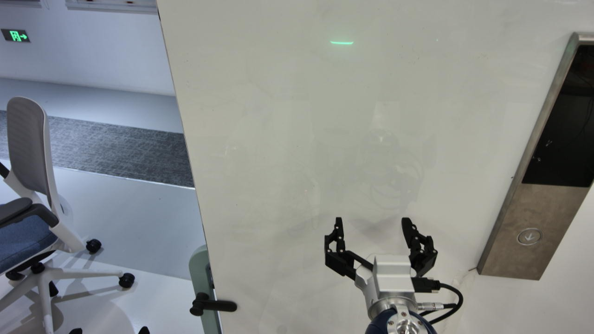
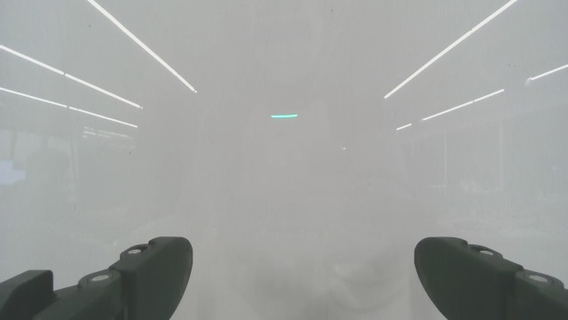
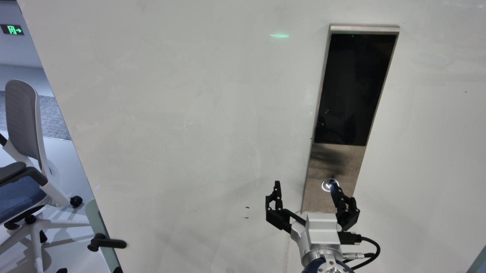
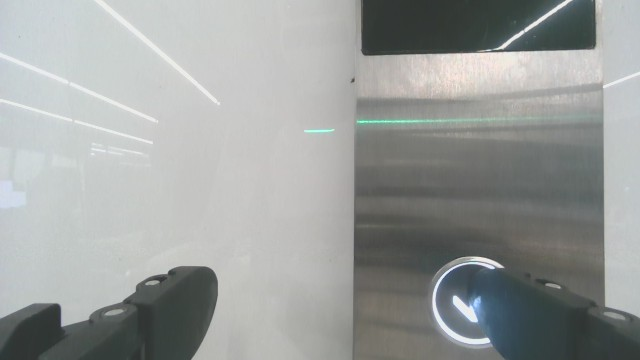

# 面板偏移后：能定位目标，却仍持续前推的 Agent 决策异常

日期：2026-11-01。模型服务：`qwen38`。

**核心现象：对同一组当前图片，单独询问目标位置时，模型能识别“按钮在夹爪右侧、腕部看不到按钮、没有对齐”；在原有动作决策会话中，却声称“已经对齐、腕图按钮在两指之间”，并继续前推。** 将独立定位结论明确传给动作模型后，本次测试中的建议由前推改为向右横移。

本文记录一次真实运行中的异常及其后续只读模型对照。对照共9次请求，未执行机器人动作；它不构成真机修复或任务成功验证。

后续方案调研见[将当前画面判读与动作选择分开：Agent 架构调研与接入建议](agent_design_research.md)，包含网页／桌面、软件开发和机器人 Agent 的参考工作，以及适合当前代码的接入设计。

## 1. 现场背景与证据来源

- 用户反馈：轻微移动了面板，机器人应向右寻找、对齐面板，但 Agent 持续向前。
- 运行目录：`20261101_211122_639d06d8`。记录显示人工停止，14条运动命令完成发送，没有模型完成报告。发送完成不等于实际接触、触发或到位。
- 本次对照使用第12轮决策观测：`facfb77c2dd54fe6b3a20ebf26b15a7d`。所有测试中的这两张当前图片字节一致。
- 第12轮原始建议为 `move [5,0,0] mm`。其理由声称手指已经接近对齐，腕部可见按钮位于两指之间，与下方原图不符。
- 前10步的动作类型及主要控制参数与成功示范相同。这提示机械参照示范的可能，但并不单独证明内部生成机制。

资料：[原运行结果](evidence/run_result.json)、[第12轮建议](evidence/live_round12_proposal.json)、[决策观测记录](evidence/live_round12_decision_context.json)、[完整动作时间线](evidence/live_command_timeline.json)、[历史示范动作时间线](evidence/demo_command_timeline.json)。

本文区分三类信息：面板被移动是用户反馈；图像位置和工具输出是记录事实；“历史推理影响了决策”等解释是基于对照的分析推断。

## 2. 当前原图与历史参照

### 当前头部画面



按钮在头部图右侧，明显位于夹爪右侧。该图不支持“已经对准按钮中心”的描述。图片中的横向偏移不是已标定的机器人位移，不能据此直接确定需要移动多少毫米。

### 当前腕部画面



腕图可见夹爪、白色表面及反光，没有看到目标按钮。“按钮在两指之间”的描述没有当前图像依据。

### 历史成功案例参考

以下来自 `20261101_182424_352b5047` 第10步 after，用于展示历史成功图与当前图的区别。**它们不是本次面板移动前后的一组成对测量，也不能用于计算本次位移。** 历史案例的按下成功由用户确认；第11步后撤中断，不能将其解释为完整撤回已验证。





四张展示图片均直接复制，未裁剪、标注或修改。观测深度和原始实测状态见[当前观测清单](evidence/current_observation.json)。

## 3. 对照设计

三个输入条件均使用同一组当前头部、腕部原图，任务和当前状态保持一致：

| 条件 | 输入内容 | 图片数 |
|---|---|---:|
| 当前观测 | 任务、系统规则、当前状态与双视角；不带案例或先前动作 | 2 |
| 案例＋当前观测 | 加入11张成功图、3张失败图及案例文字；不带先前动作 | 16 |
| 完整会话 | 复用第12轮原始请求，包含案例、此前动作、结果与历史图 | 38 |

先对三个条件使用同一条只读定位问题和 `inspect_scene` 工具，再对三个条件使用原有动作提示词与动作工具，共6次请求。随后增加一次通用核对提示测试，以及两次“独立定位结果→动作选择”测试，共9次。

温度为0，每个条件只测一次；没有清空共享服务缓存。定位问题与动作问题是两类不同任务，不能把两类请求的延迟直接当作架构速度对比。此次只读调用开始前，原运行已停止。

## 4. 定位测试：位置能看对，方向字段仍会错

| 条件 | 头部按钮位置 | 腕部按钮可见性 | 对齐判断 | `next_axis` |
|---|---|---|---|---|
| 当前观测 | 夹爪右侧 | 不可见 | 未对齐 | `+Y` |
| 案例＋当前观测 | 夹爪右侧 | 不可见 | 未对齐 | `+Y` |
| 完整会话 | 夹爪右侧 | 不可见 | 未对齐 | `+Y` |

三组视觉判断均与原图检查相符。但当前控制约定中，**机器人左为 `+Y`，右为 `-Y`**；三组都给出了与向右调整不一致的方向字段。当前观测组的文字解释甚至明确说 `+Y` 不能朝向目标，却仍将 `next_axis` 填为 `+Y`。

这说明“看出相对位置”和“把目标方向转换成控制命令”是两个不同能力。图像中的左右、物体在腕图中的运动方向、机器人手部的运动方向不能混为一谈。

原始响应：[当前观测](tests/diagnostic_current_only/response.json)、[案例＋当前观测](tests/diagnostic_cases_current/response.json)、[完整会话](tests/diagnostic_full_history/response.json)。模型预测的按钮框只是图像坐标，不是标定接触点。

## 5. 动作测试：同一画面，不同上下文下的选择

**以下全部是未执行的模型建议。** `move` 参数单位为毫米，`head` 为绝对角度，单位度。

| 测试条件 | 建议 | 与当前画面的关系 | 原始响应 |
|---|---|---|---|
| 当前观测 | `head [12,18]` | 识别面板在右侧，选择调整头部；实际角度效果未验证 | [输出](tests/action_current_only/response.json) |
| 案例＋当前观测 | `head [0,30]` | 与示范起始转头动作相同，有重新套用示范的迹象 | [输出](tests/action_cases_current/response.json) |
| 完整会话 | `move [5,0,0]` | 复现前推，错误声称腕图按钮在两指之间 | [输出](tests/action_full_history/response.json) |
| 完整会话＋通用核对要求 | `move [5,0,0]` | 要求重新核对画面和方向后，仍前推并误述腕图 | [输出](tests/grounded_action_full_history/response.json) |
| 完整会话＋独立定位结果 | `move [0,-10,0]` | 正确引用腕图不可见、头图目标偏右，选择向右横移 | [输出](tests/perception_then_action_full_history/response.json) |
| 当前观测＋独立定位结果 | `head [12,24.9]` | 仍选择调整头部观察；未验证动作效果 | [输出](tests/perception_then_action_current_only/response.json) |

“通用核对要求”没有告诉模型按钮在何处，只要求先检查最终当前图、区分物体与手部运动方向、核对符号，并明确机器人右为 `-Y`。这一条提醒在本次测试中没有纠正前推。

“独立定位结果”取自**完整会话条件下的独立定位请求**，将其中6个纯视觉字段原样交给动作模型：头部可见性、相对位置、按钮框、腕部可见性、腕部位置描述和对齐判断。没有转交错误的 `next_axis` 或含方向推断的 `visual_evidence`，没有人工指定移动距离。输入明确标为另一模型的判断，不是人工确认。

因此，成功改变建议的这次测试，并非已经部署了“只看当前两张图的视觉 Agent”；它证明的是：**在这一帧、这一组请求中，显式传入独立判读结果能够改变原动作会话的选择。** 去历史的独立视觉阶段属于下一步待验证设计。

## 6. 可以得出的结论与不能得出的结论

1. **不能简单归因于模型完全看不懂图。** 在三种上下文中，专门询问位置都能得到正确的可见性和横向关系。
2. **正常动作决策没有可靠使用当前视觉证据。** 同一完整会话能复现“继续前推＋错误画面描述”。历史动作和先前错误判断的影响是合理解释，但尚未证实模型内部机制。
3. **动作理由不能自动视为独立视觉检查。** 本次理由与图像冲突；这不证明模型内部一定“先选动作、再编理由”，生成顺序并未被观察。
4. **坐标符号转换存在独立问题。** 即使位置判读正确，模型仍可能输出错误方向；不能直接执行定位工具的方向字段。
5. **追加提醒不等于修复。** 本次通用核对提示没有纠正动作，而显式定位结果使完整会话选择了向右横移。
6. **尚无稳定性或真机成功结论。** 单帧、单次条件对照不足以证明泛化；`-10 mm` 的幅度和实际效果未验证。额外判读会增加一次模型请求。

## 7. 下一步设计含义

拟验证的流程是：

```text
当前双视角 → 独立判读可见性、相对位置、偏差和不确定性
                         ↓
历史案例、状态、动作结果＋当前判读 → 选择一个动作 → 原共享执行器
                         ↑                         ↓
                         └──────── 新观测 ─────────┘
```

“判读”先回答现在看到了什么，不负责生成运动参数；“动作选择”再结合策略经验、当前几何关系和控制坐标决定怎么动。可以由同一个 Qwen 服务分别调用完成，机器人底层接口无需另建。

这是一项待实现、待进一步验证的改进方向。**本文整理和9次测试没有修改正式提示词、运行中的控制流程、默认案例或执行器，也没有将横移建议自动执行。**

## 8. 文件与可追溯性

- [测试汇总 JSON](tests/report.json)：9次请求的输出、token、耗时和校验结果，原样复制。
- `tests/<条件>/response.json`：完整模型响应，原样复制。
- `tests/<条件>/request.readable.json`：请求阅读版，保留全部文字、工具定义、状态与历史；仅将Base64图片替换成相对文件路径，便于检查，不能直接作为API请求提交。
- `images/model_inputs/`：38张去重后的模型输入图片，覆盖所有测试条件；从原始Base64解码得到，图片字节未修改。每个阅读版请求恢复图片后均已与原请求对象逐项核对一致。
- `evidence/`：原运行结果、决策观测、动作时间线及当时实际使用的系统提示词。
- [证据清单及哈希](manifest.json)：记录复制来源、SHA-256，以及阅读版与原始请求的区别。
- [原测试报告副本](tests/original_report.md)和[图像检查依据](tests/reference_reading.json)保留原始分析上下文；其中的原目录路径属于来源信息。
- 复现脚本：[diagnose_agent_visual_context.py](../../../scripts/diagnose_agent_visual_context.py)。需提供原始 `--saved-request` 和新 `--output`；脚本仅访问模型服务，不连接机器人。

本目录包含阅读所需的图片、输入内容和模型输出。原始运行、示范、测试目录均保留，不被本次整理覆盖。
