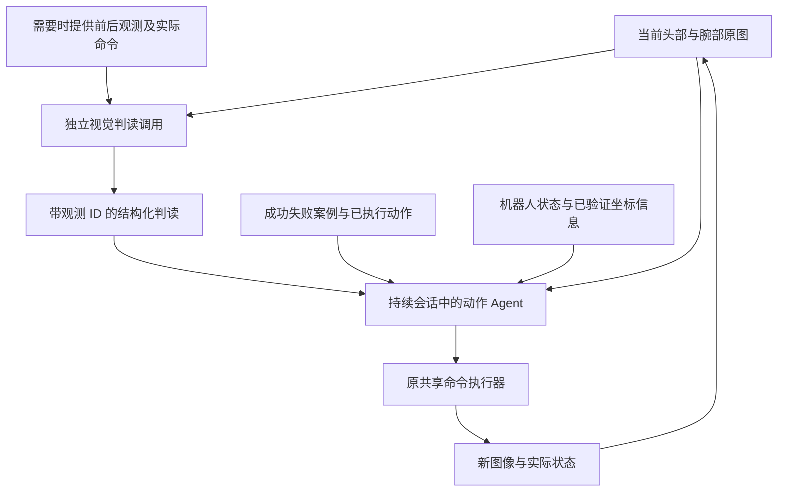

# 将当前画面判读与动作选择分开：Agent 架构调研与接入建议

调研日期：2026-11-01。范围：网页／桌面 Agent、软件开发 Agent、机器人操作与电梯任务。本文是设计建议，没有修改生产提示词、模型请求流程或机器人执行器，也没有启动真机。

## 1. 本项目的问题与研究结论

现场与只读测试证据见[现象报告](README.md)。同一组当前双视角下，定位请求能识别头图按钮偏右、腕图按钮不可见；完整动作会话仍输出向前 5 mm，并错误声称腕图已经对齐。显式传入独立判读后，一次动作测试改为向右 10 mm。三组定位请求同时出现了错误的 `+Y` 方向字段。

这支持优先拆开三件事：

1. **观测解释**：本次图片能支持哪些描述，哪些内容看不见或不能确定？
2. **动作选择及坐标转换**：为了完成任务，应执行哪个已有命令，方向和幅度依据是什么？
3. **结果核验**：执行之后，目标偏差是否减少，按钮是否亮起，是否随后撤回？

这些是职责边界，不一定对应三个模型或三个常驻进程。推荐第一版为两个串行模型调用，结果核验复用下一轮判读；必要时为灯态变化和撤回增加明确标注的前后观测。

本项目只做过单帧、各条件一次的对照。它不能证明历史会话必然造成视觉错误，也不能证明拆分后真机一定成功。使用相同 Qwen 权重的两个调用仍可能犯相同错误，结构化结果不是客观真值。

## 2. 非机器人 Agent 中最值得参考的工作

### 2.1 OmniParser：先把画面变成可引用的对象

微软的 OmniParser 将 UI 截图解析为结构化元素，使用检测与描述模型帮助后续 Agent 将操作绑定到画面区域。它适合参考“独立视觉接口”的组织方式：位置、语义和对象引用先形成明确输出，再用于行动。[论文](https://arxiv.org/abs/2408.00203)、[官方仓库](https://github.com/microsoft/OmniParser)。

**迁移到本项目的建议**：每轮先得到按钮可见性、按钮框、手指可见部位、图像相对关系和灯态。动作 Agent 必须能引用对应观测。UI 检测权重针对屏幕，不能据此认为它能直接检测我们的实体按钮或指尖。

### 2.2 Agent S2：规划与精确定位分工

Agent S2（2025）由 Manager、Worker 和 grounding experts 组成。Worker 根据当前截图生成带目标描述的动作，再由专家将描述落到像素坐标；Manager 在子任务结束后依据新观测更新剩余计划。[论文第 3 节](https://arxiv.org/html/2504.00906v1)。

**迁移到本项目的建议**：把“希望接触哪个按钮、使用哪侧手指”和“该目标在当前图的哪个区域”分开处理。目标不明确时允许先问定位模块，不必让动作理由同时承担定位任务。第一版不需要完整照搬 Manager／Worker 层级。

注意：原论文主要是“生成动作意图，再交给专家定位”，不等同于本文建议的“先独立检查当前状态，再选动作”。可借鉴其模块接口，但两者流程应明确区分。

### 2.3 SeeAct：知道要做什么，不代表能操作正确位置

SeeAct（ICML 2024）将网页操作拆成 Action Generation 和 Action Grounding：先产生动作描述，再匹配具体 HTML 元素及操作。论文中的 oracle grounding 条件与自动定位条件有明显差异，说明文字规划能力与实际目标定位能力需要分别评估。[作者项目页](https://osu-nlp-group.github.io/SeeAct/)、[论文](https://arxiv.org/abs/2401.01614)。

**迁移到本项目的建议**：“向按钮靠近”不是可执行几何依据。按钮框、手指接触部位、坐标映射必须有明确来源。网页 DOM 能直接定位点击对象，我们的单个测距点不能提供同等程度的三维定位能力。

### 2.4 软件开发 Agent：生成工作与检查实际结果分离

Anthropic 2026 年的长期应用开发 harness 使用 planner、generator、evaluator。评估器通过 Playwright 实际操作应用，检查功能、接口和数据库状态；文章指出，独立评估有助于处理生成者对自身工作的宽松评价，但拆分本身并不能消除评估错误。[官方工程报告](https://www.anthropic.com/research/harness-design-long-running-apps)。

**迁移到本项目的建议**：动作 Agent 说“按到了”，相当于编码 Agent 说“功能已经完成”；应检查实际运行结果。机器人对应的证据是新画面中的灯态、手指与按钮关系和后续撤回，而不是命令回执或生成动作时的理由。

建议让判读调用不接收此前理由，以减少迎合既有判断的机会。这是本项目提出的上下文隔离设计，不是上述报告已验证的机器人结论。

### 2.5 通用 Agent 工作流与上下文工程

Anthropic 的工作流文档介绍 prompt chaining 和 evaluator–optimizer，强调使用适合任务的简单组合；上下文工程文章强调选择进入上下文的信息，而不只是修改系统提示词。[工作流文档](https://www.anthropic.com/research/building-effective-agents)、[上下文工程](https://www.anthropic.com/research/effective-context-engineering-for-ai-agents)。

**迁移到本项目的建议**：保留动作 Agent 的持续会话，同时给视觉阶段一个简短、独立的当前观测上下文。每个模块不需要看到全部历史。这里的“独立”是请求输入隔离，不要求换模型、换服务或建立复杂多 Agent 框架。

## 3. 机器人任务中可参考的工作

| 工作 | 原方法中相关的机制 | 对本项目的参考价值与限制 |
|---|---|---|
| [Inner Monologue（2022／CoRL）](https://innermonologue.github.io/) | 将场景描述、主动问答和成功检测作为环境反馈交给语言规划器；包括受干扰后的真实机器人操作 | 非常贴近“动作不能只靠自身理由认定成功”。可以提供可见性和结果反馈，但不能假设我们的视觉判读具有论文中反馈源的准确度 |
| [MOKA（RSS 2024）](https://moka-manipulation.github.io/) | 用带标记的图片回答关键点／可操作位置问题，并通过点表示连接视觉与动作；示例包括按超声清洗器红色按钮 | 适合借鉴按钮、指尖的显式定位。标注点不是自动得到的精确三维接触点，不能直接照抄其几何执行 |
| [VoxPoser（CoRL 2023）](https://voxposer.github.io/) | 语言模型生成的程序结合视觉构建三维价值图，由运动规划器生成轨迹；缓存程序并用新视觉反馈重算以应对扰动 | 长期方向是“策略可复用，当前几何每次更新”。完整迁移涉及三维感知／规划，不是当前最小接线方案 |
| [CMU VectorRobotics 电梯项目（2026）](https://mrsdprojects.ri.cmu.edu/2026teama/system-implementation/perception-system/) | 项目描述通过 VLM 感知按钮面板及目标位姿，再转换 camera→base→arm，并用跨帧稳定处理支持控制 | 任务最接近，但这是项目实现说明，并非可直接套用的通用 VLM 成功率证据。值得借鉴感知与坐标变换接口 |
| [NVIDIA Astranomy（2026-10-14）](https://research.nvidia.com/labs/srl/projects/astranomy/) | 对 GPT-6 Astra 的原生控制、持续 Agent 会话和监控其他策略等配置做研究；相机／夹爪几何和历史组织影响表现，也记录了反复无效调整 | 支持同时关注几何、历史和执行反馈。研究基于 RoboLab 仿真任务，不能把其指标当作我们真机按键任务的预期成功率；它也没有证明增加模块总能更好 |

以上方法的共同参考价值是把环境反馈或空间表示作为显式接口。它们并非都采用两个 VLM 串行判读与决策，也并非都解决了精密接触。

### 关于 SPINE 的名称

检索到至少两项不同工作：

- [SPINE：Online Semantic Planning…（ICRA 2025）](https://zacravichandran.github.io/SPINE/) 来自宾夕法尼亚大学 GRASP Lab，重点是在线语义地图、探索及随新观测调整计划。
- [SPINE：Bridging the Cyber-Physical Gap with Agentic AI（2026）](https://arxiv.org/abs/2607.13049) 重点是机器人配置资料构建和“诊断—修复—验证”的部署／遥操作排障。

这两者不应直接当成同一个“NVIDIA 按钮控制框架”。前者可参考在线状态更新，后者可参考结构化诊断流程；本次更直接相关的是上述视觉定位与独立核验工作。

## 4. 推荐架构：独立判读＋持续决策＋可追溯反馈



### 4.1 判读模块：固定问题、独立上下文、没有执行工具

常规输入：当前头部／腕部两张原图、观测 ID、目标说明“电梯外呼向下按钮”、相机名称、必要的已知视角信息。

不输入：成功／失败示范、之前模型的理由、准备执行的动作、“已经对齐”等历史结论。它不应该为了证明某个待执行动作而检查图片。

输出应覆盖：

- 每个视角中，目标按钮是否可见，是否局部可见或遮挡。
- 可辨认的按钮区域和手指区域；坐标注明所属图片及归一化范围。
- 图像平面中按钮相对可见手指的左右／上下关系；不能判断时明确 unknown。
- 单张图能看到的亮／灭／不确定状态。
- 当前图像无法确认的内容，例如实际接触、沿面板法线的距离、被遮挡手指的位置。

示意结构如下，非重新运行得到的检测结果；省略的框不能用虚构数值补齐：

```json
{
  "observation_id": "facfb77c2dd54fe6b3a20ebf26b15a7d",
  "source": "model_assessment",
  "head": {
    "button_visibility": "visible",
    "button_relative_to_visible_gripper_in_image": "right",
    "button_bbox_0_1000": null,
    "light_state": "unknown"
  },
  "wrist": {
    "button_visibility": "not_visible",
    "button_bbox_0_1000": null,
    "light_state": "unknown"
  },
  "contact_alignment_3d": "unknown",
  "uncertainties": ["当前腕图不能核验接触手指与按钮的对齐"]
}
```

不输出 `next_axis`、`xyz_mm` 或固定后续步骤。之前三组定位请求都填错方向字段，正说明视觉模块不宜顺便承担控制坐标转换。

“没有看见”不等于“目标不存在”；头图中的投影重叠也不等于三维接触对齐。跨视角的手指身份若没有标定或可靠对应，应保持未知，不能把每张图的“左手指”视为同一个实体。

### 4.2 动作 Agent：保留持续会话，显式消费新判读

继续保留现有成功／失败案例、动作记录、当前状态与当前原图。每轮将独立判读附在当前观测后，并明确标为模型估计，不冒充传感器真值或人工结论。

动作 Agent 回答：本步打算纠正哪个偏差或获得什么信息、选哪个接触手指、使用哪个现有命令、下一轮预计观察到什么变化。理由继续简短；预期变化可写入独立决策日志，不需要修改机器人 HTTP 动作接口。

针对当前失败帧，合理的决策方向是重新处理横向对齐／寻找目标，而非沿用“已经对齐”的旧描述。但不能把这帧写成所有情况下固定 `-Y 10 mm` 的规则。

如果动作 Agent 不同意判读，要求说明当前图片中的具体反证，或请求重新观察。不能悄悄把“腕图不可见”改写成“腕图按钮在两指之间”。同时也不能把独立判读当成不可质疑的裁判。

### 4.3 坐标层：区分图像方向、机器人方向和位移大小

本项目机器人坐标的“右＝-Y”是确定的接口定义。但“头图右侧＝机器人必须 -Y”并非对任意相机姿态都成立；腕相机随手运动，图像中物体移动方向还可能与手部方向相反。

优先让程序提供已验证的相机／机器人变换、当前姿态和方向定义。有有效目标深度与标定时，可以将目标像素转换为机器人坐标；缺少这些条件时只提供定性判断及未知项，不伪造毫米误差。固定测距点的深度不能直接代替按钮或指尖深度。

第一版仍由现有动作 Agent 选择 XYZ，保留现有执行路径。确定性坐标工具或局部视觉伺服属于后续增强，不应通过暗中修改 Agent 输出实现，也不恢复固定 150 mm 夹爪长度规则。

### 4.4 结果核验：从下一轮新观测获得证据

常规判读也可检查上一步预期的结果，但需要时应显式提供上一轮原图、当前原图及实际发送的命令；不要只提供上一步的动作理由。这样通常为 4 张图片，额外历史图片只按明确核验任务加入。

灯态变化需要比较本次运行中的初始／先前灯态和当前灯态。同一张亮灯图片不能独立证明“刚刚由本次按压触发”。撤回需要触发之后的观测及实际状态；命令发送完成不能独立证明已经撤回。

维护两种记录：当前几何判读随观测更新；本次运行的已发生事件及其证据 ID 持久保留。旧的“对齐”判断不能自动沿用到新观测，旧的亮灯证据也不能被当成当前画面。

保留用户已确认的行为许可：单边手指按压；深度无效或尚未确认触发时仍可选择前推。增加的是判读和依据，不是“腕图不可见就禁止前推”或强制闭爪的执行器限制。

## 5. 如何接入当前代码

以下为待实现方案，依据本次读取的代码结构提出：

| 位置 | 建议变化 |
|---|---|
| 新建 `src/pressb/agent_loop/perception.py` | 构建短上下文判读请求、校验观测引用／枚举／框范围、保存原始响应；不导入机器人执行接口 |
| `src/pressb/agent_loop/conversation.py` | 当前观测消息携带已完成的独立判读，继续按原样保存历史；压缩保留证据引用，按实际图片数计数 |
| `src/pressb/agent_loop/client.py` | 动作工具参数保持兼容；现有动作解析／校验和请求修正继续使用 |
| `scripts/s1b_agent.py` | 每轮取得观测→可停止的判读调用→动作调用→原执行器；复用相同观测快照与停止信号 |
| 网页及日志 | 分开显示“画面判读”“动作及简短理由”“新观测核验”，分别记录耗时和 token |

结构校验可以确认观测 ID、字段与坐标范围是否合法，不能证明视觉语义正确。不把格式合法等同于“看对了”。

判读结果不伪装成动作 Agent 自己发起的工具返回；可以作为明确标记的观测附加内容输入。这样无需伪造 `tool_call_id`，也不会破坏原有工具调用配对。成功／失败案例读取器应继续通过独立决策上下文准确定位本轮观测。

判读和动作必须绑定同一观测；发生新的机器人动作后旧判读不能提交执行。停止期间返回的判读或动作响应均不得触发运动。复用现有幂等命令与采图失败不重放语义。

## 6. 延迟与复杂度取舍

| 方案 | 代价与收益判断 |
|---|---|
| 一个请求中先写观察、再写动作 | 调用少，但上下文仍混在一起；不能获得输入隔离，不足以作为这次问题的主要修复 |
| 每轮独立判读＋动作选择 | 推荐第一版；两个可分别检查的输出，增加一次串行模型请求 |
| 每轮再加一个动作审查 Agent | 调用与冲突处理更多；现阶段不作为默认。下一轮判读已有结果反馈作用 |
| 专用检测／跟踪＋动作 Agent | 后续降延迟方向；需要验证实体按钮、手指和灯态检测，不能用 UI 模型指标替代 |
| 标定几何／视觉伺服＋高层 Agent | 对精细对齐更有吸引力，但实现范围较大，当前不要求引入新轨迹执行器 |

本地现有对照中，当前图定位请求为 22.59 s，完整历史动作请求为 14.84 s。它们不是优化后的两阶段端到端基准，但足以说明增加判读不会天然提速。总耗时约为采图＋判读＋决策＋执行，串行依赖不能靠把两个请求同时提交消除。

第一版控制判读输出长度、仅传当前双视角、复用图像编码；保留动作会话的稳定历史前缀。以后再评估更小的定位模型、目标区域裁剪或跟踪。任何裁剪都应保留必要的全局视角，防止面板偏移后一直在旧区域找目标。

“同模型两个角色”是上下文与工具权限的隔离，不是两个独立传感器。若持续出现相同误识别，下一步应改善感知模型或几何证据，而不只是再增加一个同类 Agent。

## 7. 最小验证建议

沿用已有保存观测做小规模只读回放即可，不建设新评测平台：

1. 面板偏右帧：判读是否稳定输出头图偏右、腕图不可见；动作是否不再虚构腕图已对齐。
2. 成功接触附近与亮灯帧：是否能区分目标、指尖和灯态，而非把所有靠近画面都判为失败。
3. 动作前后帧：是否能判断可见性或投影偏差的变化，无法判定时是否保留未知。
4. 坐标转换检查：分别核对图像关系、机器人方向、动作参数，不将三者合并成一个“正确率”。
5. 运行语义回归：停止后不执行、动作不重放、未知值不变成事实、灯态及撤回引用属于本次运行。

对最关键失败帧适当重复请求，记录稳定性及两阶段实际耗时；不预先承诺提速或真机成功。完成必要检查后可沿原入口做现场闭环，不要求离线训练或复杂消融作为前置阶段。

推荐首先实现“独立短上下文判读＋原持续决策会话”，并保留当前图片给动作 Agent 核对。它直接针对本次证据所揭示的问题，也保留现有键盘／Agent 共享执行器、案例资料和行为许可。
