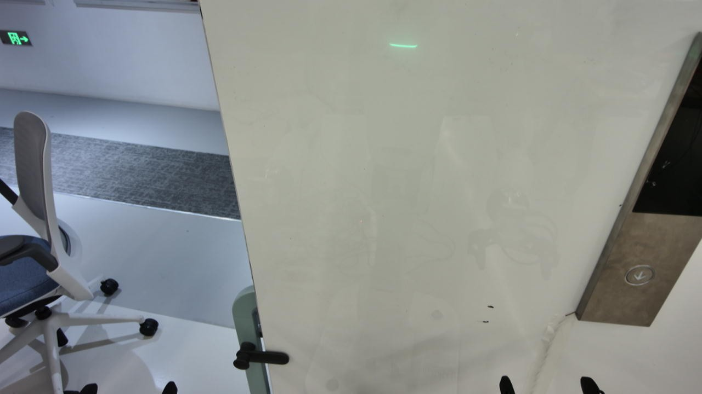
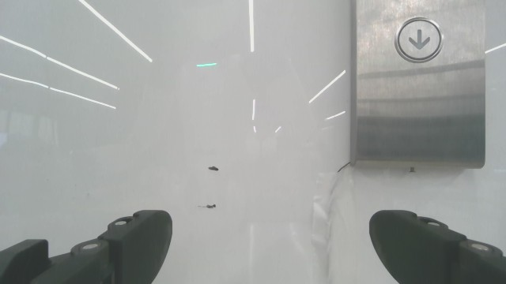

# 腕图前推限制启用后的真机检查

运行 `20261102_002849_b03f7d26`，2026-11-02。运行中的只读检查，快照截止时间与逐轮记录见 `snapshot.json`；没有调用模型、改变机器人命令或修改控制代码。

## 已确认结果

第2轮模型原先提出前推20mm。独立腕图检查未确认两指可辨和横向位于两指之间，程序拒绝该候选；模型修正为抬高10mm，实际只执行了修正动作。前推限制已在真机路径生效，不能把被拒绝的原始候选算作已执行命令。

截至00:34:28，8条命令发送、采图均完成，净命令XYZ为 `[0,-20,+30] mm`，没有实际前推。实测XYZ从 `[402.21,-269.18,1048.88]` 到 `[400.51,-287.25,1077.03] mm`。第9轮随后提出继续抬高10mm；最新快照另保存后续进展。当前未有亮灯、撤回或完成证据。

## 为什么仍反复微调

- 当前输入只提供right/above等粗类别，没有横向/高度误差大小。相同的above可以持续很多轮，动作决策缺乏可靠的步长依据。
- 第3轮再次发送与第1轮相同的绝对head `[0,30]`；实测pitch约25.06→25.18°，并没有实现理由所说的进一步低头。
- 第6轮上下判读错误：按钮在头图右指尖上方，却输出below。HEAD/WRIST请求图片解码后均与对应观测原图逐字节一致，排除拿错画面。
- 第6轮还出现独立的代码误报。理由“the button is right of the right finger and below it”与below一致，但反向关系正则将其中“the right finger and below it”误解为手指在按钮下方。原始Y-10候选被错误拒绝，修正后变为Z-10并实际执行。第7轮又判above、执行Z+15，形成不必要回摆。
- 普通一轮约11.5秒判读加15–18秒动作决策，动作发送约1秒。额外正文、灯态与灯态来源矛盾等格式修正会使一轮达到40–49秒。大部分时间耗在推理和修正。

第6轮头图：

第6轮腕图：

## 后续设计依据

提示词应明确当前阶段、应处理的偏差、预期图像变化及再次观察后的检查方式；分档步长需要可用误差量与本机验证。只增加“看到上方就上移”的文字不能消除错误视觉判读。语义正则也不能承担普遍的自然语言推理校验。

用户选择的腕图横向检查继续是正X的硬条件，不在此检查中暗加高度门槛。任何进一步的策略改动需要与这个约束区分。此次只完成检查和记录，未实施新的控制策略。
