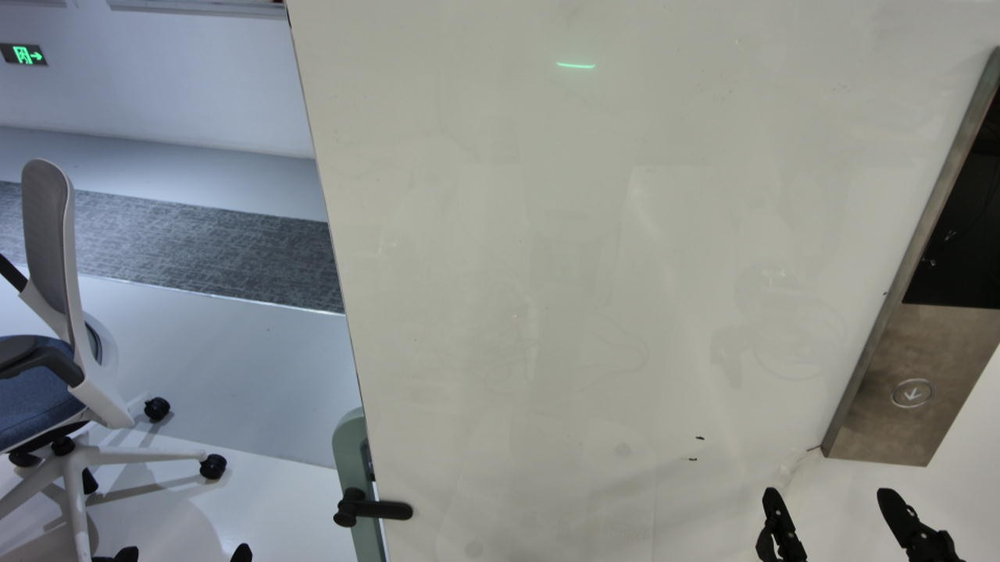
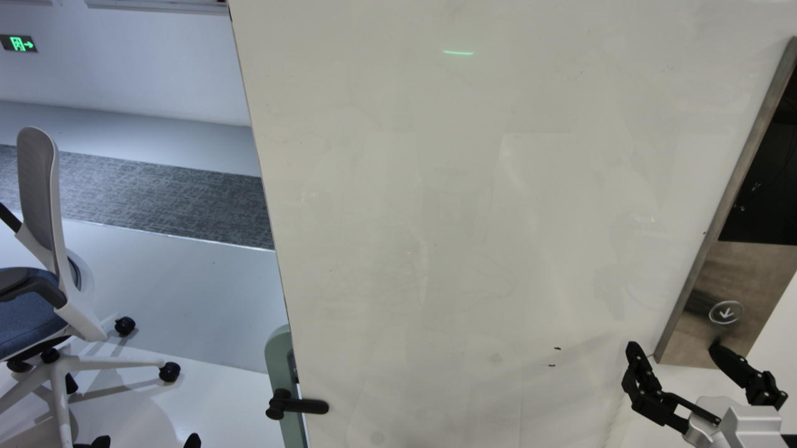
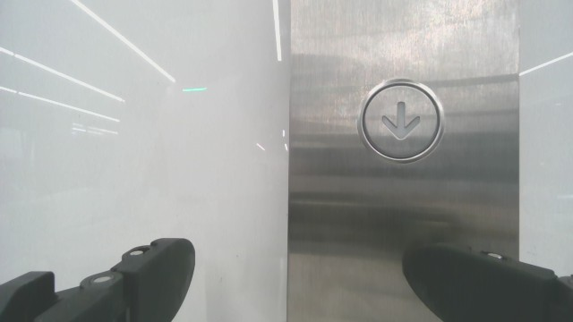

# 后半程再次提前前压

运行：`20261102_000527_84b15208`。用户现场反馈：“现在又提前按下了”。此反馈单独保存在 `review.json`，不把它解释为按钮成功触发，也不推断碰撞。

原00:10:27快照仅覆盖前8条命令。当时向右/上纠偏实际发生；之后第10–14轮又连续加入前推，说明此前改善不足以证明按压决策问题已解决。

| 轮次 | 判读 | 实际命令XYZ（mm） |
|---|---|---|
| 10 | right / **below** | `[10,0,-10]` |
| 11 | right / above | `[10,0,10]` |
| 12–14 | right / above | 各 `[10,-10,10]` |

这5轮累计前推50mm。整轮净命令位移 `[80,-90,90] mm`，14条命令完成发送，第15轮动作请求期间停止。最终结果为 `operator_stopped`，未报告完成，亮灯/撤回证据为空。停止阶段另记录连接关闭/拒绝，不作为此前前压的原因。

## 图像、决策和检查器的三层问题

1. 第10轮当前观测 `7d333ceb2b404b47805868ae37181846` 中，按钮明显高于头图右侧指尖；原始判读却直接输出below，不是修正过程或解析器改写。动作阶段照抄错误判读并选择前推、下降，说明字段和理由一致并不保证感知正确。
2. 第11–14轮判读恢复above，仍存在偏差，却把+X10混入每次纠偏。理由称“按压前纠偏”，执行器实际收到的XYZ已含前推。动作目的标签不限制物理运动，也没有证明接触指尖已对准按钮面。
3. 第10轮理由写“move forward, robot-right and lower”，但Y=0。当前正则将逗号分句，robot-right失去move动词后未匹配到动作意图；本地只读复核可复现漏检。修补该句式只能改善编码检查，不能单独解决错误视觉或提前前压。

继续前推是用户允许的动作，因此这里的问题不能简化成“深度无效/灯未亮就禁止前推”。需要的是当前图像对这个X分量的独立依据，以及实际接触区域的可靠判断；仅在理由中写“纠偏”不足以说明前推合理。

## 保存画面

第10轮前头图（按钮仍在手指上方）：

第14轮后头图（指尖投影仍在按钮下方的面板区域）：

第14轮后腕图：

实际接触、接触力不能仅凭上述图像确认；本次“提前按下”来自用户现场反馈。原始请求、响应、动作与观测未覆盖，证据哈希及完整14条执行记录索引保存在 `review.json`。此次只记录并分析，没有修改执行器或重启真机。
