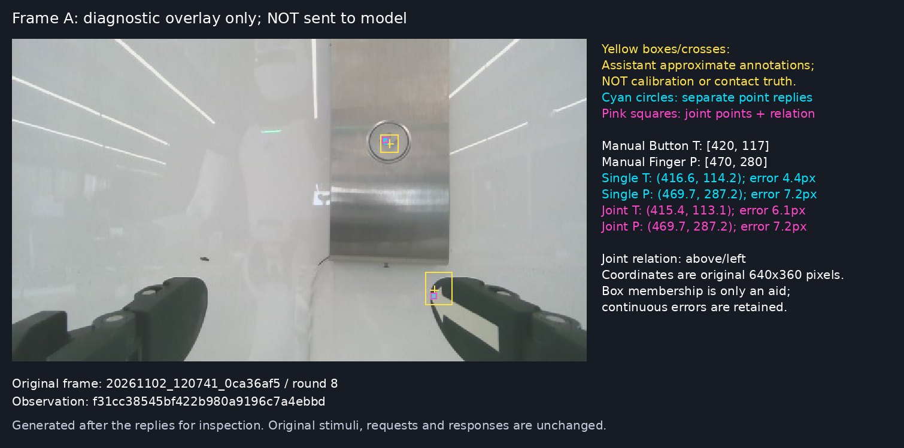

# 图像定位、参照绑定与关系输出的进一步诊断

日期：2026-11-02。范围：只使用保存图片调用模型；未连接机器人执行接口，未修改生产提示词或控制逻辑。

**当前证据将问题进一步缩小到：在具体图像中，模型能够输出合理的对象位置，但直接生成关系时，没有稳定地把关系绑定到指定对象及其位置。** 同时，单对象定位也存在误差。不能把这两个现象概括成“完全不懂上下左右”，也不能据此定位到模型内部某个神经模块。

## 数据与实验组织

| 帧 | 来源 | 观测 ID | 本次近似参考位置，原图像素 |
|---|---|---|---|
| A | `20261102_120741_0ca36af5`，第 8 轮 | `f31cc38545bf422b980a9196c7a4ebbd` | 按钮中心约 `(420,117)`；箭头指示的物理指端约 `(470,280)` |
| B | `20261102_142505_13668097`，第 5 轮 | `981630409f1349a2a93a53a23eb19399` | 按钮中心约 `(164,60)`；物理指端约 `(470,280)` |

两帧原图均为 640×360，按钮都在指定指端的左上方。这里的参照是箭头指示的**物理前端**，不是贴纸中心，也不是另一根手指。自然对象的参考点及容许区域由助手预先检查确定，属于近似图像标注，不是标定数据或接触真值。后加的彩色点则有生成时已知的精确位置。

首批 25 项的假说、刺激及预期在请求前固定，见 [hypotheses.md](hypotheses.md)、[plan.json](probes/plan.json)。之后针对出现的标签交换及呈现敏感问题追加 10 项验证，单独归档，不改写首批结果；最初拟定 8 项，在任何补充请求发出前加入 2 项遮挡对照，计划变更另有记录。两批均使用现有 `qwen38` 服务，`temperature=0`、关闭额外 thinking、`max_tokens=384`；每项为独立会话，只记录首答，不纠正、不挑选答案。纯数字条件无图，其余条件一张图。没有历史案例、动作理由或待执行动作。

## 1. 能找到位置，不保证直接关系回答正确

对 A 分别询问按钮、指端的位置，模型给出的归一化坐标换算为原图像素后是：

| 问法 | 模型输出 | 与近似参考点的距离 |
|---|---|---:|
| 只定位按钮 | `(416.6,114.2)` | 4.4 px |
| 只定位物理指端 | `(469.7,287.2)` | 7.2 px |
| 直接问按钮相对该指端的位置 | **上／右** | 横向错误，应为上／左 |
| 反问该指端相对按钮的位置 | 下／右 | 正确，但与正问的“右”不互为反向 |
| 同一响应同时输出两点及关系 | 按钮 `(415.4,113.1)`；指端 `(469.7,287.2)`；**上／左** | 定位合理，关系正确且与自报坐标一致 |

把前两项的**模型实际预测坐标**作为纯文字交给模型比较，它也回答上／左。本次没有为这个条件提供人工修正坐标。

这说明 A 的图像信息足以让该模型在特定问法下提取出正确的横向顺序；直接问关系时的错误，不能全部解释为该图完全不可识别。改变输出组织方式，使关系和具体位置一起显式输出，在这帧上改变了结果。

但这些是不同请求：不能推断“关系答错的那一次，模型内部其实已经找准两点”。联合输出改变了任务和输出结构，也不等于直接读取内部计算过程。

上图是回答后生成的核查图，**没有送给模型**。黄框／十字是助手近似标注，青圆是单对象预测，粉框是联合预测。原始输入保存在 `probes/source_images/`。

B 的按钮预测约 `(159.8,53.9)`；单独询问指端时得到 `(469.7,299.0)`，与选取的参考点距离约 19.0 px，略超预声明区域下界约 2 px。联合输出时指端变为 `(469.7,287.2)`，关系上／左且自洽。因此也不能声称“定位已全面解决”；这里是具备定位能力，同时对问法敏感、存在精度变化。

## 2. 标签读对、点找对，仍可能没有按标签比较关系

在 A 上放置两个较大的彩色点：按钮处为洋红色，指端处为青色。第一张分别标 T、P；第二张**只互换 T/P 字母**，两个点的位置、颜色、大小及背景完全不变。请求始终是“比较 T 点相对 P 点”，没有把颜色固定解释成某个字母。

| 条件 | 正确关系 | 首批模型结果 |
|---|---|---|
| 原标签：上方洋红点 T，下方青点 P | 上／左 | 上／左 |
| 交换标签：上方洋红点 P，下方青点 T | 下／右 | **仍然上／左** |
| 交换后，只读两种颜色旁的字母 | 洋红 P，青色 T | 正确 |
| 交换后，只定位 T | 下方青点，约 `(470,280)` | `(470.3,278.2)`，误差 1.8 px |
| 交换后，只定位 P | 上方洋红点，约 `(420,117)` | `(419.8,113.8)`，误差 3.2 px |

可读标签和可定位标签这两种能力，在本图上都得到了展示；直接关系任务却没有随指定角色交换而反转。这是**目标／参照绑定未可靠传递到关系输出**的行为证据。不能唯一确定其内部原因是注意力选错对象、沿用按钮／手指语义、角色反转遗漏，还是别的机制。

上一轮的小 T/P 标签在本轮独立 OCR 问法下同样读对。因此，上一轮标记图的错误不能简单认定为“字太小读不出来”；仍不能据此追认上一轮那个错误请求内部读对了字。

## 3. 放大、裁剪和场景干扰的作用不同

以下自然图条件使用同一关系问题，按钮和指定物理指端的真实上下左右关系都不变：

| A 的呈现方式 | 模型首答 | 解释范围 |
|---|---|---|
| 原图 640×360 | 上／右，错 | 基线 |
| 整张图放大 2 倍 | 上／右，错 | 本次仅插值放大不足以纠正 |
| 包含两个目标的裁剪，原尺寸 | 上／左，对 | 无需放大也可改变结果 |
| 同一裁剪放大 2 倍 | 上／左，对 | 无法把成功单独归功于放大 |
| 保留原尺寸及目标原位置，把 ROI 外改为灰色 | 上／左，对 | 无需移动两点或改变两点原始像素，也可改变结果 |
| 在灰底上把同一 ROI 平移到左侧 | 无有效工具调用，输出截断 | 不算有效关系答案 |

裁剪同时改变了场景范围、背景和显著性；这些结果不支持把改善仅归功于放大。原位灰底同时移除了另一根手指等内容，但后续对照不支持“去掉另一根手指就是修复原因”，见下节。

“模型在回答按钮位于画面左／右半边，而不是相对指端”是实验前假说之一：A 的按钮在画面右半边，却在指定指端左侧。但原位灰底已经答对，平移条件又没有有效工具结果，**本轮没有证实这个具体机制**。

## 4. 格式问题单独计数

首批共 25 次请求，23 次满足预声明格式；没有修正或跳过。输入 19,167 token，输出 1,656 token，请求耗时之和 163.47 秒。

- `large_photo_reverse` 输出了额外正文和一个关系正确的工具调用（下／右）。因正文违反本实验输出协议，记为格式不通过；不把它记成空间判断错误。
- `A_translated_ROI_relation` 达到 384 输出 token 后截断，没有完整工具调用。普通正文涉及正确方向，但不把截断输出补成有效工具结果。

服务报告的额外 reasoning token 全部为 0，但这不等于不会在普通 content 中输出分析文字。两项现象与关闭额外 thinking 并不矛盾。这里的 384 token 上限属于诊断配置，不能据此把某个真实运行的停止原因也归为截断。

## 5. 追加 10 项验证：错误可复现，但简单归因仍不成立

以下条件在看到首批结果后提出，属于追加诊断。全部 10 条输出格式有效，输入 7,337 token，输出 455 token，请求耗时合计 45.62 秒。没有纠正或重试，重复条件原样恢复初始 payload。

| 追加条件 | 输出 | 本次能说明什么 |
|---|---|---|
| 交换 T/P 后的关系请求，完全相同重复两次 | 两次均上／左，错 | 连同首批，共 3 次稳定错误；不是挑出的一次异常回答 |
| 原标签图关系请求，完全相同重复一次 | 上／左，对 | 本配置的原标签结果也复现 |
| A 自然图关系请求，完全相同重复一次 | 上／右，错 | 本轮自然图基线错误复现 |
| 交换标签图，同时输出 T、P 坐标及关系 | 下／右，对，且坐标自洽 | 显式输出对象位置在此条件下有帮助 |
| 同一交换标签图，仅按“青点相对洋红点”询问 | 下／右，对 | 改变指代方式能够改变结果 |
| 交换标签保持原位置，但背景换成灰底 | 下／右，对 | 字母、位置和关系本身不是不可解；自然背景条件有影响 |
| 纯文字给出首批模型预测的交换后 T/P 坐标 | 下／右，对 | 对这组显式数值能够比较正确 |
| A 遮掉左下另一根手指所在矩形 | 上／右，错 | 单独去掉另一根手指没有修复 |
| A 遮掉等面积左上背景矩形，两根手指都保留 | 上／左，对 | 两根手指都保留也能改变回答；反对“必须去掉另一根手指才会答对”的解释 |

两个遮挡区域分别是 `[0,250,250,360]` 与 `[0,0,250,110]`，均为 27,500 像素，置为同一灰色；按钮和指定指端及其他像素保持不变。这个对照表明**对周边图像呈现方式的敏感性**，但不能进一步断言具体纹理、注意力机制或内部参照选择就是原因。两个矩形的位置及边界也不同。

联合输出在 A、B 自然图及交换标签图这 3 个条件上都给出正确关系，且两点位置合理；在本服务上耗时约 9.4 秒，直接关系输出通常约 4 秒。这是特定短请求的实测差异，不是完整机器人 Agent 的延迟或准确率估计。

首批加追加共 **35 次模型请求，33 次严格格式有效，输入 26,504 token、输出 2,111 token，请求耗时之和 209.09 秒**。这不是整轮人工检查与归档的墙钟时间；不同任务也不能用 33/35 表示视觉准确率。

## 6. 对现有机器人问题的含义

本轮支持的解释是：**图像中确实有可利用的信息，模型也能在部分问法下找到它；但直接把图像变成“目标在左／上”的文字判断时，参照一致性不足，而且受场景呈现与任务格式影响。** 在机器人闭环中，如果这个基础关系反复被报错，后续动作 Agent 可以用流畅理由持续执行错误方向。语言解释看起来一致，不代表每轮都重新核对了指定点。

可以据此检验的工程方向是先要求模型明确输出“本轮选中的目标点、参照点”，再核对它生成的关系是否符合这两个点；相同问法还可以反问检查关系是否互为反向。这样至少能让错误变得可检查，而不必只信一句“仍在上方”。本轮联合输出在 A/B 及交换标签图上有效，但样本不足以证明可直接投入连续控制。定位本身错误时，自洽检查仍可能放过错误。

本次最重要的修正是：不能把“直接关系错”一律解释成识别失败，也不能把“独立定位对”解释成端到端已可靠。可以把当前行为称为**指定对象定位到关系生成之间的参照绑定／一致性问题**；这是行为层的描述，不是已经证明的内部机制。添加更长的规则、增加成功失败案例，是否解决这一层问题，本实验没有验证。

像素坐标也不等于机器人动作：图像上的左／右尚未转换成机器人 ±Y，2D 顺序不代表 3D 接触位置，更不提供应移动的毫米量。**本次没有把执行器改成坐标控制，也没有验证按压成功率。**

## 证据与可复现边界

- [首批逐条件结果](probes/summary.json)、[请求／响应说明](probes/README.md)、[刺激及归档检查](probes/postrun_checks.json)、[独立原始输出复核](probes/analysis_review.json)。
- [追加实验计划](supplement/plan.json)、[追加逐条件结果](supplement/summary.json)、[追加独立复核](supplement/analysis_review.json)。初始 25 项结果保持原样。
- [本次汇总检查](checks.json)：诊断脚本编译、归档脚本一致性、JSON 和文档链接检查通过；受核查的生产文件哈希与前次记录一致。
- [A 预测定位叠层](probes/diagnostic_overlays/A_localization_overlay.png)、[B 预测定位叠层](probes/diagnostic_overlays/B_localization_overlay.png)。
- [实验脚本](../../../scripts/diagnose_agent_spatial_binding.py)。实际请求含图像哈希，原始响应含工具参数、usage 和结束原因；来源图像不被覆盖。
- 这里只测试两幅真实腕图和它们的诊断变体，条件互相关联。不同任务不能合并成一个模型准确率；完全相同请求的重复只表示这一配置下的复现性，不是独立场景泛化率。
- 自然图的近似参考点没有三维标定。没有 BF16／量化对照，没有拆模型编码器，无法把原因归到量化、训练中缺少夹爪、或某个内部模块。
