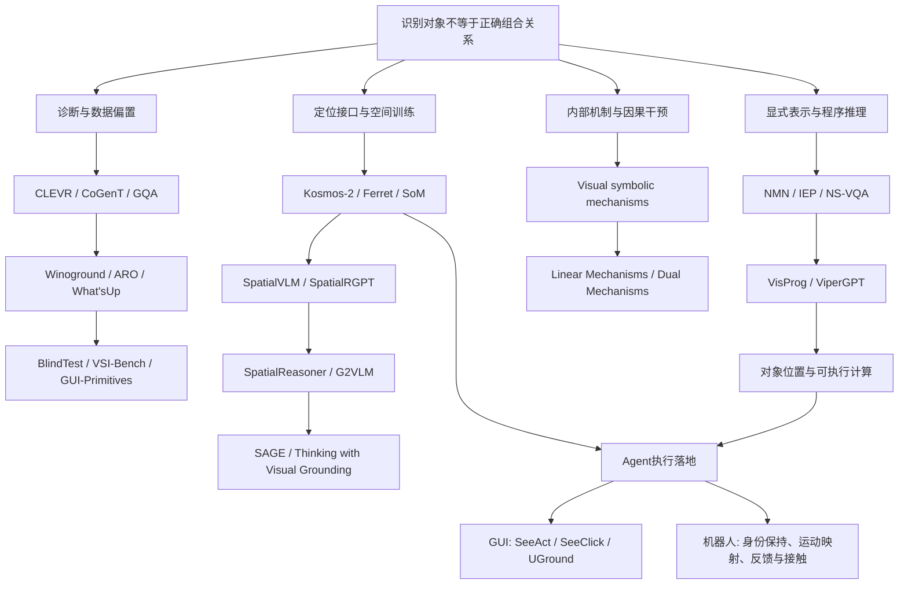

# 从对象识别到可靠空间关系：研究时间线、方法图谱与候选研究问题

检索截止：2026-11-02（Asia/Shanghai）。本次为一手文献调查与项目实验对照，没有调用机器人或新增模型实验。

核心判断：识别对象、定位实例、绑定目标与参照、计算关系、把关系转成动作，是可以分别出错的环节。相关研究从早期视觉问答发展为开放视觉语言模型、GUI Agent、空间模型与机制解释等并行路线。“感知与推理解耦”已有长期先例；当前更值得研究的是在开放、变化的场景中如何保证中间表示正确、被实际使用，并支持持续纠错。

## 1. 阅读范围与证据等级

- 时间优先按论文首次公开年月排列，会议年份另列。重要新版本单独注明；不把 2025 年补充的结果追记为 2024 年结论。
- 下面的时间线是围绕本问题的选择性脉络，不是计算机视觉、空间认知或具身智能的完整历史。
- 区分四种任务：二维图像定位／绑定、三维度量与视角关系、模型内部机制、真实动作闭环。它们的分数不能互相替代。
- 论文中已观察到的改进不等于当前 Qwen3.8 部署的验证结果。研究方向推断明确标为候选，不声称检索已证明“无人研究”。

## 2. 按时间梳理：问题如何被重新定义

| 首次公开时间 | 代表工作 | 当时的研究转折 | 留下的问题 |
|---|---|---|---|
| 2015-11 | [Neural Module Networks](https://arxiv.org/abs/1511.02799)，CVPR 2016 | 按问题组合查找、识别等模块，让识别和推理具有结构分工。 | 解析问题和视觉模块仍可能错；模块化本身不保证结果正确。 |
| 2016-12 | [CLEVR](https://arxiv.org/abs/1612.06890)，CVPR 2017；[CoGenT](https://cs.stanford.edu/people/jcjohns/clevr/) | 用可控场景、对象信息和功能程序，拆开感知、关系、计数等能力；CoGenT检查未见属性组合。 | 合成物体、有限属性与真实机器人画面差距很大。 |
| 2017-05／06 | [IEP](https://arxiv.org/abs/1705.03633)、[Relation Networks](https://arxiv.org/abs/1706.01427) | 一条路线生成程序并执行；另一条显式对对象／区域特征的成对组合学习关系。 | 学会对象特征不自动获得关系能力；学习式执行器也可能不一致。 |
| 2018-10—2019 | [NS-VQA](https://arxiv.org/abs/1810.02338)、[NS-CL](https://arxiv.org/abs/1904.12584) | 神经感知生成对象表示，再连接语义程序与符号推理；NS-CL进一步研究弱监督学习这些组件。 | NS-VQA的CLEVR 99.8%属于受控任务，不能解释成开放视觉或接触操作已解决。 |
| 2018-11—2020-06 | [NLVR2](https://arxiv.org/abs/1811.00491)、[GQA](https://arxiv.org/abs/1902.09506)、[GQA-OOD](https://arxiv.org/abs/2006.05121) | 转向真实照片、关系一致性和罕见问答组合，反思平均准确率掩盖的失败。 | 单帧／图像对问答仍不能反映连续行动中的误差积累。 |
| 2021-01公开；02预印本 | [CLIP论文](https://arxiv.org/abs/2103.00020)、[官方发布](https://openai.com/index/clip/) | 大规模图文学习扩大开放语义识别与迁移范围。 | 图文匹配高分不自动约束主客体关系；这条扩展路线与模块化路线并行。 |
| 2022-04／10 | [Winoground](https://arxiv.org/abs/2204.03162)、[ARO](https://arxiv.org/abs/2210.01936) | 相同对象／词集合、不同角色／顺序的对照，系统揭示图文组合性不足；ARO用困难负例改善对比模型。 | 对象、属性、关系仍可能被错误组合。对比学习机制不能直接套用所有生成式VLM。 |
| 2022-11—2023-03 | [VisProg](https://arxiv.org/abs/2211.11559)、[ViperGPT](https://arxiv.org/abs/2303.08128) | LLM生成调用视觉模块与计算模块的程序，显式传递中间结果。 | 感知和生成程序都可能错；“检测→Python比较”本身已非新架构。 |
| 2023-06—10 | [Kosmos-2](https://arxiv.org/abs/2306.14824)、[Ferret](https://arxiv.org/abs/2310.07704)、[Set-of-Mark](https://arxiv.org/abs/2310.11441) | 把框、区域特征、编号等变成可输入／输出的明确指代接口。 | 输出坐标／读对标记，不代表空间关系必然正确，也不等于物理接触点标定。 |
| 2023-10 | [What’s “up” with vision-language models?](https://aclanthology.org/2023.emnlp-main.568/) | 控制真实照片中对象身份、改变位置，直接检验基本空间关系。 | 与“面板稍微移动后失效”高度相关，但历史受测模型表现不能当作当前模型成绩。 |
| 2024-01—10 | [SeeAct](https://arxiv.org/abs/2401.01614)、[SeeClick](https://arxiv.org/abs/2401.10935)、[UGround](https://arxiv.org/abs/2410.05243) | GUI Agent暴露“会描述下一步，却未必点对位置”的断点；专门训练定位模块，分工规划与grounding。 | GUI像素可直接用于点击；机器人还需运动映射、深度与接触判断。人工定位条件的成绩不是自动部署成绩。 |
| 2024-01／06 | [SpatialVLM](https://arxiv.org/abs/2401.12168)、[SpatialRGPT](https://arxiv.org/abs/2406.01584) | 补充空间问答数据、区域指代和深度信息，提高定性／定量空间能力。 | 改善空间问答不等于本机闭环按压；区域与深度质量仍影响结果。 |
| 2024-07；2025-03重要更新 | [BlindTest](https://arxiv.org/abs/2407.06581) | 基础几何任务仍会失败；v6的探针研究在两个开源模型、两类任务中发现视觉特征可被读出，而完整VLM回答不可靠。 | 不能一概把错误归到“没看见”；也不能把这些模型的语言读取瓶颈普遍套用。 |
| 2024-12—2025 | [Thinking in Space / VSI-Bench](https://arxiv.org/abs/2412.14171) | 问题扩展到视频空间记忆；显式认知地图在受测空间距离任务中有帮助，普通文字推理方法未必有效。 | 并非证明所有thinking无效，也未验证真实机器人操作。 |
| 2025-04 | [SpatialReasoner](https://arxiv.org/abs/2504.20024)，NeurIPS 2025 | 用显式三维表示连接感知、计算和推理，检查中间事实并评估新问题泛化。 | 中间值仍可能预测错误；显式表示并不天然真实。 |
| 2025-06—2026-03 | [Visual symbolic mechanisms](https://arxiv.org/abs/2506.15871) → [Linear Mechanisms](https://arxiv.org/abs/2601.12626) → [Dual Mechanisms](https://arxiv.org/abs/2603.22278) | 从输出诊断推进到空间索引／变量绑定的内部机制研究，通过探针和激活干预检验作用。 | 机制结论依赖受测架构、任务和干预；还不是通用空间推理理论。 |
| 2025-11，CVPR 2026 | [G²VLM](https://arxiv.org/abs/2511.21688) | 联合三维重建与空间理解，直接学习几何表示。 | 几何理解进步不自动解决指定指端身份或接触控制；论文与公开权重可用性也应分开。 |
| 2026-05 | [SAGE](https://arxiv.org/abs/2605.18162)，10月更新 | 将几何与语言变换前后的关系一致性纳入后训练，针对单题答对却在等价／反向变换中失效的问题。 | 对称／变换一致性训练已有先例；一致并不充分保证对象找对。 |
| 2026-06 | [Thinking with Visual Grounding](https://arxiv.org/abs/2606.16122) | 在推理中加入点／框，并把所引用区域与答案一起纳入训练验证。 | “让理由绑定可见证据”“给定位过程奖励”已有研究，不能仅换成机器人就声称首创。 |
| 2026-08 | [GUI-Primitives](https://arxiv.org/abs/2608.21832)，作者注明EMNLP 2026录用 | 固定截图与参照、改变关系词，区分候选定位错误与关系选择错误。 | 人工给定候选标记的提升是oracle诊断，不是自动定位方案；部分关系结果不能泛化到全部任务。 |

这不是一条“旧方法被新方法淘汰”的直线。开放模型扩大了语义范围，但受控域中有效的对象表示、模块化计算和反事实诊断，在新模型中仍有价值。

## 3. 方法图谱

箭头表示本报告概括的研究主题承接，不表示每条边都有直接引用或历史因果关系。

## 4. 最贴近本项目的新证据

**Dual Mechanisms（2026-03，v3更新于2026-10-06）尤其值得读。** 论文在受测VLM中发现视觉编码器和语言骨干有并行的空间排序来源，视觉侧是主要来源；排序信号分布到对象以外的背景token。通过内部干预改变这些信号能够影响关系输出。[论文](https://arxiv.org/abs/2603.22278)、[作者项目](https://spatial.baulab.info/)

这给我们的“只遮掉背景，关系答案就改变”提供了具体可检验的机制方向：背景区域未必只携带无关纹理，也可能参与空间布局表征。但本地没有做内部激活干预，不能宣布这就是Qwen3.8错误的原因。不同工作分别在不同模型／任务中发现视觉侧和语言侧的作用，不能归纳为“所有错误都在同一个模块”。

GUI-Primitives也提醒我们不要预设所有失败都是关系推理：它的若干关系任务中，一旦输出落到候选区域内，目标选择明显好于完整定位成绩。与之相对，本地两帧实验已展示单独定位合理但直接关系错误。两者并不矛盾；需要按场景分解故障，不能只凭总体失败率下诊断。[论文](https://arxiv.org/abs/2608.21832)

本地证据来自[35次模型实验](../20261102_spatial_binding_followup/README.md)：两张真实腕图及其变体，联合位置输出、角色交换、背景遮挡等条件。它支持特定条件下的可靠性断点，尚不是跨模型、大规模场景或真实控制成功率的结论。

## 5. 已有解决方法：哪些问题能被实际处理

| 方法类别 | 已有代表 | 可以处理的环节 | 仍需验证的部分 |
|---|---|---|---|
| 检测／定位 + 程序几何 | NS-VQA、ViperGPT | 给定可靠位置后的排序、差值和逻辑一致性 | 定位错、身份错仍会传播；需保留unknown |
| 区域、编号、点／框接口 | Kosmos-2、Ferret、SoM | 明确“指的是谁”，减少含糊指代 | 正确读编号不保证持续绑定；候选生成不能依赖人工真值冒充自动性能 |
| 空间数据与反事实训练 | ARO、SpatialVLM、SAGE | 针对角色、关系和变换约束训练 | 分布外场景、未见操作和自洽但错误的答案 |
| 几何表示、深度及三维重建 | SpatialRGPT、SpatialReasoner、G²VLM | 改善度量、视角关系和几何信息可用性 | 深度、重建与跨视角关联误差，真实接触 |
| 定位过程监督 | Thinking with Visual Grounding | 让中间引用位置参与训练评价 | 坐标是否真实、后续答案是否确实使用它 |
| 内部机制干预 | Visual symbolic / Linear / Dual Mechanisms | 在受测模型中定位、干预绑定表征 | 对新架构、量化服务和真实动态画面的迁移 |
| 专门grounder接规划Agent | SeeClick、UGround | 提高计划落到屏幕对象的位置精度 | 通用规划与定位接口中的错误恢复；机器人额外的运动映射 |

机器人还有更早的视觉伺服传统：用明确视觉特征和几何／控制模型，根据误差闭环调整。2006年的经典教程已系统介绍图像式与位置式视觉伺服。因此，“计算图像误差并闭环控制”也不能当作新研究空白。现在的问题是如何在开放语言指代、易变对象和不确定感知下，与这些方法可靠衔接。[Chaumette与Hutchinson，Visual Servo Control](https://web.mit.edu/amcp/OldFiles/drg/Chaumette_Part_I.pdf)

## 6. 候选科研问题：已有先例之后，还能研究什么

以下是结合文献与本地实验提出的具体问题，不是“整个领域从未有人做过”的声明。研究前仍需围绕选定贡献做更窄的查重。

### A. 显式坐标究竟怎样改善关系输出？

已有工作支持显式表示，但在本模型中，收益究竟来自正确的实例绑定、额外输出计算、数字比较，还是提示形式变化，尚不清楚。可以固定图片、预算和输出长度，对照直接关系、位置加关系、位置交程序比较，以及位置被有控制地交换或扰动的条件。

关键指标应分开：定位误差、角色绑定正确性、关系正确性、坐标与关系自洽率，以及对干预的预期响应。正确坐标是否真被使用，与答案是否碰巧正确，是不同问题。若以此为贡献，必须与SpatialReasoner、定位过程监督及机制研究比较，不能只报告一个提示词比另一个好。

### B. 从单帧正确到连续行动：身份和证据怎样保持？

把当前任务中的同一按钮与同一物理指端，在头部／腕部视角、遮挡、转头和手臂移动后继续对应起来。观测ID、相机姿态、估计对象身份与不确定性需要共同进入接口，不能把两个视角的“右边手指”默认视为同一个对象。

这属于跨视角关联、动态grounding与闭环控制的交叉问题，并非无人研究。对本项目的可测贡献应落在：定位或身份错误是否在动作前被识别，错误恢复是否减少无效循环，以及同一执行器下是否改善真实触发与撤回。

### C. 什么情况下应该复核，复核是否真的增加信息？

多调一次同模型不等于独立验证。可比较直接重复、裁剪重看、定位结构化输出、换视角和真实重新取景，研究各自的收益、耗时和相关错误。应同时度量正确率、拒答／复核覆盖率、错误被接受的比例和任务进展。

需要防止只靠互逆、自洽或重复一致判定正确：模型可以持续一致地绑定错误对象。SAGE已经研究一致性训练；本项目若做此方向，应强调感知真值、动作后证据及成本约束，而非仅增加对称性损失。

### D. 背景敏感性是否来自可迁移的空间绑定机制？

在同一真实场景中控制目标位置、背景、标签身份、候选数和输入分辨率，并在可访问权重的模型上做探针及激活干预。对比视觉表征、融合后表征及语言输出，检验哪些改变与错误有因果关系。

此方向与Dual Mechanisms等直接重叠，具有明确前作基础。潜在延伸是本地原生多模态／量化架构、真实双视角机械指端、位置输出和关系输出两种任务间的差异。必须控制精度版本和模型规模；不能把量化、网络结构或“训练没见过夹爪”当作未经验证的结论。

## 7. 本项目优先顺序

工程上，先复用已经有依据的路线：模型定位指定对象、程序比较图像坐标、动作Agent消费结构化证据，并记录行动后的变化。它可使用现有共享执行器；二维像素不自动转换成毫米指令。

科研上，优先把本地已经出现的“单独位置合理、直接关系错误、背景改变答案”做成可复现的分层诊断，再选择A或D检验机制；若目标是提高真机可靠性，则B与C更直接。一次按压成功可以证明这次实验完成，但不足以证明方法对位置变化或未见场景具有泛化性。

建议精读顺序：What’sUp → ViperGPT → BlindTest v6 → SpatialReasoner → Dual Mechanisms → SAGE → GUI-Primitives。这个顺序覆盖现象、可执行解法、内部断点、显式表示、机制干预、一致性训练和非机器人Agent实例。
