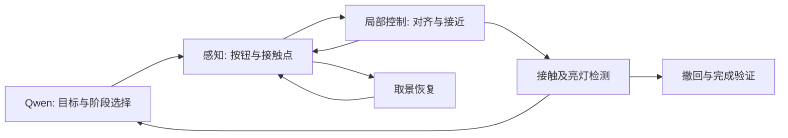

# Qwen3.8 电梯按钮控制：实验审查与文献阅读建议

调研日期：2026-11-02（北京时间）。本次只读检查代码、报告、原始结果及部分保存图像，并检索论文原文、作者项目和代码；没有连接机器人、请求新的模型推理或运行训练。本文新增归档，不改变现有控制行为。下文的改进方案均为建议，未经本次实验验证。

后续按 Agent 控制、程序技能和自主改进方向整理的专题见 [CaP-X / ASPIRE / PhysicalRSI / ENPIRE / SPINE 调研](qwen38_robot_agent_harness_review_20261102.md)。下表最新取景运行已依据后续机器人端审计更新，第五条命令现已获得发送完成证据。

**建议优先补齐接触点定位、视觉误差到动作的映射和动作效果反馈，并让 Qwen 负责目标与阶段选择。** 当前证据还不足以把主要问题归因于模型大小、量化或 thinking 设置。若研究目标是保留纯 VLM direct 控制，也应先建立可独立评分的感知与动作效果实验。

## 1. 当前项目实际到了哪一步

### 两条路线要分开看

| 路线 | 已有实现与证据 | 解释边界 |
|---|---|---|
| Qwen3.8 工具调用 Agent，当前真机工作重点 | 头部/右腕图、成功键盘示范、状态和历史输入；模型选择 `move/head/gripper`，共用键盘执行器 | 属于通用 VLM 驱动的工具闭环，没有证据表明当前聊天模型经过本机动作训练 |
| VLA-JEPA + 残差 RL，之前仿真路线 | 冻结 step8000 VLA，SAC 学习 7×3 笛卡尔动作残差；72,020 更新保存点完成 val-40 | 属于动作策略学习；仿真成绩不能写成当前 Qwen3.8 真机成功率 |

本地服务审计记录 `qwen38` 对应 **Inferact/Qwen3.8-27B-NVFP4**，revision 为 `6128240ebaf4eaa7bad2b3d1c72c37d677c5f462`。这是本地已归档审计结论，本次没有重新探测运行服务。原审计还记录视觉塔未做 NVFP4 量化，暂无受控证据证明量化造成当前失败。[本地审计](../report/20261101_panel_shift_root_cause/model_research.md)、[官方基础模型](https://huggingface.co/Qwen/Qwen3.8-27B)、[量化模型来源](https://huggingface.co/Inferact/Qwen3.8-27B-NVFP4)。

默认 `grounded` 已经包含独立定位、图像误差计算、阶段建议和短记忆；最新现场测试使用 `direct` 加取景与进展复核。不能把所有版本描述成完全没有反馈。现有 250 Hz 是底层插值和发送频率，模型外层仍常需数十秒；发送完成不代表到位、接触或触发。[当前架构](../astribot/planar_control/agent_run.md)。

### 关键实验结果

| 记录 | 看到的结果 | 能得出的结论 |
|---|---|---|
| 键盘示范 `20261101_182424_352b5047` | 操作者确认第10步按下亮灯；第11步后撤中断 | 证明当前硬件构型可以完成按压；完整撤回未验证。[标签](../../outputs/keyboard_sessions/20261101_182424_352b5047/case_review.json) |
| 面板偏移后的受控模型回放 | 同一帧，完整会话继续前推；加入独立视觉事实后改为 `[0,-10,0]` | 感知状态到动作的接口值得改进；9次请求、每条件一次，没有执行新建议。[对照](../report/20261101_panel_shift_visual_action_mismatch/README.md) |
| thinking 开关对照 | 三帧开/关均选择 `[5,0,0]`，未纠正前推 | 当前小样本没有支持“打开 thinking 即可解决”；不能外推为 thinking 永远无效。[记录](../report/20261101_direct_thinking/README.md) |
| `20261102_000527` | 实测右移约47.2 mm、抬高46.2 mm，之后仍提前前推；最终没有亮灯/撤回证据 | 已具备部分真实纠偏能力，但对齐到按压的阶段转换仍不可靠。[前段](../report/20261102_live_alignment_progress/README.md)、[后段](../report/20261102_live_alignment_progress/premature_press/README.md) |
| 红标记 direct，`20261102_110447` | 10次已完成手部动作累计下降155 mm；首个下降已令按钮退出腕图，之后仍重复原理由 | 动作效果与预期相反时没有有效更新决策。已查看原始前后图片，非仅依赖模型文字。[分析](../report/20261102_red_marker_direct_descent/README.md) |
| 取景定位三帧回放 | 正确报告头图缺少有效目标，但腕图按钮框偏移，指端均判 `partial`，正式关系均 `unknown` | 暴露了不确定性，仍未证明精细定位可靠；没有真实执行。[记录](../report/20261102_view_recovery/model_replay_report.md) |
| 本次查到的最新有结果运行 `20261102_142505_13668097` | 本地4条转头完成；后续机器人端副本补证第五条也发送完成，pitch目标30→35→42→48→55°。仍无法通过取景，客户端随后轮询遇 HTTP503：`dictionary changed size during iteration` | 最新瓶颈包含过强取景门槛、取景阶段缺少停滞监测、头部欠跟踪及独立服务故障。发送完成不等于实测到位；没有手部XYZ、按压或撤回。[原结果](../../outputs/agent_web/20261102_142505_13668097/agent/result.json)、[后续审计及第五条补证](../report/20261102_view_loop_audit/README.md) |
| 10月25日 XYZ residual 仿真验证 | 34/40（85%），历史零残差23/40（57.5%）；13场改善、2场退化，最终3次超时、3次意外接触 | 局部动作学习已有积极证据，也有接触代价。单种子、每场景一次、复用历史基线、同步仿真；不是100k训练完成或真机85%。[报告](../astribot_rl/xyz010_raw_command_100k.md)、[原始配对结果](../../outputs/astribot_online_rl/xyz010_raw_command_100k/paired_val40_72020_20261025_142010/paired_comparison.json) |

审查到的11月1–2日17份 `agent/result.json` 中有2次模型自报完成、9次人工停止、5次错误、1次达到轮数上限。两次自报完成的人工成功/撤回字段均为 null。这些是不断改变版本和初始条件的开发运行，**不能据此计算统一成功率，也不能把未人工确认直接视作失败**。后续新增日志不在这个快照统计中。

10月22日旧 [VLaRL 可行性文档](vlarl_feasibility_20261022.md) 引用的25/40不是目前最新主要残差结果，应结合上述34/40理解进展。

## 2. 最重要的研究问题

1. **接触点到底在哪里。** 白箭头/红贴纸让物体容易指称，但不等于工具中心点（TCP）标定，也不保证模型定位到了真正触碰按钮的表面。最新取景卡住与这一点直接相关。
2. **动作会怎样改变画面。** 头相机与腕相机的运动机制不同；转头不改变腕相机，腕相机随手下降时固定面板可能向图像上方运动。需要可测的局部动作—视觉变化关系。
3. **动作后的证据能否推翻旧判断。** 反复调用同一模型并不能提供独立真值；已有复核也误判了上下关系。需要对执行前后图像和实测动作进行单独评价。
4. **二维对齐如何变成三维接触。** “按钮在两指之间”、单点深度接近131 mm、或者按钮和指端图像中心接近，都不能分别证明真实接触对齐。
5. **谁负责最后几毫米。** 模型外层数十秒的周期适合低频任务选择；局部定位、误差收敛和接触终止更适合可计算或经过训练的低层控制。
6. **成功如何确认。** 到位、接触、按钮触发、亮灯、撤回是不同事件，必须分开记录。模型完成报告、软件测试通过、离线建议正确都不能替代完整任务证据。

当前已有独立标定控制原型，但文档明确 TCP/手眼/工作范围、在线FK/IK及接触验收未完成，示例配置不能直接执行运动。历史核查也未确认可用腕部六维力流；关节 torque 不能直接当作已标定的接触力。因此以下涉及几何或力控的建议都需要补齐前提。[原型与传感边界](../astribot/planar_control/calibrated_control.md)。

## 3. 优先阅读：与当前任务直接对应

### A. 最贴近“通用模型 + 成功示范 + 电梯按钮”的工作

**He et al., Robot Manipulation with GPT-6-Astra: Body Knowledge, Experience Reuse, Emergent Skills, and Sim2Real Transfer，2026年9月预印本。**

[论文](https://arxiv.org/abs/2609.31770)、[全文](https://arxiv.org/html/2609.31770v1)、[代码/提示词/逐试验材料](https://github.com/hesd10/astra-robot-sim2real)。

- 阅读重点：§3、§5.2、§6、§8及Appendix B。论文直接研究电梯按钮，比较机体几何与相机资料、同步图像—动作—状态经验，以及可复用短程序。
- 对本项目的启发：示范需要说明观察时刻、实际状态、动作效果和成功边界；身体知识应明确相机安装关系和接触点，不能只给“右移/上移”的文字。可从重复成功段提炼可验证技能。
- 限制：真机仅12次，主要条件每组3次，成功口径是人工确认接触，**没有验证按钮触发或亮灯**；局部 LOOP 技能并未补齐自动对齐反馈。论文主要支持效率与经验复用，不能证明 Qwen 能稳定完成这里更严格的任务。
- 成本：阅读和对现有示范包做对照较低；跨模型或机体复现需重新建立控制契约。作者仓库已可读，但本次未执行其代码。

### B. 最能解释“移动方向为什么反了”的基础

**Chaumette & Hutchinson, Visual Servo Control, Part I: Basic Approaches，IEEE Robotics & Automation Magazine，2006；Part II: Advanced Approaches，2007。**

[作者页面与两篇PDF](https://www-cvr.ai.uiuc.edu/ResPages/vs.php)、[Part I PDF](https://web.mit.edu/amcp/OldFiles/drg/Chaumette_Part_I.pdf)、[ViSP](https://visp.inria.fr/)。

- 阅读重点：图像误差、interaction matrix / image Jacobian、eye-in-hand、外部相机、混合视觉伺服。
- 对本项目的启发：固定接触点、夹爪构型和头姿后，用小幅已执行动作及实测位移辨识局部映射，判断哪条动作会减少误差；相机或构型改变时重新验证。这样能直接检验下降后按钮进一步出画的问题。
- 限制：图像误差收敛不等于三维接触正确；还需深度、可见性、姿态和接触判据。ViSP是实现参考，不是Astribot即插即用控制器。
- 成本：借鉴局部Y/Z误差控制为中等；无需先训练通用大模型。

### C. 最具体的电梯按钮工程实现

**Schulze et al., On realizing autonomous transport services in multi story buildings with doors and elevators，Frontiers in Robotics and AI，2025。**

[论文全文](https://www.frontiersin.org/journals/robotics-and-ai/articles/10.3389/frobt.2025.1546894/full)。

- 阅读重点：§3.1.3按钮操作。检测按钮后，利用深度恢复三维位置与表面法向，运动到预接近点，再线性推进并用力反馈事件结束接触；末端ArUco标记用于校正相机与实际指端的位置偏差。
- 对本项目的启发：把白箭头的“语言指称”推进到可测接触点；将切向对齐和法向按压分开。若采用标记，要明确标记到物理指端的变换。
- 限制：依赖标定、力反馈和已知布局匹配，不能声称无需标定或任意面板泛化；未核实可直接部署到S1B的官方控制代码。
- 成本：中等到较高，主要在几何与接触接口，而非提示词。

### D. 保留Qwen直接决策时，值得做的动作表示对照

**PIVOT: Iterative Visual Prompting Elicits Actionable Knowledge for VLMs，2024。**

[论文](https://arxiv.org/abs/2402.07872)、[作者项目](https://pivot-prompt.github.io/)。

- 核心：在画面上呈现带编号的候选动作，让VLM选择并迭代细化。
- 对本项目的启发：对比“自由生成XYZ”与“选择经过几何验证的候选小动作”，减少图像左右、机器人左右和动作符号之间的自由转换。必须正确投影候选动作，不能随意画方向箭头。
- 限制：仍会错误选择，且多次模型调用增加时延；本次未在作者项目页核实官方可运行实现。
- 成本：具备投影或局部运动模型后为中等；先做保存图像上的候选选择实验。

**MOKA: Open-World Robotic Manipulation through Mark-Based Visual Prompting，RSS 2024。**

[正式论文](https://www.roboticsproceedings.org/rss20/p062.html)、[作者项目](https://moka-manipulation.github.io/)、[代码](https://github.com/moka-manipulation/moka)。

- 核心：用编号视觉标记选择功能/接触关键点、目标点和中间路点，再转换为机器人操作。
- 对本项目的启发：显式区分“贴纸中心”“实际指端”“按钮可按区域”，并研究如何从成功经历提供上下文；作者项目展示了按红色按钮开启超声清洗机，并非电梯外呼面板验证。
- 限制：MOKA的视觉标记是结构化接口，不等同于在夹爪上贴一张箭头；实际执行仍需要几何与控制转换。正式RSS题名为Open-World，部分旧稿使用Open-Vocabulary。
- 成本：借鉴选点接口较低，完整执行迁移中等。

### E. 从视觉描述走向可执行约束

**ReKep: Spatio-Temporal Reasoning of Relational Keypoint Constraints for Robotic Manipulation，2024。**

[论文](https://arxiv.org/abs/2409.01652)、[作者项目](https://rekep-robot.github.io/)、[代码](https://github.com/huangwl18/ReKep)。

- 核心：VLM生成三维关键点之间的时空约束，跟踪与优化器负责连续闭环。
- 对本项目的启发：表达“指端与按钮可按区域对齐”“沿面板法向接近”“触发后撤回”，使目标和动作之间有可检查的中间量。
- 限制：需要三维关键点、标定、跟踪和碰撞信息。官方仓库明确未公开真机感知流水线，仿真中的关键点/SDF来源不能直接替代真机感知。
- 成本：完整复现较高；只借鉴接触点约束即可形成有价值的对照。

### F. 当前取景恢复问题的专门研究

**SaPaVe: Towards Active Perception and Manipulation in Vision-Language-Action Models for Robotics，CVPR 2026（作者页标Highlight）。**

[论文](https://arxiv.org/abs/2603.12193)、[作者项目](https://lmzpai.github.io/SaPaVe/)。

- 核心：解耦相机动作与操纵动作，先学习语义相机控制，再联合学习动态视角下的操作。
- 对本项目的启发：`get_view/recover_view`应有独立目标与指标，例如按钮和指定指端的共同可定位率、恢复所需转头次数、头姿变化后的定位稳定性。反复转头而仍不能认出指端，也可能是识别问题，而非视角不足。
- 限制：原系统及数据需要训练和机体适配；截至本次核查，作者页仅提供论文/视频，未核实可下载的完整训练代码与数据。
- 成本：借鉴评估与模块分工较低；复现学习方案较高。

### G. 如果考虑把Qwen发展成真正的动作策略

**HAMSTER: Hierarchical Action Models For Open-World Robot Manipulation，ICLR 2025。**

[论文](https://arxiv.org/abs/2502.05485)、[作者项目](https://hamster-robot.github.io/)、[代码](https://github.com/liyi14/HAMSTER_beta)。

高层VLM给出粗略2D轨迹，低层策略完成精细操作。适合连接当前Agent和已有VLA/示范分支；需要轨迹学习与本机低层数据，三步提示示范不等于训练好的控制策略。建议随后读下面的3D扩展。

**3D HAMSTER: Bridging Planning and Control in Hierarchical Vision Language Action Models through 3D Trajectory Guidance，IROS 2026。**

[论文](https://arxiv.org/abs/2606.31329)、[作者项目](https://davian-robotics.github.io/3D_HAMSTER/)、[推理代码](https://github.com/DAVIAN-Robotics/3D_HAMSTER)、[规划器权重](https://huggingface.co/DAVIAN-Robotics/3D_HAMSTER)。

- 核心：Qwen3-VL-8B结合深度编码器，预测带度量深度的轨迹，完整系统由点云低层策略执行；真机实验明确包含Button Pressing。
- 对本项目的启发：二维像素轨迹缺少自由空间深度，不能简单借用对应表面深度。适合先检查保存RGB-D上目标点/三维轨迹是否比当前自由文本估位移可靠。
- 开源边界：已核实提供约9B BF16规划器权重和**仅推理代码**；官方README明确**未包含低层点云策略**。因此可以离线试规划器，不能直接复现完整真机结果。
- 输入要求：对齐RGB的、单位为米的完整深度图；当前单像素深度数字不能替代。还需核实本机归档是否保存完整可恢复深度与内参。
- 成本：离线规划对照中等，使用已发布规划器无需先重训；S1B端完整控制迁移较高，需要另行实现或训练适配本机的低层控制器。论文按钮结果不能当成电梯任务的性能承诺。

### H. 已有残差学习分支最值得继续读的论文

**VLaRL: Augmenting Vision-Language-Action Models with Simulation-Trained Latent-Conditioned Residual RL，2026年9月预印本。**

[论文](https://arxiv.org/abs/2609.30868)、[全文](https://arxiv.org/html/2609.30868v1)、[项目已有分析](vlarl_feasibility_20261022.md)。

- 核心：冻结VLA，使用其内部视觉语言latent、基座动作、本体状态和腕部力学习残差；训练时将仿真latent映射到真实分布，部署读取真实latent。实验含按钮按压。
- 对本项目的启发：当前34/40结果支持继续研究局部修正；重点检查余下接触失败、域差异以及actor可部署信息，而不只延长训练。阅读III-C–E、IV与VI的适用条件。
- 限制：论文先有真实示范和近似对应仿真，仍需接触动力学与特征分布处理；不能把本项目仿真结果直接解释成已完成sim-to-real。本次未核实官方完整可运行代码。
- 成本：已有RL基础可复用，但迁移到当前真机仍为较高投入。

**Luo et al., Precise and Dexterous Robotic Manipulation via Human-in-the-Loop Reinforcement Learning（HIL-SERL），2024预印本，Science Robotics 2025。**

[论文](https://arxiv.org/abs/2410.21845)、[作者项目](https://hil-serl.github.io/)、[代码](https://github.com/rail-berkeley/hil-serl)。

利用示范和人工在线接管学习精细操作。可把训练子任务限定为“已经在按钮附近→对齐→触发”，复用键盘纠正采集；需要可靠成功标签、重置流程及Astribot适配。这是迁移建议，论文未给出本项目电梯按钮效果，也不能照搬其训练耗时。

## 4. 按需要补读，避免无限扩展文献清单

| 文献 | 为什么读 / 边界 |
|---|---|
| Klingbeil et al., **Autonomous Operation of Novel Elevators for Robot Navigation**, ICRA 2010。[作者PDF](https://ai.stanford.edu/~olga/papers/icra10-OperationOfNovelElevators.pdf) | 直接任务先例：面板结构、反光、识别与按压分开评测。实验仅3部电梯、14次试验；借鉴分解方式，不必复刻旧分类器。 |
| Liu et al., **A Large-Scale Dataset for Benchmarking Elevator Button Segmentation and Character Recognition**, 2021预印本。[论文](https://arxiv.org/abs/2103.09030)、[数据与实现](https://github.com/zhudelong/elevator_button_recognition) | 3718张面板图、35100个按钮标签，可作为专用感知入口。没有本机指端、接触或亮灯轨迹，外呼箭头需本域补充。 |
| **Qwen-RobotManip Technical Report: Alignment Unlocks Scale for Robotic Manipulation Foundation Models**, 2026。[论文](https://arxiv.org/abs/2606.17846)、[官方说明](https://github.com/QwenLM/Qwen-RobotManip) | Qwen3.5-4B + flow-matching动作专家，值得读相机坐标动作表示与机体对齐。官方仓库明确当前无权重发布计划，不应列为可立即替换的开源控制模型。也不同于当前Qwen3.8聊天服务。 |
| **Qwen-VLA: Unifying Vision-Language-Action Modeling across Tasks, Environments, and Robot Embodiments**, 2026。[论文](https://arxiv.org/abs/2605.30280) | 了解DiT动作解码器、机体描述和动作训练的作用；不是现有Qwen3.8仅换提示词即可拥有的能力。 |
| **Wonderful Team: Zero-Shot Physical Task Planning with Visual LLMs**, 2024预印本 / TMLR 2025。[论文](https://arxiv.org/abs/2407.19094)、[代码](https://github.com/wonderful-team-robotics/wonderful_team_robotics) | 可参考感知、规划、记忆与纠错分工；当前已有类似结构，增加更多同模型角色未必比改善定位更有效。 |
| **Iterative Visual Thinking and the Self-Correction Mirage in VLM Grounding**, 2026，**v2**。[论文](https://arxiv.org/abs/2606.13156v2) | v2指出事后按真值选择最佳迭代造成表面收益，部署可用停止规则下收益消失。提醒固定选择规则、独立标注评估；不代表所有视觉复核无效。搜索缓存中的v1题名与正面结论已过时。 |
| Johannink et al., **Residual Reinforcement Learning for Robot Control**, ICRA 2019。[论文](https://arxiv.org/abs/1812.03201) | 残差控制基础：可靠基座负责主要运动，学习修正处理误差。残差不能替代目标身份与成功判据。 |
| Raibert & Craig, **Hybrid Position/Force Control of Manipulators**, 1981。[原文](https://fab.cba.mit.edu/classes/865.15/classes/measurement/hybrid-position-force.pdf) | 理解面板切向位置控制与法向力控制的分工；先确认本机接触力观测与控制能力。 |

## 5. 建议做哪些实验，而不是只积累论文

### 第一优先：把感知和动作效果做成可独立评分的小基准

从现有运行按**完整会话**划分开发/验证集，避免同一段视频的相邻帧分到两边。初版可选约100–200组双视角及动作前后样本，数量只是建议。覆盖目标偏移、指端遮挡、反光、目标出画、转头、初始已亮与未亮等情况。

人工标注按钮可按区域、指定物理指端、可见性、灯态和前后误差变化；无法可靠判断时允许未知。记录：按钮框IoU、指端像素误差/按按钮尺寸归一化误差、方向准确率、unknown比例、错误放行率、灯态假阳性。不能靠IoU高就宣布控制成功。

固定模型和输入规模，比较当前Qwen定位、原图加局部裁剪、可用的专用按钮/标记检测、编号候选选择；thinking和量化对照也放在这个固定基准上。若做局部裁剪，保留全局图与明确的裁剪坐标，避免再次引入坐标歧义。同模型复核必须对独立标签评分。

### 第二优先：区分“识别错”与“运动模型错”

建议三组可解释对照：

| 对照 | 保持一致 | 回答的问题 |
|---|---|---|
| 人工正确关键点 → 现有Qwen动作 | 当前状态、工具、示范 | 感知正确后，动作方向是否仍错？ |
| 当前模型关键点 → 几何/局部反馈控制 | 同一定位来源 | 动作求解改进能否消除重复错误？ |
| 人工正确关键点 → 几何/局部反馈控制 | 同一初始条件 | 感知与控制分离后的可达上限是什么？ |

最后一组中的人工输入只作为诊断上限，不计作自主能力。离线回放只能评价当下建议，不能将原运行下一帧当成新建议执行后的结果。

### 第三优先：小范围局部视觉伺服

固定头姿、接触指端和夹爪构型，先做切向Y/Z局部映射。设视觉特征误差为 `e`，从实际动作前后估计 `Δe ≈ J_local Δp`，再测试能减小误差的位移。模型未知的是局部映射，不能预设“图像向右就是机器人向右”。

这里的特征可以是外部相机的按钮—指端关系，也可以是腕相机下与已标定接近构型相符的目标投影。**不能把任意腕图中按钮中心与指尖像素重合直接设为接触目标**：相机、指尖和面板深度不同会造成投影偏差。头姿、距离或构型明显变化时，局部映射需重新验证。通过Y/Z收敛后，再研究面板法向与前推。

采用分层方案时，建议的职责是：

这是拟议架构，不是对现有默认流程的修改。原有观测ID、实际命令台账、停止能力、示范边界和双视角归档值得保留。

### 第四优先：把接触控制和任务成功分开验收

先明确所用物理指端的TCP及按钮平面，深度从选定射线读数升级为有效区域/平面估计；如果引入力反馈，先验证可用传感器、力估计和控制接口，不能把关节torque直接当作按钮法向力。

分别记录 `aligned / contacted / activated / withdrawn`。使用本次动作前后的灯态变化，避免按钮初始已亮导致假成功；记录错按、边缘接触、人工接管和未撤回。机器人SDK的发送完成单独保留为执行事件。

### 第五优先：冻结协议后比较路线

初轮工程比较可选择6类初始偏差、每类5次，共30次/方法，作为筛选而非最终高可靠性证明。固定面板、光照、按钮初始灯态、重置方式和终止时间，交替测试顺序；场景与参数确定后再做独立复验。

建议保留三个核心组：当前冻结版direct；当前冻结版grounded；Qwen高层 + 局部反馈。训练路线成熟后增加低层学习/残差组。报告完整成功率及区间、各阶段失败、错误放行、人工接管、真实总耗时、模型调用数和接触异常。

HTTP503、图像缺失和采图时机器人尚未稳定等问题另列工程原因，同时在端到端可靠性分母中如实报告，不能只删除故障回合后宣称系统成功率。

## 6. 实际阅读顺序

如果只读五组：**He等电梯按钮经验复用 → Visual Servo Control I/II → Schulze等电梯系统§3.1.3 → PIVOT/MOKA → ReKep**。

如果最近主要卡在取景，提前读 **SaPaVe**；如果愿意做有训练的分层策略，读 **HAMSTER → 3D HAMSTER**；如果延续已有仿真残差成果，读 **VLaRL → HIL-SERL**。

最有辨识度的后续研究问题是：在小目标、反光、指端遮挡与移动相机场景中，给通用VLM加入何种可验证的身体知识、局部动作模型或低层反馈，能够稳定提高“按亮并撤回”的完整成功率？这比单独比较提示词长度或模型规模更直接对应目前的失败证据。
