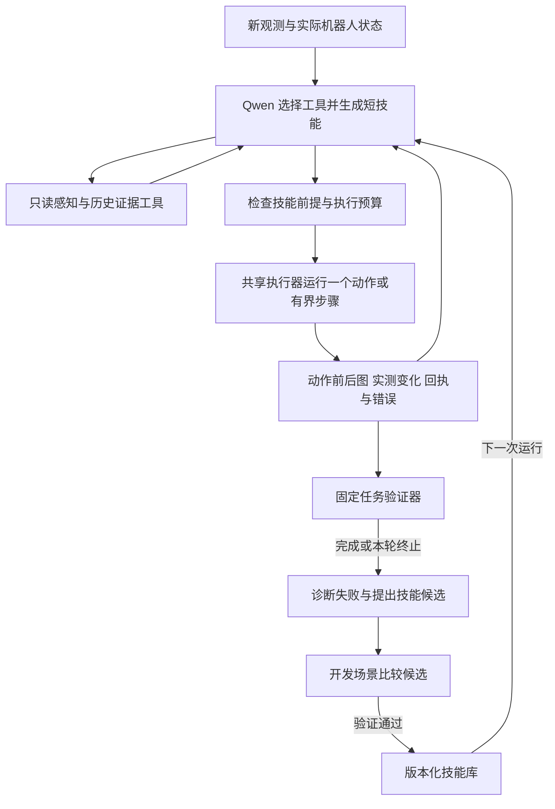

# Qwen3.8 按电梯按钮：机器人 Agent、程序技能与自主改进调研

日期：2026-11-02。本文按“Agent 如何控制机器人、诊断失败并积累技能”重新组织调研；几何控制、接触控制及 VLA 的补充背景见[前一份综述](qwen38_elevator_button_review_20261102.md)。本轮读取项目代码、已有实验与新增审计，并查阅论文原文、作者项目及官方仓库。没有运行机器人、调用本地模型、训练或修改控制代码。下述架构和实验均为建议。

## 1. 结论与阅读顺序

**建议以 CaP-X 的程序与工具接口为起点，借鉴 ASPIRE 的执行证据和技能验证，再研究 PhysicalRSI 的跨运行改进。** 当前项目已有工具调用、记忆和过程复核，下一步值得研究的是：Qwen 能否主动取得所需证据、组合带反馈的短程序、检验失败假设，并把验证有效的方法保留到下一次运行。

阅读顺序：**CaP-X → ASPIRE → PhysicalRSI → PhysRSI-eval → ENPIRE**。SPINE 另用于检查机器人接口、部署状态与故障修复是否可信。

先澄清名称：本次未核实到名为“NVIDIA SPINE”的对应工作。检索到的 **SPINE: Bridging the Cyber-Physical Gap with Agentic AI** 来自 Northwestern，研究部署排故；NVIDIA 的 **ASPIRE** 和 **ENPIRE** 更贴近自主编程和策略改进。另有 UPenn 的同名 SPINE，研究在线语义规划。不能把它们合为一个项目。[SPINE 作者页](https://magics-lab.github.io/SPINE-web/)、[NVIDIA ASPIRE](https://research.nvidia.com/labs/gear/aspire/)、[NVIDIA ENPIRE](https://research.nvidia.com/labs/gear/enpire/)。

| 工作 | 主要研究对象 | 对 PressButton 的具体价值 | 公开材料边界 |
|---|---|---|---|
| CaP-X，2026 | Agent 编写程序，组合感知和控制原语 | 有真实电梯按钮案例；可对照当前单步 XYZ 接口 | 有论文和代码，机器人适配仍需自己完成 |
| ASPIRE，2026 | 执行、诊断、修复、验证、积累技能 | 把下降出画、取景停滞变成可检验的失败模式 | 有代码及真机运行文档，依赖完整感知和控制基础设施 |
| PhysicalRSI，2026 项目/软件 | 固定基础模型，迭代改进可执行控制框架 | 区分本次任务执行和跨次技能改进 | 项目概念、当前通用核心、冻结 benchmark baseline 的能力不同 |
| PhysRSI-eval，2026 技术报告 | 如何测量 LLM-as-policy 的改进 | 检验改进来自工作区技能、历史、评分还是重试预算 | 主要是有限任务和预算下的评估，不能直接代表真机可靠性 |
| ENPIRE，2026 | 真机策略研究的自动实验循环 | 固定复位与评分，让研究 Agent 比较策略候选 | 需要可重复复位和可信 verifier |
| SPINE，2026，Northwestern | 建档、部署、诊断和修复验证 | 明确“发送完成/实测到位”和头部执行异常 | 作者页仍显示 Code coming soon，未核实可获取实现 |

## 2. 当前实验说明了哪些 Agent 问题

### 2.1 最新证据更新

当前审计记录的模型是 `Inferact/Qwen3.8-27B-NVFP4`，服务别名 `qwen38`。不应将其他工作里的 Qwen3.8-Max 或更大模型结果直接套到这个检查点。此前残差 RL 仿真结果也属于另一条路线，不能作为该 Agent 的真机成绩。[模型审计](../report/20261101_panel_shift_root_cause/model_research.md)。

| 已有记录 | 核实的现象 | 与 Agent 研究的关系 |
|---|---|---|
| `20261102_110447` 红标记 direct | 10 条完成的手部命令累计下降 155 mm；首次下降后按钮已从腕图上方退出，之后仍重复原判断 | 新证据没有有效推翻原假设；需要动作前后比较、预测误差和恢复逻辑。[报告](../report/20261102_red_marker_direct_descent/README.md) |
| `20261102_142505_13668097` 取景循环 | 本地记录 4 条完成；后续机器人端副本补证第 5 条也发送完成。目标 pitch 为 30、35、42、48、55°，相应动作后采图时实测约 25.11、28.82、34.23、40.33、47.88°。没有手部 XYZ、按压或撤回 | 不能继续沿用“第五条是否执行未知”的旧结论。发送完成与实测到位必须分开。[最新审计](../report/20261102_view_loop_audit/README.md) |
| 同一取景循环 | HEAD 必须同时完整定位按钮和精确物理指端，否则手部工具被移除；头图的小侧面标记持续识别不到，模型一直选择继续低头 | 放行条件缺少可达性和停滞判断；模型遵守规则也会陷入循环。不是仅靠强化提示词能诊断的问题 |
| 同一运行的输入审计 | 63 张归档编码图片与来源一致；观测更新、HEAD/WRIST 顺序正确。像素探针响应会随图改变，但仍漏认按钮/箭头 | “图送对了”和“感知正确”是两个命题；多个同模型角色不能提供独立真值。[探针](../report/20261102_view_loop_audit/pixel_probe/README.md) |
| 同一运行的执行与服务审计 | 头部目标在约 47–65 秒后仍未达到；最后服务返回 503：`dictionary changed size during iteration` | 需要把执行器异常和规划失败分开。fake 复现了任务快照竞态，很可能相关，但没有现场完整堆栈确认精确抛错位置；SDK 是否因控制组切换而不再保持头目标仍待验证 |

这些是对已有运行的新审计，不是新增真机试验。此次动作调用 5 次均首次合法；取景请求 7 次，其中 2 次结构修正。不能把这次循环归因于动作格式无限重试。

前次快照中的 17 份开发运行含 2 次 `model_reported_done`，但均缺少人工确认成功/撤回标签；条件和代码版本也不统一，不能计算统一成功率。键盘示范证明人工能按亮按钮，但其后撤步骤中断。当前首先需要统一“完成”的验收口径。[前次实验汇总](qwen38_elevator_button_review_20261102.md)。

### 2.2 当前 Agent 与文献系统的差距

| 能力 | 当前已有 | 值得研究的扩展 |
|---|---|---|
| 动作工具 | `propose_move/head/gripper`、`request_observation`、`report_done/unable`，每轮一条工具调用 | 带前后条件、终止条件和恢复分支的短技能；必要时允许受限程序组合工具 |
| 写程序 | Qwen 输出固定 schema，不能写文件、运行 Python 或修改策略 | 让模型生成可检查的技能程序或 DSL，并先验证其调用和预算 |
| 感知 | 宿主固定编排取景、定位、进展和前推检查，使用同一模型 | Agent 按需查询局部图、定位器、动作轨迹和几何工具；明确测量来源与不确定性 |
| 会话记忆 | direct 保留历史及压缩；grounded 使用短结构化记忆 | 按失败假设和动作证据检索，避免旧解释压过新画面 |
| 跨运行经验 | 人工指定成功示范和失败案例 | 自动提炼候选技能，经独立验证后版本化保存，并记录反例 |
| 过程恢复 | XYZ 进展复核、腕图前推检查、观点冲突恢复 | 覆盖 get_view 自身的停滞、信息增益与目标—实测偏差；没有分歧也能触发检查 |
| 完成验证 | grounded 检查亮灯、撤回记录及证据 ID | direct/separated 需要同等级程序验证；非空完成说明不等于完成证据 |
| 预算 | 外层默认 20 轮、请求超时、上下文压缩 | 增加内层修正、阶段耗时和相同失败的总预算；当前内层修正没有总次数上限 |

代码依据：[工具与解析器](../../src/pressb/agent_loop/client.py)、[固定编排与记忆压缩](../../src/pressb/agent_loop/conversation.py)、[XYZ 进展监测](../../src/pressb/agent_loop/progress.py)、[grounded 完成门槛](../../src/pressb/agent_loop/short_loop.py)、[示范选择](../../src/pressb/agent_loop/demonstration.py)、[状态与回执](../../src/pressb/agent_loop/model_context.py)、[运行入口](../../scripts/s1b_agent.py)。

仓库里由开发助手完成的修复，不属于机器人 Qwen Agent 自主学习。后续如研究 PhysicalRSI，必须记录究竟是谁修改了策略、修改依据是什么，以及修改后是否经过同条件验证。

## 3. 必读工作及如何读

### 3.1 CaP-X：最直接的控制接口参考，也有电梯按钮案例

**CaP-X: A Framework for Benchmarking and Improving Coding Agents for Robot Manipulation**，2026，arXiv v2 于 2026-07-02 更新。

[论文](https://arxiv.org/abs/2603.22435) · [全文](https://arxiv.org/html/2603.22435v2) · [项目](https://capgym.github.io/) · [代码](https://github.com/capgym/cap-x)

它把机器人环境暴露成可交互的 Python 执行环境，让 Agent 编写程序组合感知与控制原语，并利用执行反馈继续修改。重点读 §3.2 的多轮反馈层级、§4 的 CaP-Agent0，以及 Appendix B.3.6 和 Figure 16 的真机案例。CaP-RL 是后续训练分支，理解程序型 Agent 不需要先做 RL。

**直接相关的案例：让机器人乘电梯下楼。** 机器人相对墙面倾斜，Agent 获取分割后的墙面点云，用 RANSAC 平面拟合估计表面法向，再确定按压方向。这说明程序型 Agent 可以把“我需要知道沿哪个方向按”转成具体测量与计算。它是定性展示，论文没有单独给出随机化电梯按钮测试的成功率。[案例原文](https://arxiv.org/html/2603.22435v2)。

论文还比较了原始图像反馈与前后画面的结构化差异反馈；在其基准配置中，加入原始 RGB 并不总是改善表现，视觉差异模块能提供更有效的变化描述。对本项目，可检验“按钮从腕图退出”“实测头角没追到目标”等变化是否比持续堆叠历史图更有用。这不是所有任务都应去掉原图的结论，差异描述也需要验证。

实现入口优先看 [adding-apis.md](https://github.com/capgym/cap-x/blob/main/docs/adding-apis.md)：接口 docstring 进入 Agent 上下文，应该写清单位、坐标系和输入输出；工具日志记录文字与图像。可借此设计 S1B adapter，而不是直接拷贝已有机器人控制配置。

注意两个边界：原语背后已有感知、IK 和规划能力；CaP-Agent0 在论文中使用的技能库由一次合成流程建立，不能据此声称已经证明持续终身技能学习。其多样本推理也增加成本，应单独计入预算。

### 3.2 ASPIRE：最适合研究“失败如何变成可复用技能”

**ASPIRE: Agentic /Skills Discovery for Robotics**，2026，NVIDIA 等联合工作；arXiv v2 于 2026-10-20 更新。

[论文](https://arxiv.org/abs/2607.00272) · [全文](https://arxiv.org/html/2607.00272v2) · [官方项目](https://research.nvidia.com/labs/gear/aspire/) · [代码](https://github.com/NVlabs/ASPIRE)

重点读 §2 的三个部分：执行引擎、技能库、程序搜索。执行引擎提供原语级的前后图、参数、输出和状态，Agent 据此定位失败、修改程序并重新验证；验证有效的修复被提炼成技能，供之后任务使用。多分支搜索帮助跳出一条失败程序的局部修改路径。[方法原文](https://arxiv.org/html/2607.00272v2)。

与当前项目的对应非常具体：Agent 不仅看到“本轮失败”，还能查询“哪次下降后目标出画、实际下降多少、之前预测是什么”，再决定修复感知、动作假设还是停止条件。这里关键的是可以追溯到实际执行的证据，增加角色数量本身不能保证诊断正确。

建议结合三份官方实现文档阅读：

1. [Iterative-debugging workflow](https://github.com/NVlabs/ASPIRE/blob/main/.claude/skills/iterative-debugging/SKILL.md)：开发场景和保留评估集分开；修复应针对失败模式。技能提出后，由另一个验证者只拿技能说明、不给提出者代码，重新解决任务，通过后才保留。这里作为被研究的实现文档阅读，没有执行其工作流。
2. [System 2 operator runbook](https://github.com/NVlabs/ASPIRE/blob/main/docs/system2.md)：真机运行依赖硬件配置、标定、RGB-D、感知服务、IK/规划和统一执行线程。移植成本主要在这些接口。
3. [System 2 agent guide](https://github.com/NVlabs/ASPIRE/blob/main/docs/system2-agent-guide.md)：运行时发现能力、检查观测新鲜度，并在动作结束后读取新图和实际状态。缓存读取不能算新的物理观测。

本项目可先把现有 `observations/rounds/progress_review` 做成按命令 ID 查询的证据工具，再研究技能修复。技能应保存适用条件、方法、停止条件、反例和验证来源，避免把某次固定 XYZ 序列当作通用方法。官方当前文档也指出，部分新增文字技能来自示范提炼，尚未再次独立验证；不能把仓库里每条技能都视为已经验证。

模型能力仍是变量：官方展示包含 Qwen3.8-Max 等模型，并不等于当前 27B NVFP4 检查点有相同性能。可以先固定本地模型验证框架变化，再做模型对照。

### 3.3 PhysicalRSI：固定基础模型，改进可执行控制框架

**Physical RSI 1.0: Recursive Self-Harness for Scaling Embodied Skills**，2026 项目/软件发布。本次未核实独立论文；网址 `/v2/` 是项目网页版本，不应写成“论文 v2”。

[项目说明及结果](https://yanming03.github.io/PhysicalRSI/v2/) · [当前官方项目](https://mmlab.hk/research/PhysicalRSI) · [代码](https://github.com/PhysicalRSI/PhysicalRSI) · [软件引用信息](https://github.com/PhysicalRSI/PhysicalRSI/blob/main/CITATION.cff)

其方法可以理解为：固定基础模型 F，由模型根据执行轨迹改进控制框架 H；H 包含路由、技能、工具调用、状态管理和控制代码。提出多个候选、执行评估、选择保留，下一轮从保留版本继续。π0.5 等动作策略可以是可调用工具，代码技能也可以执行，因此它不等同于纯 VLA 训练。[方法页](https://yanming03.github.io/PhysicalRSI/v2/)。

对 PressButton，值得持久化的是“如何发现取景没有增加信息”“如何检验下降方向假设”“如何确认亮灯后撤回”这些方法。当前物体位置、机器人姿态和相机内容仍应重新观察。可以让 Agent 修改候选取景策略和短技能，但固定用于评价的成功定义。

**复现前必须区分三个发布层面：**

| 材料 | 已核实内容 | 不应推断 |
|---|---|---|
| 项目方法和演示 | 执行轨迹驱动的技能/控制框架改进、候选评估和继承 | 所有任务都有完整演化记录，或已经适配本机 |
| 当前 `main` v0.3.0 通用核心 | 技能描述、组合、环境适配、证据与研究循环；默认已实现的语言 proposer 修改声明空间中的 JSON 数值参数 | 默认 CLI 已经允许任意模型生成代码并在机器人上执行 |
| `benchmarks-and-demos` 分支 | RoboDojo 冻结 baseline，evaluation-only；包含注册技能组合和模型资产入口 | 下载即可复现完整递归改进历史；或通用技能无需任务几何假设 |

实现依据：[当前 README](https://github.com/PhysicalRSI/PhysicalRSI/blob/main/README.md)、[通用核心](https://github.com/PhysicalRSI/PhysicalRSI/blob/main/PhysicalRSI_core/README.md)、[baseline 说明](https://github.com/PhysicalRSI/PhysicalRSI/blob/benchmarks-and-demos/PhysicalRSI_baselines/README.md)、[冻结发布说明](https://github.com/PhysicalRSI/PhysicalRSI/blob/benchmarks-and-demos/PhysicalRSI_baselines/robodojo/releases/robodojo-v1/README.md)。

建议重点看[折衣服开发记录](https://yanming03.github.io/PhysicalRSI/v2/fold-clothes-evolution.json)：选出的三个版本在同一 40 场景队列为 1/40、16/40、26/40，修改涉及实际末端反馈、边缘表示、中途重新观察和接触前修正。作者数据同时说明场景未证明是未见测试、这是选中的开发点而非完整搜索历史，且多个变化没有隔离消融。这支持研究反馈程序的改进价值，不能独立证明递归机制的普遍因果收益。其仿真榜单及 `press_by_number` 也不能当成真实电梯按钮可靠性。

### 3.4 PhysRSI-eval：判断系统有没有真的“越做越好”

**Where is Physical RSI capability from? An Observational Scaling Law of LLM-as-policy**，2026-10-19 技术报告，提出 PhysRSI-eval；与上面的 PhysicalRSI 项目不是同一条文献。

[论文](https://arxiv.org/abs/2610.26848) · [全文](https://arxiv.org/html/2610.26848v1)

重点看 RoboDojo 仿真中的评估协议、消融和冻结工作区后的泛化实验。固定模型权重，允许代码、工具、技能和笔记跨回合保留；先执行并评分，再关闭动作执行并修改工作区。比较移除历史、移除评分反馈以及保留工作区等条件，有助于区分经验积累和简单增加尝试次数。

对本项目的直接启发是：技能库冻结后，要换初始姿态和面板位置再次测试；并比较完整历史、结构化技能和无跨运行记忆。主实验首次成功即停止，衡量“预算内曾经成功”和“冻结策略反复可靠成功”是不同问题。该研究的有限任务/相关样本不能当作普遍物理自主改进定律的确定证明。

### 3.5 ENPIRE：把真实实验组织成可重复的研究循环

**ENPIRE: Agentic Robot Policy Self-Improvement in the Real World**，2026，官方项目标注 CoRL 2026。

[论文](https://arxiv.org/abs/2606.19980) · [官方项目](https://research.nvidia.com/labs/gear/enpire/) · [代码](https://github.com/NVlabs/ENPIRE)

它组织环境复位、策略改进、机器人执行和实验结果积累，可改进代码策略或学习策略。与当前需求最相关的是外层研究 Agent：提出一个假设，修改候选，按固定协议执行，再决定保留或拒绝。[项目方法](https://research.nvidia.com/labs/gear/enpire/)。

优先读[autoresearch instruction](https://github.com/NVlabs/ENPIRE/blob/main/enpire/policy/autoresearch_instruction.md)：策略/训练代码可以调整，复位、reward/verifier、测试种子和记录格式固定；每次变化对应假设、diff、配置及结果。对 PressButton，可先在可复位实验面板上比较取景规则、证据组织和短技能。真实电梯按钮若不能及时恢复未亮状态，就不具备同等高吞吐自动实验条件。

官网 99% 的口径是 **pass@8**，允许每子任务最多 8 次基于反馈重试，不能解释为单次按压成功率 99%，也不能假定这些重试彼此独立。该方法更适合在执行、复位和评分可信之后采用。

### 3.6 SPINE：让部署与执行语义先可信

**SPINE: Bridging the Cyber-Physical Gap with Agentic AI**，Northwestern，2026；arXiv v2 于 2026-09-21 更新。

[论文](https://arxiv.org/abs/2607.13049) · [全文](https://arxiv.org/html/2607.13049v2) · [作者项目](https://magics-lab.github.io/SPINE-web/)

重点看 robot profile 和 debugger。前者整理接口、启动依赖、检查方法及来源；后者利用只读诊断角色排查，维护阻塞清单，并在修复后重新检查。最新干预之后，遥操作命令图和就绪检查必须在同一周期通过才能关闭问题；已解决经验引用通过记录，未解决诊断和失败尝试也保留。就绪结论只覆盖实际检查和观察窗口，排故成功率不能当作自主按按钮的成功率。[方法原文](https://arxiv.org/html/2607.13049v2)。

对本项目，可据此完善 S1B profile：坐标轴正方向、增量相对于上一命令目标还是实测状态、头部绝对角度、相机身份、控制模式、发送完成和实际到位的区别。最新头部欠跟踪和任务快照竞态应先有可重复诊断，再让策略 Agent 学习其动作效果。

开源边界：作者页仍显示 “Code (coming soon)”，未核实可获取实现。若用户指的是另一篇 **SPINE: Online Semantic Planning for Missions with Incomplete Natural Language Specifications in Unstructured Environments**，那是 UPenn 的 ICRA 2025 工作，重点是探索、语义地图和滚动规划，与本任务精细操作的关联较弱。[另一 SPINE 论文](https://arxiv.org/abs/2410.03035)、[作者项目](https://zacravichandran.github.io/SPINE/)。

### 3.7 两篇基础与一篇任务相近的补读

- **Code as Policies: Language Model Programs for Embodied Control**，2022 预印本：[论文](https://arxiv.org/abs/2209.07753)、[作者项目](https://code-as-policies.github.io/)。用程序表达条件、循环、计算和感知/控制调用，是理解 CaP-X 的基础。程序可以实现反馈控制，不必是一段固定轨迹。
- **Inner Monologue: Embodied Reasoning through Planning with Language Models**，2022：[论文](https://arxiv.org/abs/2207.05608)、[作者项目](https://inner-monologue.github.io/)。关注任务成功、场景变化等外部反馈怎样驱动重规划；内部推理长度和外部证据质量需要分开评价。
- **Robot Manipulation with GPT-6-Astra: Body Knowledge, Experience Reuse, Emergent Skills, and Sim2Real Transfer**，2026：[论文](https://arxiv.org/abs/2609.31770)、[材料](https://github.com/hesd10/astra-robot-sim2real)。有电梯按钮、机体知识、经验复用和短程序，适合对照现有示范包。真机样本小，成功按人工接触判定，未验证亮灯，不能直接支持本项目的完整成功要求。

## 4. 建议研究的 Agent 架构

以下是结合论文与本地证据提出的设计，不是已经实现或验证的结论。

### 第一步：让 Agent 可以查证，而不只是等待固定提示

最先扩展只读接口：按 `command_id` 读取动作前后原图、请求参数、实际位姿变化、目标残差、时间戳和错误；按 `observation_id` 查看局部裁剪与定位结果；返回结构化变化及其原始证据。现有归档已经提供了大部分原料。

`fit_panel_plane` 一类工具可作为后续能力，但必须先确认有效点云、坐标变换和接触点标定。当前点深度或图像框不等于已有可靠三维面板模型。Agent 的灵活性来自选择适用工具，也来自知道什么时候工具不能回答问题。

### 第二步：把重复阶段改为可检查的短技能

首先研究三个候选技能：

| 技能 | 应包含的条件和反馈 | 对应已有问题 |
|---|---|---|
| `acquire_view` | 区分头图全局可见与腕图局部细定位；检查实测头角、可见性变化、阶段预算；停滞时诊断或退出 | 取景条件过强、只反复增加 pitch |
| `align_with_feedback` | 动作前记录预期图像变化；动作后用新观测检验；目标出画或误差恶化时停止原假设 | 连续下降和重复原理由 |
| `press_verify_retreat` | 明确预接近条件、触发证据、退回条件及最终姿态；每个事件绑定观测 ID | 提前前推、模型自报成功与实际验收脱节 |

这些技能可以用受限 Python、DSL 或一组带状态的工具实现。需要检验的是条件、反馈和复用是否改善任务；开放任意 shell 权限并不是研究前提。程序中的循环仍需重新读取实际观测，不应把长串盲动作作为默认输出。

### 第三步：跨运行积累经过验证的方法

每个技能保存适用条件、版本、证据、成功与失败边界。候选修复例如“取景停滞后先检查实测角度，再判断是否换感知方式”，而不是“始终再低头 7°”。用开发场景验证，技能冻结后用未参与修改的布局评估；失败候选也保留假设和反例，避免反复尝试同一解释。

Agent 可以修改策略逻辑、候选技能和待比较的动作放行条件；评估用的亮灯/撤回定义、保留集和预算应固定。放宽过强的取景条件是合理策略候选，但不能同时降低最终验收标准，否则改善可能来自成功定义变化。若暂时没有独立自动 verifier，先保留人工标注，不把同模型复核当独立真值。

## 5. 最小对照实验：先证明 Agent 设计的贡献

先修复/验证执行与日志链路，统一 direct 和 grounded 的成功口径，再固定同一个 Qwen 检查点、初始条件集合和动作预算比较。代码生成可先用已保存失败案例和 fake 工具检查；离线结果只评价诊断、工具选择和程序合法性，真实动作效果需要另行验证。

| 条件 | 相对前一条件新增 | 回答的问题 |
|---|---|---|
| A | 冻结当前 direct 基线及版本 | 现有系统的可重复表现是什么 |
| B | 按需感知/证据查询、结构化执行反馈 | Agent 能查证是否优于只读固定上下文 |
| C | 有条件和停止分支的短程序/技能；无跨运行积累 | 程序表达与反馈是否有效 |
| D | 通过开发验证的跨运行技能库 | 改善是否来自可复用经验 |
| E | 自动提出控制框架候选，并按固定协议选择 | 在同等研究预算下，自主改进是否优于冻结版本 |

每一层尽量只增加一个能力，并记录额外模型调用。对 D/E 另做“只保留技能说明、去掉原始历史”和“冻结工作区后换新布局”测试；不把连续看过同一布局后的成功当作泛化。

至少报告以下指标：

- **首次尝试完整成功**：从明确的未触发初态开始，目标按钮被触发并完成撤回；按预先定义的证据判定。
- **预算内成功与重试次数**：和首次尝试分开；记录恢复动作、模型调用/token、墙钟时间与物理动作数。
- **阶段失败**：取景、定位、对齐、按压、验证、撤回分别统计；执行异常单列。
- **改进的可迁移性**：固定技能后换面板位置、初始偏差或视角；开发集与保留集分开报告。
- **诊断质量**：失败假设能否被新观测证实/否定，是否减少重复无效动作，而非仅生成更长解释。

这套评估更适合回答当前研究问题：**在固定 Qwen3.8 的条件下，增加工具、执行证据、反馈程序和经过验证的技能记忆，究竟能带来多大改善。** 在这些变量分清之后，再比较模型规模、量化或训练方法，会更容易解释结果。

