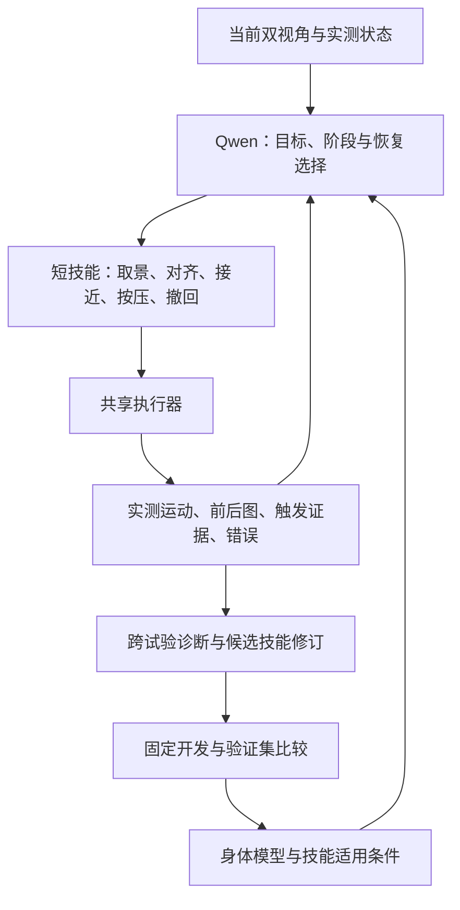

# 电梯按钮任务的 Robot Agent 调研：PhysicalRSI、ASPIRE、ENPIRE 与 SPINE

调研日期：2026-11-02，北京时间。范围：当前工作树、11月1–2日已归档实验、原始论文、作者项目页与公开代码。本文只新增调研文档，没有修改控制代码、启动机器人、请求新的 Qwen 推理或运行训练。下文“建议”均未由本次真机实验验证。

**推荐主线：用可验证的机器人技能与身体模型承接 Qwen 的决策，再用执行证据改进技能。优先读 ASPIRE、PhysicalRSI、KnowBody；用 GPT-Policy/AGP 设计直接 Agent 控制的对照，用 ENPIRE 设计重复实验。**

这里的 harness 指围绕模型的运行框架，包括工具、上下文、记忆、动作校验、执行反馈和恢复流程。当前项目已经在实现这一层；关键问题是怎样让它产生可测、可迁移的改进。

## 1. 先澄清名称与路线

| 名称 | 已核实归属与作用 | 本项目中的位置 |
|---|---|---|
| **Physical RSI 1.0** | MMLab / PhysicalRSI；System 2 根据执行经验改进 System 1 技能与 harness；有项目与软件发布 | 技能组织、跨试验修订与继承 |
| **ASPIRE** | NVIDIA 等；Agent 写控制程序，诊断、修复并积累技能 | 最接近“Agent 如何真正控制并改善机器人行为” |
| **ENPIRE** | NVIDIA、CMU、UC Berkeley；组织真实环境复位、执行、验证和策略改进 | 可重复的机器人自动实验 |
| **SPINE: Bridging the Cyber-Physical Gap with Agentic AI** | Northwestern University；建立平台档案，诊断并修复机器人部署问题 | 驱动、相机、网络、控制接口的诊断支持 |

因此，“NVIDIA SPINE”需要区分：已核实的这篇 SPINE 来自 Northwestern，NVIDIA 更相关的两项工作是 ASPIRE 和 ENPIRE。[SPINE 官方页](https://magics-lab.github.io/SPINE-web/)、[ASPIRE 官方页](https://research.nvidia.com/labs/gear/aspire/)、[ENPIRE 官方页](https://research.nvidia.com/labs/gear/enpire/)。

Physical RSI 也被其他团队用作研究方向名称。本报告以 [MMLab 的 Physical RSI 1.0](https://mmlab.hk/research/PhysicalRSI) 为主；[Kinex/STACX](https://stacx-lab.github.io/kinex/) 的同名实验与其不是同一项目，不合并结果。

## 2. 当前项目的实验告诉了我们什么

### 2.1 当前系统已具备的部分

当前真机路线是 **Qwen 工具调用 Agent**：成功键盘示范、头部/右腕图、实测状态和历史进入模型；模型调用 XYZ 平移、绝对头部角度、夹爪等工具。键盘和 Agent 共用 `CommandExecutor`。本地归档审计将 `qwen38` 对应到 `Inferact/Qwen3.8-27B-NVFP4`；这次没有重探测在线服务。[运行说明](../astribot/planar_control/agent_run.md)、[模型审计](../report/20261101_panel_shift_root_cause/model_research.md)。

`grounded` 已有独立定位、程序计算图像关系、阶段建议和短记忆；最新现场使用 `direct` 加取景、进展复核及前推检查。不能将整个项目描述为没有反馈。250 Hz 是底层发送/插值频率，外层模型闭环仍常为数十秒。[当前流程](../astribot/planar_control/agent_run.md)。

### 2.2 最有研究价值的失败证据

| 实验/审查 | 已有证据 | 对 Agent 设计的含义 |
|---|---|---|
| 成功键盘示范 `20261101_182424_352b5047` | 第10步按下亮灯由用户确认；第11步撤回中断 | 硬件构型能完成按压，但示范不提供完整撤回成功样本。[证据](../report/20261101_panel_shift_visual_action_mismatch/README.md) |
| 面板偏移后的动作异常 | 前10步主要命令与示范一致；同图独立判读能识别偏移，完整动作会话却仍前推；加入独立事实后某次建议改为右移 | 需要把示范变成带适用条件的经验，并允许新证据推翻历史判断。对照仅9次请求、每条件一次、没有执行建议。[报告](../report/20261101_panel_shift_visual_action_mismatch/README.md) |
| 红标记 direct `20261102_110447` | 10次已完成手移累计下降155 mm；按钮退出腕图后仍重复“下降使按钮进入视野” | 缺少可靠的动作效果模型，以及对无效策略的修订。[报告及原始 audit](../report/20261102_red_marker_direct_descent/README.md) |
| `20261102_000527` 后段 | 已能右上纠偏，随后又提前前推；第10–14轮累计前推50 mm | “对齐”“接近”“按压”需要各自物理条件；动作理由不能代替这些条件。[报告](../report/20261102_live_alignment_progress/premature_press/README.md) |
| 最新 `20261102_142505_13668097` | 始终 get_view；头部目标30→35→42→48→55°，无手部XYZ。头图无法精确辨认小标记指端，所有手部工具被移除；head/get_view没有相应进展监测 | 前置条件需要可达性、视角分工、失败出口和替代策略。增加判读层也可能形成新的停滞循环。[最新审查](../report/20261102_view_loop_audit/README.md) |
| 同一次运行的执行问题 | 实测头角长期欠跟踪；最后HTTP503 `dictionary changed size during iteration` | 必须区分控制器、通信和决策失败，才能给外层改进可靠反馈。[执行与竞态审查](../report/20261102_view_loop_audit/README.md) |

最新审查更新了此前综述中的一处计数：客户端只保存4条完成记录；后续只读取回的机器人端归档确认第5条55°也已发送完成。应同时保留两个来源，不能把客户端报错等同为动作未发生。头部控制组切换是欠跟踪的待验证解释，现有 fake 只证明调用顺序，不能证明 SDK 的物理行为。

当前源码也支持这些诊断：`view_acquisition.py` 要求头图完整定位按钮与接触端；`progress.py` 的平移进展比较不覆盖头部动作；`service.py` 的任务快照读取与部分写入没有一致的锁保护。具体对应关系见[审查报告](../report/20261102_view_loop_audit/README.md)。本文不实施修复。

### 2.3 目前还不能报告的结果

查到的17份11月1–2日 Agent 结果，包含9次人工停止、2次模型自报完成、5次错误、1次轮数耗尽。两次自报完成的人工成功/撤回字段均为 null。这些是不同版本、配置和初态的开发记录，不能当作统一成功率，也不能把所有未确认结果判成失败。

仿真 VLA/残差 RL 是另一条路线。已有34/40的残差验证可用于后续低层技能研究，但不属于当前 Qwen 真机 Agent 的成功率。[仿真报告](../astribot_rl/xyz010_raw_command_100k.md)。

## 3. 优先阅读的工作

### 3.1 ASPIRE — 最优先的 Agent 控制与技能迭代参考

**Lu et al., ASPIRE: Agentic /Skills Discovery for Robotics.** 2026预印本；本次核查 v2，2026-10-20。

[论文](https://arxiv.org/html/2607.00272v2)、[官方项目](https://research.nvidia.com/labs/gear/aspire/)、[公开代码](https://github.com/NVlabs/ASPIRE)。

核心是执行引擎、可复用技能库和程序搜索：Agent 查看各个感知、规划、控制调用的记录，诊断故障，修订程序，由独立 verifier 再次执行并验证修复后纳入技能库。优先读 §2.1–2.3 和 Appendix D 的真机接口。

**项目借鉴：** 将一次失败定位为“按钮定位错”“指端身份错”“命令没到位”“动作效果反向”“成功误判”等具体事件；技能保存适用条件、失败特征、修复方式和验证记录。不要把整段旧会话原样继承为下一次的行动依据。

特别有用的代码入口：[API reference](https://github.com/NVlabs/ASPIRE/blob/main/docs/api-reference.md)、[System 2](https://github.com/NVlabs/ASPIRE/blob/main/docs/system2.md)、[运行产物](https://github.com/NVlabs/ASPIRE/blob/main/docs/run-artifacts.md)。可借鉴实测终态、图像、时效性与错误诊断的返回格式，仍需适配 Astribot。

与 Qwen 有关的直接证据：v2 Table 18 的 **Qwen 3.8 Max 为56.0%**，条件是10个 LIBERO-Pro Goal任务的位置扰动设置、各50个留出种子、初始空技能库、迭代调试、不含进化搜索。它是特定仿真与不同模型的结果，不是当前27B配置的效果。[原表](https://arxiv.org/html/2607.00272v2#A5.T18)。

### 3.2 Physical RSI 1.0 — 怎样把失败变成下一版技能

**MMLab & PhysicalRSI contributors, Physical RSI 1.0: Recursive Self-Harness for Scaling Embodied Skills.** 2026项目与软件；本次未核实独立 arXiv 论文。

[正式项目](https://mmlab.hk/research/PhysicalRSI)、[方法展示页](https://yanming03.github.io/PhysicalRSI/v2/)、[代码](https://github.com/PhysicalRSI/PhysicalRSI)。

研究机制是固定基础模型，在外部 harness 中修改表示、状态、计划或控制结构；候选经过比较评估，优胜版本进入后续轮次。官网的插入技能分 approach、align、insert、micro-adjust、settle、retract，与本任务的分阶段接触很接近。其展示主要来自 RoboDojo，不能视为电梯真机验证。

**开源状态需要按版本读：** 本次 GitHub 直接读取的 main 已标为 **Core release / v0.3.0**，不是搜索缓存里的旧 preview。核心是有类型的技能描述、组合、环境适配、证据与版本继承。基准及演示放在 `benchmarks-and-demos` 分支。当前内置语言 proposer 是声明参数空间内的 JSON 数值变更；不能把这个发布直接说成已包含任意控制源码自动重写。网站方法愿景、软件核心和已复现机器人能力要分开。[核查版本 README](https://github.com/PhysicalRSI/PhysicalRSI/blob/2574f72bebf9b357140ebe376db71e782575fe65/README.md)。

核查版本为 `2574f72`，提交时间为北京时间2026-11-02 03:07；这不是v0.3.0的发布日期。该版本设计文档仍列出部分基线使用整体式控制器、固定几何或oracle终止等待迁移项。复现时应检查具体adapter的观测与评分边界。[技能设计及已知问题](https://github.com/PhysicalRSI/PhysicalRSI/blob/2574f72bebf9b357140ebe376db71e782575fe65/docs/skill-design.md)。

**项目借鉴：** 先将 `get_view`、`align`、`press`、`verify` 变成可单独评测的技能；每次改动给出假设、父版本、验证场景和退化结果。现有原始图像、动作、实测状态和观测ID已经是很好的输入。

### 3.3 KnowBody — 与当前动作方向和接触点问题最贴近

**Lou et al., Know Your Body: A Harness for Direct and Self-Improving Robot Control with VLMs.** 2026-09-22预印本。

[论文](https://arxiv.org/abs/2609.28530)、[项目](https://loule0-0.github.io/KnowBody/)、[代码状态](https://github.com/Loule0-0/KnowBody)。

它给冻结VLM一个可查询、可修订的部分身体模型：实际运动如何改变腕图；控制末端坐标怎样对应真正作用的工具尖端；目标是否有连续整臂路径。身体估计更新后，依赖旧估计的知识需要重新检查。

**项目借鉴：** 为头相机、腕相机分别保存运动效果；区分贴纸、被指向的物理指端、SDK末端坐标。记录适用头姿、夹爪构型、深度范围和估计置信度，避免把一次观察得到的正负号推广到所有构型。

四类真机任务的固定初始化对照为12/16成功，对照组4/16；两组共32次。跨回合持续更新是另一项实验，不能混为一个成功率。官方仓库目前说明源码、提示词与复现材料仍待批准发布，适合先读方法，不宜安排为立即可运行的基线。[项目实验与方法](https://loule0-0.github.io/KnowBody/)。

### 3.4 GPT-Policy 与 AGP — 保留直接 Agent 控制的两种参考

**Cheng et al., In-Context Robot Learning with VLM Agents（GPT-Policy）.** 2026-09-16预印本。

[论文](https://arxiv.org/html/2609.19138v1)、[代码](https://github.com/cheng-haha/GPT-Policy)。

固定VLM通过 context compiler 使用示范、目标图、历史和动作参考，输出结构化工具请求；执行器返回实际结果。优先读 §3 的上下文构造和 §4.3 的视觉示范/动作参考消融。

**项目借鉴：** 示范应保留“什么条件下做了哪个动作，真实产生了什么变化”，并按当前阶段选取相关片段。现有最后三步成功示范可以作为一个条件，与完整阶段摘要、动作前后配对参考做比较。

公开实现有 ARX X5、YAM 和可选 RoboDojo 后端，但迁移到S1B仍需接口适配。论文v1与当前README中的部分真机数字不同，本文不拼接这些成功率；使用实验数字前应固定论文/代码版本。[发布范围](https://github.com/cheng-haha/GPT-Policy/blob/main/README.md)。

**Jia et al., Agent as Policy for Robotic Manipulation（AGP）.** 2026-09，论文v3。

[论文](https://arxiv.org/abs/2609.12541)、[项目与逐次结果](https://agent-as-policy-2026.github.io/results.html)、[代码](https://github.com/agent-as-policy-2026/agent-as-policy)。

Agent 在运行中观察、写程序、执行、验证，并复用保存的程序和步骤。它比仅允许一次XYZ工具调用的接口提供了更丰富的计算和行为组合能力。适合研究“Qwen生成短程序/调用技能”相对“Qwen逐轮生成位移”的收益。

其真实任务包括装配、搭积木、翻骰子、抛掷和折毛巾；论文报告8种配置中的7种至少80%，但任务耗时较长、试次数有限，不能外推到按钮或当前Qwen。公开代码还包含标定和独立硬件桥接，说明身体接口仍是方法的重要组成。[官方方法与边界](https://agent-as-policy-2026.github.io/)。

### 3.5 ENPIRE — 让改进过程成为可重复的真实实验

**Xiao et al., ENPIRE: Agentic Robot Policy Self-Improvement in the Real World.** CoRL 2026；本次参考v2。

[论文](https://arxiv.org/html/2606.19980v2)、[官方项目](https://research.nvidia.com/labs/gear/enpire/)、[代码](https://github.com/NVlabs/ENPIRE)。

重点是先建立可重复的 reset、执行、验证、记录接口，再由研究Agent改程序、策略或训练方式。改进对象可包含规则、工具调用、BC和RL。优先读 §2 与 Appendix A。

**项目借鉴：** 给同一按键环境固定初态分布、成功判据、重试预算和日志格式；Agent 可以提出“怎样按”，评分定义保持固定。按钮侧信号或人工复核可以先承担验证，尚未自动化的复位要如实计入人工工作。

官网的99%是 **pass@8**：同一长任务中每个子任务最多8次、依赖之前失败反馈的重试。它既不是一次尝试99%，也不是8个独立样本取最好。对本项目应分别报首次成功与限定重试后成功。[官方口径](https://research.nvidia.com/labs/gear/enpire/)。

### 3.6 SPINE — 适合处理平台和执行故障

**Ham et al., SPINE: Bridging the Cyber-Physical Gap with Agentic AI.** Northwestern，2026预印本；本次参考v2。

[论文](https://arxiv.org/html/2607.13049v2)、[官方项目](https://magics-lab.github.io/SPINE-web/)。

它建立机器人profile，让诊断Agent整理问题、修复软件/配置、请求必要的物理操作，再同时验证运行流水线和就绪检查。实验针对两种双臂平台上的12类植入故障，主要目标是恢复遥操作；官方代码仍标 coming soon。

**项目借鉴：** 把坐标/单位、头部绝对角语义、相机安装关系、SDK路径、命令完成与实测到位的差别写成平台档案；把HTTP503、采图失败、欠跟踪分别返回，避免全部解释成Qwen规划失败。

其 OSS 指“解决的故障占比”，不是机器人自主操作成功率；统计耗时也不包括预先构建profile。这里最值得学的是诊断与验收流程。[方法和实验](https://arxiv.org/html/2607.13049v2)。

## 4. 第二批阅读：把自改进做成可评价的研究

| 工作 | 优先阅读内容 | 对本项目的价值与边界 |
|---|---|---|
| **PhysEvo: Astra Can Act, Let It**，2026-10-06。[论文](https://arxiv.org/html/2610.08995v1) | §3、§4.2、附录F | 同一冻结模型的执行Agent与改进Agent使用不同上下文/工具；可复用诊断工具。适合处理当前“失败归因与运动决策混在一起”。真机84%来自5任务×5次且继续了真机修订，不是零适配迁移；未核实作者公开实现。 |
| **SERA: From VLM Planners to Robotic Agents: Self-Evolving Harnesses for History-Dependent Manipulation**，2026-10-21。[论文](https://arxiv.org/html/2610.29560v1)、[代码](https://github.com/StevenKKXS/SERA) | §3.2–3.3、Appendix B | 围绕固定VLA执行器更新记忆、判据和控制规则，选定harness后冻结做留出测试。RoboMME为44.38%→51.38%，16任务×50次；适合未来接已有VLA，不能当真机证据。 |
| **Where is Physical RSI capability from? An Observational Scaling Law of LLM-as-policy**，2026-10-19。[论文](https://arxiv.org/html/2610.26848v1) | §3、§6、§7 | PhysRSI-eval分开评估初始能力、改进速度、成绩、物理预算和失败恢复；18仿真任务、最多17轮、首次成功即停，另测冻结工作区的新布局。尤其适合设计本项目评估。能力相关性是探索性观察，不能据此断言Qwen的上限。 |
| **RegenHarness: A Robot Agent Harness with Evidence-Gated Recursive Self-Improvement**，2026-09。[论文](https://arxiv.org/html/2609.27612v1) | 证据、进展、验证和恢复机制 | 对“模型完成声明、控制结束、任务成功”做分离。主要证据来自四足巡检，适合借鉴协议，不能提供指端精定位方案。 |
| **Code as Policies: Language Model Programs for Embodied Control**，2022预印本。[论文](https://arxiv.org/abs/2209.07753)、[项目](https://code-as-policies.github.io/) | 程序表达反应式策略与组合API | 是理解ASPIRE的基础：用变量、计算和循环表达策略，感知与控制API的质量仍需保证。 |

如果主要兴趣是纯Agent路线，先读上述工作即可。ReKep、视觉伺服、HAMSTER、残差RL等仍有价值，可作为技能内部实现的补充；已有[较广综述](qwen38_elevator_button_review_20261102.md)保留了这些方向。

## 5. 对当前项目建议怎样组织 Agent

以下是结合项目证据和文献提出的设计，不是文献已验证的S1B方案。

### 5.1 让工具返回足够判断下一步的结果

保留现有执行器和观测ID；在技能层区分：请求被接受、命令发送结束、实测到位、视觉关系改善、接触、按钮触发、撤回。它们可以部分已知、部分未知，不能由一个 `completed` 覆盖。

建议的技能接口（名称是设计示例，尚未实现）：

| 技能 | 输入/前提 | 应返回的结果 |
|---|---|---|
| `acquire_view` | 当前目标与相机状态 | 哪个视角提供了哪种信息；是否新增有效信息；角度是否实测改变；若停滞则给原因 |
| `align_contact` | 指定物理接触点、目标区域、当前适用的运动效果模型 | 前后误差、实测动作、预期与实际效果是否一致；不可判断时保留unknown |
| `approach` | 当前切向对齐与接近依据 | 实际接近程度、可见性变化、执行异常 |
| `press` | 接触方案与终止条件 | 运动、接触及触发证据分别记录 |
| `verify_activation` | 本次动作前后证据 | true/false/unknown及证据来源，区分旧亮灯与本次触发 |
| `withdraw` | 当前接触状态与撤离目标 | 实测后撤和可观察的脱离证据 |

头图承担目标/手部全局关系，腕图承担局部细节；所需精度随技能变化。`get_view` 应评价信息是否增加，并有其他观察方案或明确失败返回。当前正X guard只检查腕图横向条件，其通过不能升级为三维对齐证明。这是现有文档记录的此前选定检查范围；本节讨论新技能的研究方案，不改变当前放行规则。

### 5.2 保留两种值得比较的 Agent 控制方式

**直接决策增强：** Qwen仍选每次小动作，但输入可查询身体模型、绑定观测的当前事实和实测动作效果；比较它是否能纠正符号与方向错误。这最接近当前direct路线和KnowBody/GPT-Policy。

**程序与技能控制：** Qwen生成或选择短程序，程序中包含观察、误差计算、动作、效果检验；重复性高的局部环节复用已验证技能，Qwen处理阶段与异常。这更接近ASPIRE/AGP。技能可以由几何控制、短程序或学习策略实现，Agent方法本身不规定必须训练VLA。

两者都值得实验。现有失败不足以证明Qwen一定不能直接控制，也不足以证明更换大模型就能解决；应固定接口和预算做比较。

### 5.3 把自改进放在可审查的试验循环中

一次候选修订应包含：失败假设、修改的技能/参数、适用条件、对照结果、退化案例和版本。评分器、原始日志和留出测试定义保持固定。初期可只让Agent提出参数/技能组合候选，再逐步研究程序修订。

当前最有价值的持久知识例子是“此构型下下降导致按钮向腕图上方移动”“这条头部命令发送结束后仍存在实测误差”“此灯态不能证明本次触发”。知识应带来源、范围和失效条件，避免保存未经验证的理由。

模型自己看图给出的复核仍是估计。本项目已经出现复核误判，不能把多个同模型角色的共识当独立真值。用于接受新技能的反馈应尽量包含实测几何、按钮侧信号或人工复核。

## 6. 建议的下一轮实验顺序

### 第一步：先把归因分开

优先处理任务状态503与头部目标/实测不一致，复核取景前置条件与停滞退出。否则上层Agent的失败数据会混入工具问题。保留原有“发送完成”定义，同时新增实测响应信息；不要靠重发动作补齐丢失的结果。

### 第二步：建立固定的离线诊断集

从现有会话整理四类样本：目标/接触点不可见、图像相对位置、动作效果、触发/撤回判断。标签分人工、传感测量、模型估计；按完整会话与面板条件划分开发和留出集，避免相邻帧泄漏。

先比较：当前Qwen、同模型加入结构化身体/效果信息、同模型改变示范编译方式；如有预算，再用较强模型作同接口诊断上界。离线只能评价识别、阶段与动作建议，不能证明新动作的物理效果。

### 第三步：运行小规模、预先固定的物理对照

| 条件 | 固定部分 | 改变部分 | 回答的问题 |
|---|---|---|---|
| A 当前基线 | 初态分布、模型配置、底层动作原语与执行器、成功定义 | 无 | 可靠基线究竟是多少？ |
| B 身体/动作效果模型 | 同A | 显式作用点、坐标与局部运动效果 | 方向错误是否来自身体关系缺失？ |
| C 短技能 | 同B | 对齐/按压等可验证短技能 | 技能执行是否改善精度与时延？ |
| D 跨试验改进 | 同C | 允许从开发失败生成并筛选技能候选 | 改进是否能在冻结后的新初态重复出现？ |

可先用4类面板/初态条件、每类5次作为每组20次的探索性设计；根据现场成本缩减组数，报告原始计数和不确定性。测试场景与改技能用的场景分开，组间顺序交错，记录复位与环境变化。一次成功不作为技能稳定的充分证据。

所有组应记录：首次成功、限定重试成功、误触/误按、模型误报成功、人工接管、时间、模型调用数与token、物理动作数、复位成本。主终点是“本次目标按钮触发且撤回”；另外保留取景成功、对齐、接触等中间事件。

### 第四步：验证经验是否真的能复用

对同一技能库做“清空记忆”“保留记忆但冻结修订”“新位置/新头姿”“新按钮外观”对照。身体模型的使用范围发生变化时重新核对。只有冻结技能后在留出条件下仍改善，才支持从一次调试进展到可迁移能力的结论。

## 7. 建议阅读顺序与预期产物

1. **ASPIRE 方法与 Appendix D**：产出本项目的技能调用、执行反馈、失败定位规范。
2. **PhysicalRSI 方法与当前核心 README**：产出技能定义、候选版本、比较评估和继承流程。
3. **KnowBody**：产出相机/控制坐标/物理接触点之间的可查询身体关系表。
4. **GPT-Policy + AGP**：产出直接位移工具与短程序/技能工具两种对照方案。
5. **ENPIRE + PhysRSI-eval**：产出复位、固定评分、重试预算和留出评估方案。
6. **SPINE**：产出S1B平台档案与故障分类；需要接已有VLA时再深入SERA。

对当前项目最具体的研究问题可以表述为：**在冻结Qwen参数的条件下，结构化身体知识、可验证技能和基于执行证据的harness修订，分别能在多大程度上提高接触任务的首次成功率、恢复能力与新初态泛化？** 现有失败归档能够支持提出假设；真正的研究证据需要固定协议下的对照与留出测试。
