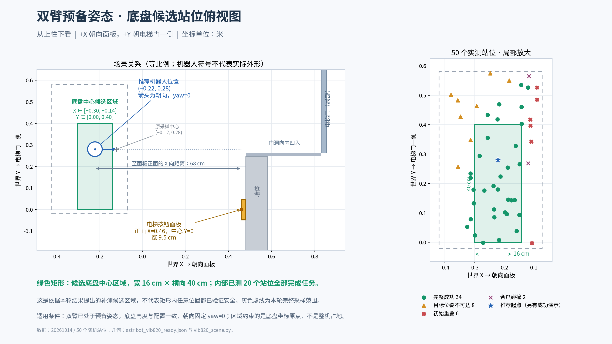

# VIB-820 后续实验基准规格

版本：v1.3。生效日期：2026-10-14（北京时间）。

用户已确定：后续 VIB-820 按钮实验采用本文的底盘位置范围、独立随机yaw 0–10°、双臂预备姿态、头部全程低头30°及全部相机，其中左右腕部相机和头部单目相机为必需视角。本文作为该实验设置的维护入口；历史验证计划和旧批次保留原始定义，不随本文修改。

当前规格的结构化记录见 [`experiment_v1_3.json`](experiment_v1_3.json)。它记录采样范围、执行参数与证据，不是执行脚本直接读取的物理配置；运行命令见第5节。历史 [`config_v1_2.json`](config_v1_2.json) 保留为姿态/物理基础配置，随机范围由批次参数显式指定。

## 1. 底盘位置、yaw和坐标约定

所有坐标均使用仿真世界坐标系，长度单位为米。+X 朝向面板，+Y 朝电梯门一侧。

| 项目 | 固定规格 |
| --- | --- |
| 底盘 X 范围 | **[-0.30, -0.14] m**，包含边界 |
| 底盘 Y 范围 | **[0.00, 0.40] m**，包含边界 |
| 区域尺寸 | X 向 16 cm × Y 向 40 cm |
| 零yaw固定站位对照 | **X=-0.22 m，Y=0.28 m，yaw=0°**；保留历史基准 |
| 随机底盘yaw范围 | **[0,10]° = [0,π/18] rad ≈ [0,0.1745329252] rad**；正向单侧偏移，不是±10° |
| yaw零位与正方向 | 零位朝向世界+X；绕世界+Z按右手规则旋转，正角度由+X偏向+Y |
| yaw参考与采样 | 相对原始0°朝向的绝对根节点角度；与X、Y独立均匀采样，不累加到上一回合 |
| 底盘高度 | 沿用资产 `base_lift_m`，本轮记录约 0.102 m；不随机改变高度 |
| 回合内底盘 | 平移、yaw及高度全程固定；仅在回合初始化时改变站位/朝向 |

这里的“底盘位置/中心”指配置中的 `robot_base_x`、`robot_base_y`，对应 `/World/Astribot` 根节点的世界平移及固定关节锚点。根节点与实际 `base_link` 存在固定变换，不能把这组坐标直接替换成其他坐标系的底盘中心坐标；矩形也不表示机器人整机占地边界。

原采样参考点为 `(-0.12, 0.28) m`。相对该点，当前范围等价于 **ΔX∈[-0.18,-0.02] m、ΔY∈[-0.28,+0.12] m**。默认站位 `(-0.22,0.28)` 不等于区域的几何中心 `(-0.22,0.20)`。

配置中的`robot_base_yaw_rad`使用弧度，批次参数`--yaw-deg 0 10`使用度。根节点旋转和世界侧固定关节方向必须一致；IK采用完整世界到根坐标变换，按钮位置及接近方向保持世界场景定义。不能只旋转显示模型，或将角度直接作为弧度写入配置。范围上限10°不是已证明的安全阈值；边界和失败组合见第6节。

以下俯视图保留位置区域和零yaw参考示意，不表示本版每个样本都朝向+X。



面板正面为 X=0.46 m，中心 Y=0，宽 0.095 m；安装墙面 X=0.48 m。当前底盘范围到面板正面的 **X 向距离为 0.60–0.76 m**，默认站位为 0.68 m。这是根节点到面板平面的坐标差，不是夹爪或机器人外壳的净空。

## 2. 双臂预备姿态与头部俯仰

本规格的可执行配置使用 [`config_v1_2.json`](config_v1_2.json)，与本次已通过完整按压验证的配置一致；它在双臂预备姿态配置基础上增加 `head_pitch_deg=30.0`。直接从双臂已抬起的预备姿态初始化，**不包含从下垂姿态抬臂的动作**。随机回合按预定清单覆盖 `robot_base_x`、`robot_base_y` 和 `robot_base_yaw_rad`；除这三项外保持基础配置。

关节值单位为 rad，必须按名称赋值，不能依赖仿真内部关节排列顺序。

| 序号 | 左臂 `astribot_arm_left_joint_N` | 右臂 `astribot_arm_right_joint_N` |
| --- | ---: | ---: |
| 1 | -0.4 | +0.4 |
| 2 | -0.7 | -0.7 |
| 3 | -1.0 | +1.0 |
| 4 | +1.4 | +1.4 |
| 5 | -0.9 | +0.9 |
| 6 | 0.0 | 0.0 |
| 7 | 0.0 | 0.0 |

头部通过 `astribot_head_joint_2` 设置 **+30°（π/6 rad）**，正方向为低头；`astribot_head_joint_1=0`。从初始预备姿态到按压、撤回、归位和重置检查，始终保持该目标，不包含从0°逐渐低头的过渡动作。此处30°指头部俯仰关节角度，镜头相对头部链接的挂载外参与视场沿用现有定义。执行入口会检查角度是否有限且位于 URDF 限位内，运行与独立审计检查头部相对该目标的保持误差。

其余未指定关节的初始目标为0，初始关节速度为0；随后由原流程合拢右夹爪。不要直接以已合爪状态替代该步骤。姿态来源详见 [双臂初始姿态说明](../astribot_initial_pose.md)。

`return_to_initial_pose=true`。回合流程保持为：预检查 → 预备姿态保持 → 右夹爪合拢 → 移到工作位姿并稳定保持 → 接近与按压 → 释放、撤回 → 返回工作位姿 → 返回双臂预备姿态 → 复位与审计。左臂及躯干保持既定姿态，头部保持低头30°。

## 3. 物理与控制基准

| 参数 | 基准值 |
| --- | --- |
| 场景 | `scene_type=vib820`，下行呼梯按钮，`sequence=[0]` |
| 物理步进 | `physics_hz=120` |
| 图像采集频率 | `capture_hz=30`，录像按实验需要启用 |
| 头部俯仰 | `head_pitch_deg=30.0`，全程固定低头 |
| 关节速度 | `joint_speed=0.4` rad/s |
| 按压速度 | `press_speed_m_s=0.012` m/s |
| 接近距离 | `approach_distance=0.065` m |
| 指令按压深度 | `press_depth=0.0018` m |
| 按钮最大行程 | `button_travel=0.002` m |
| 按压判据 | 同一物理步行程 ≥0.001 m 且指定接触力 >0.02 N |
| 释放阈值 | `release_threshold=0.0003` m |
| 按钮弹簧 / 阻尼配置值 | `button_stiffness=300.0`，`button_damping=3.0` |
| 工作位姿末端目标 | `home_tip=[0.28,0.0,1.2]`，世界坐标，单位 m |

其余几何、碰撞过滤、禁止接触判据、稳定保持与返回判据沿用基础配置及现有执行/独立审计脚本。后续对比实验默认固定这些条件；如需研究某个参数，记录其变更及对照，不把变更后的结果混入原基准统计。

启动成功与完整回合成功分别报告：启动须完成预检查、预备保持、合爪、工作位姿移动及稳定保持，右臂工作位姿关节误差 <0.025 rad，且此前无禁止碰撞；完整成功还须完成按压、释放、返回工作位姿、返回预备姿态、复位及独立审计。缺失证据不算成功。

## 4. 全部相机与采集规格

后续实验必须启用当前场景的全部 **7 路相机**，特别是 **左腕 `wrist_left`、右腕 `wrist_right`、头部单目 RGB `head`**；不能只使用外部总览或面板相机。相机集合如下：

| 类型 | 流名称 | 安装位置 / 用途 | 当前输出分辨率 |
| --- | --- | --- | --- |
| 机器人相机（必需） | `head` | `astribot_head_link_2`；低头30°的头部单目 RGB 视角 | 1280×720 |
| 机器人相机（必需） | `wrist_left` | `astribot_gripper_left_base`；左腕随动视角 | 640×480 |
| 机器人相机（必需） | `wrist_right` | `astribot_gripper_right_base`；右腕随动视角 | 640×480 |
| 场景相机 | `overview` | 场景总览 | 960×600 |
| 场景相机 | `panel` | 面板观察 | 640×480 |
| 场景相机 | `front` | 正面观察 | 640×480 |
| 场景相机 | `lobby` | 电梯厅观察 | 640×480 |

机器人相机挂载与成像参数以 [`configs/astribot_sensors.json`](../../configs/astribot_sensors.json) 为准。左右腕部使用已修正的挂载外参，随各自夹爪基座运动，不得退回早期自定义安装位置；头部采用已有的单路 RGB 视角。核对记录见 [左右腕相机安装核对](../astribot_wrist_camera_audit.md) 和 [相机清单](../astribot_camera_inventory.md)。

此处“全部”指当前仿真中已实现的 7 路。头部独立 RGB 双目左右视点及胸部 RGB-D 尚未接入，不计入这 7 路；不能把现有 `head` 单目流标为双目，也不能将七路录像描述为实机全部传感器覆盖。将来新增相机时同步更新本节及必需流清单。

官方 `aos` 分支另有 `torso_rgbd` 与头部双目节点声明，尚未接入本实验；其传感器支持状态及躯干相机朝向问题见[腰部 / 躯干相机定义检索](torso_camera_definition_20261014.md)。该检索中的 v1.1 状态属于历史记录；v1.2及当前v1.3沿用同一相机集合。

按压实验使用 **120 Hz 物理步进、30 Hz 同步 RGB 采集**。传感器通用配置中的 `capture_hz=10` 属于完整传感器接口默认值，不取代本实验按压配置中的 30 Hz。七路 RGB 不代表已经采集深度或 IR；这些通道如在后续实验启用，另行记录其类型和频率。

启用方式与记录要求：

- 单回合入口 [`run_astribot_press.py`](../../scripts/run_astribot_press.py) 必须传入 `--all-cameras`；需要连续录像时再加 `--video`。关闭视频编码不等于禁用头部或腕部相机，阶段快照仍须覆盖全部相机。
- 录像保存七路独立原始视频及 `camera_timing.json`；拼接视频仅用于浏览，不能替代各路原始记录。记录每路帧数、分辨率、仿真时间、物理步号及 reset epoch，确保跨相机同一时刻对应同一物理状态；不以重复旧帧或插帧补齐缺失。
- 在批次中保存传感器配置快照/哈希和实际 `camera_paths`，核对全部 7 路存在且有有效图像。任一必需相机缺失或采集失败时，将相机完整性记为失败，不能把该回合标为符合完整实验规格；物理任务结果另行保留。
- 当前随机批次入口 `run_vib820_random_base.py` 已支持 `--all-cameras` 参数传递、传感器配置归档和阶段快照审计；正式批次必须显式启用该参数。默认关闭视频编码，七路相机仍输出阶段快照。

### 4.1 历史零yaw对照：低头30°完整录像与验证

本次在默认站位 `(-0.22,0.28) m` 实际完成合爪、接近、按下、撤回、归位与重置。七路原始视频各839帧、30 FPS、时长27.9667秒；相机之间及相机与采样物理时间的最大时间差均为0秒。头部实测关节角为30.00005°–30.00051°；3354个物理采样点的独立审计23项全部通过，按压成功，无误按或异常接触。

- [头部与左右腕三路同步对照视频](../../outputs/vib820_press_head30_20261014/three_cameras.mp4)：上方头部、下方左腕和右腕，标注动作阶段，原速播放，约第19秒触发按钮。
- 单路视频：[头部](../../outputs/vib820_press_head30_20261014/run/head.mp4) · [左腕](../../outputs/vib820_press_head30_20261014/run/wrist_left.mp4) · [右腕](../../outputs/vib820_press_head30_20261014/run/wrist_right.mp4)。
- [接触时刻三视角截图](../../outputs/vib820_press_head30_20261014/press_preview.jpg) · [完整录制说明](../../outputs/vib820_press_head30_20261014/WATCH.md)。
- [物理审计](../../outputs/vib820_press_head30_20261014/run/independent_audit.json) · [视频同步及角度审计](../../outputs/vib820_press_head30_20261014/video_audit.json) · [运行报告](../../outputs/vib820_press_head30_20261014/run/report.json) · [源码与配置归档](../../outputs/vib820_press_head30_20261014/manifest.json)。

当前站位下，头部能看到完整面板和右手接触位置；右腕接近时能看到按钮，但接触时按钮中心被夹爪部分遮挡；左腕主要朝向电梯门，左臂保持预备姿态。三路对照仅用于浏览，仍保存全部七路原始视角。上述观察及角度验证针对本次固定站位，尚未验证整个随机底盘范围内的视野覆盖，也未将旧批次成功率作为30°配置的验证结果。

此前的[水平头部视野检查](head_camera_check_20261014/README.md)与[0°/15°/30°/45°静态对比](../../outputs/vib820_head_pitch_comparison_20261014/WATCH.md)保留为选取30°的历史依据。

### 4.2 当前最大成功yaw样本：第24组补录

50组随机实验中最大的成功yaw是 **9.588858185150498°（0.1673571468376842 rad）**，站位 **X=-0.2460769662790993 m、Y=0.1019737412256509 m**。本目录保存与补录运行逐字节一致的 [`config_sample024_yaw9p5889.json`](config_sample024_yaw9p5889.json)，该固定样本用于复现录像，不替代随机采样范围。

- [播放头部＋左右腕同步视频](../../outputs/vib820_sample024_yaw9p5889_recording_20261014/three_cameras.mp4)：33.2秒、30 FPS，每路996帧，原速1×，附动作阶段和补录标识。
- [单路视频与播放说明](../../outputs/vib820_sample024_yaw9p5889_recording_20261014/WATCH.md) · [视频审计](../../outputs/vib820_sample024_yaw9p5889_recording_20261014/video_audit.json) · [物理审计](../../outputs/vib820_sample024_yaw9p5889_recording_20261014/run/independent_audit.json)。
- 七路均保存原始视频。完整按压、松开、归位与复位成功，24项物理审计通过；相机间及相对采样物理时间的最大差均为0秒，头部实际角度30.00005°–30.00051°。

这是按原配置另行运行的补录；原50组批次只有阶段快照，统计和原始结果未被补录覆盖。“最大成功”仅指该50组清单；另有默认站位yaw=10°的独立联调成功，不计入这50组，也不证明整个范围安全。

## 5. 后续实验使用方式

随机实验在第1节范围内独立均匀采样X、Y和yaw，采用PCG64：先生成全部N×2个XY偏移，再生成N个yaw角度并转换为弧度。每批预先声明数量和种子并冻结完整清单；参考验证为N=50、seed=20261014，后续批次不固定必须50次。当前普通批次入口单批支持20–50例，400条需分批或另行扩展入口；此文档更新未改变该限制。数量与种子都参与复现，改变N会改变随后抽取的yaw序列。NumPy均匀采样通常包含下界、不包含上界，不强制抽到边界；单独边界测试应另行标记。

当前基础配置`config_v1_2.json`本身不包含随机范围，缺省yaw仍为0。仅传该JSON不会自动随机旋转；必须同时传入以下位置/yaw参数。新批次示例（输出目录必须不存在）：

```bash
cd /home/js/robot/VLA/PressB
source scripts/activate_local.sh
export CUDA_VISIBLE_DEVICES=0,1
python scripts/run_vib820_random_base.py \
  --output outputs/vib820_spec_v1_3_xy_yaw_n50 \
  --config docs/vib820_experiment_spec/config_v1_2.json \
  --count 50 --seed 20261014 \
  --nominal -0.12 0.28 --dx -0.18 -0.02 --dy -0.28 0.12 \
  --yaw-deg 0 10 --all-cameras \
  --gpus 0 1 --workers 4 --cpu-threads 8 --launch-interval 5 --timeout 600
```

当前批量验证采用4个独立进程、两卡各2个、每进程8个CPU工作线程、5秒错峰启动、单回合600秒超时。这是已实测稳定的执行设置，不是GPU充分利用或最高吞吐的保证。正式50组启用了全部七路相机；8路曾出现初始化停滞，后续用4路完成。运行器每条重新启动仿真，物理与IK在CPU执行，GPU主要用于渲染；常驻进程复用场景、仅三路采集和精简导出仍属待实施优化，不视为当前能力。

批次默认headless、全部相机启用、关闭连续录像，保留七路阶段快照、完整物理轨迹、日志和审计。当前随机批次入口没有连续录像开关，不能把`--video`直接加到该批次命令；录像使用单回合入口。复现第24组补录：

```bash
source scripts/activate_local.sh
export CUDA_VISIBLE_DEVICES=0,1
export OMNICLIENT_HUB_MODE=disabled
mkdir -p .cache/sim_tmp
export TMPDIR="$(mktemp -d "$PWD/.cache/sim_tmp/v-XXXXXXXX")"
python scripts/run_astribot_press.py \
  --config docs/vib820_experiment_spec/config_sample024_yaw9p5889.json \
  --output outputs/vib820_spec_v1_3_sample024_recording \
  --headless --video --all-cameras --gpu 1 --cpu-threads 8 --buttons 0 --repeats 1
python scripts/audit_astribot_press.py outputs/vib820_spec_v1_3_sample024_recording
python scripts/compose_astribot_cameras.py outputs/vib820_spec_v1_3_sample024_recording
```

上面最后一条命令生成通用七路合成视频；本次交付的三视角带阶段标注版本使用补录目录归档的`compose.py`，原始七路视频始终保留。GPU索引按实际资源选择，需在`CUDA_VISIBLE_DEVICES`中可见；执行前检查资源与磁盘余量。

每批保存规格版本、全部XYZ/yaw（Z固定）、有效配置、源码/传感器快照及哈希。失败样本不替换，首次结果不覆盖，初始化中断的同配置重试单列，并明确最终统计使用的attempt。启动、实际按压及完整成功均以本批预定样本数为分母；运动中碰撞率另注明已启动回合分母。缺失图像或轨迹证据不算完整成功。

## 6. 已有证据与适用边界

当前随机位置＋yaw配置已完成[50组验证](yaw0_10_validation_20261014.md)：首次45成功、1初始碰撞、4初始化中断；仅对4个初始化中断同配置补跑后，49/50完整成功（98%），关键姿态IK为50/50通过，49个已启动回合中无运动中非预期碰撞。独立恢复批次审计通过。

失败`sample_050`为X=-0.1716644312 m、Y=0.2817268079 m、yaw=9.9296899469°，初始右夹爪与面板/按钮固定环重叠，被预检查阻止动作。不能将当前矩形和yaw范围称为无碰撞区间，也不能把9.5889°当作统一安全上限；位置和yaw共同影响结果。

以下为头部零位、零yaw的历史批次，用于解释位置矩形的选择，不混入当前49/50结果；低头30°零yaw固定站位对照见第4.1节。

2026-10-14 的正式验证在更大的区域 X∈[-0.42,-0.07] m、Y∈[-0.02,0.58] m 运行了 50 个随机站位（PCG64，seed=20261014）：启动与完整回合均为 34/50 成功。

当前采用的矩形是依据该批结果选定的后续实验范围，其中已有 **20 个站位全部完成任务**；将 Y 下限从 0.05 m 扩展到 0.00 m 后，多纳入 3 个已有成功点，没有新增仿真。该 20/20 是事后区域内的样本统计，不是对整片连续区域或边界安全性的证明，Y=0 边界也尚未专门验证。

- [正式结果与审计入口](../plan/vib820_ready_parallel_validation/results.md)
- [全部 50 个站位及终态](../../outputs/vib820_ready_parallel/20261014_seed20261014_n50_ready_dx30_5_dy30_v1/summary.csv)
- [成功站位精确坐标](../../outputs/vib820_ready_parallel/20261014_seed20261014_n50_ready_dx30_5_dy30_v1/successful_stations.csv)
- [俯视图生成脚本](../plan/vib820_ready_parallel_validation/figures/draw_top_view.py)

这份规格适用于当前仿真场景和控制流程；改变场景几何、底盘朝向定义/范围、双臂姿态或路径后，应另行记录验证，不能直接沿用本区域的历史成功率。

## 7. 维护约定与变更记录

后续实验开始前以本文核对范围、姿态与全部相机，并在各批清单中记录规格版本 `v1.3`。范围、姿态、相机或基准参数更新时，同步更新本文版本、变更理由、对应配置及相关图示；历史批次保持原样。更新控制代码时，在新批次保存实际使用的源码/配置快照及哈希，不能只引用会继续变化的配置路径。

| 日期 | 版本 | 变更 |
| --- | --- | --- |
| 2026-10-14 | v1.0 | 按用户决定，固定后续实验范围 X∈[-0.30,-0.14] m、Y∈[0.00,0.40] m，采用双臂预备姿态和返回流程；建立规格维护入口。 |
| 2026-10-14 | v1.1 | 按用户要求纳入全部 7 路已实现相机，明确左右腕部与头部单目为必需视角；补充同步采集、记录要求及批次入口尚需传递全相机参数的实现状态。 |
| 2026-10-14 | v1.2 | 将已录制验证的低头30°配置纳入基准，保存可执行 `config_v1_2.json`；明确头部全流程保持、三路同步对照、七路原始记录及固定站位验证边界，补充录像与审计证据。 |
| 2026-10-14 | v1.3 | 将独立随机yaw 0–10°纳入当前设计，明确世界坐标正方向、弧度字段、采样顺序和回合内固定；新增结构化规格及第24组精确录像配置，记录49/50验证、初始碰撞边界、补录证据和实测稳定并发。 |
