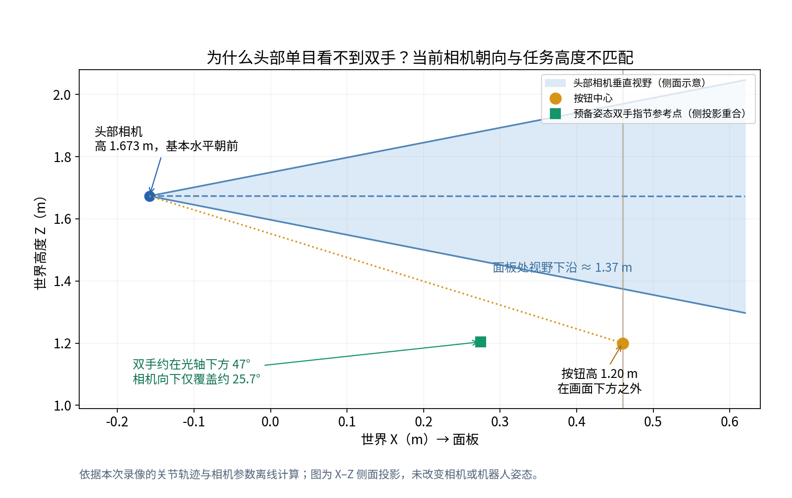

# 头部单目相机视野检查

检查日期：2026-10-14。对象：[规格 v1.1 七路录像](../../../outputs/vib820_spec_v1_1_all_cameras_20261014/WATCH.md)。本次只离线核对已有录像、轨迹、USD 和配置，没有重跑仿真或修改姿态。

历史结论（v1.1，头部零位）：**该配置下看不到双手符合几何预期；相机安装与保存的官方仿真定义一致，但固定的水平头部朝向不适合观察当前双手和按钮工作区。**“挂载正确”和“任务目标处于视野内”是不同的检查项。

## 当前定义

源配置：[astribot_sensors.json](../../../configs/astribot_sensors.json)。相机为 `head_rgbd` 的单路 RGB 视点，不是独立双目左右相机。

| 项目 | 实际配置 |
| --- | --- |
| 挂载链接 | `astribot_head_link_2` |
| 局部位置，m | `[0.0603,-0.2139,-0.0277]` |
| 局部 LookAt 目标，m | `[1.0603,-0.2139,-0.0277]` |
| 局部 up | `[0,-1,0]` |
| 源 SAPIEN 四元数 wxyz | `[0.7071,0.7071,0,0]`，已转换到 USD 相机轴 |
| 分辨率 | 1280×720 |
| 水平 / 垂直视场 | 约 81.12° / 51.42° |
| 焦距 / 水平片门宽度 | 约 14.020 mm / 24 mm；头部焦距由自身视场参数计算，不直接采用通用 18 mm 默认值 |
| 近 / 远裁剪面 | 约 0.02834 m / 141.69 m |
| 本次视频采集频率 | 30 FPS，来自按压配置；通用传感器配置的 10 Hz 未用于本次视频 |
| 两个头部关节目标 | 全轨迹均为 0 rad，无低头或目标跟踪动作 |

源定义已与本地保存的官方 ManiSkill 源文件核对，固定版本为 `1403f9623efaea2709731c74629f395869849e89`。本次录像的 [实际挂载审计](../../../outputs/vib820_spec_v1_1_all_cameras_20261014/run/camera_mount_audit.json) 检查了头部局部/世界变换、分辨率、视场和裁剪面，均通过。这里验证的是公开仿真定义，不能据此断言某台实机的标定或可见范围。

## 看不到双手的原因

使用记录的关节轨迹、底盘世界位姿与相机局部变换重建相机坐标系，并将按钮和双手指节参考点投影到原始 1280×720 画面：

- 相机世界位置约 `(-0.15835,0.25230,1.67345) m`，光轴基本沿 +X 水平朝前，仅下俯约 0.09°。
- 垂直视场一半为 25.71°，所以光轴下方只能覆盖约 25.7°。
- 预备姿态双手末端指节参考点约高 1.204 m，方向在光轴下方约 47.21°；投影纵坐标约 **1168 px**，超出图像的 **0–719 px**。
- 按钮中心高 1.20 m，方向在光轴下方约 37.35°；投影约 **(945,931) px**，同样在画面下边界外。
- 在面板所在 X=0.46 m 处，视野下沿高度约 **1.375 m**，比按钮高约 **17.5 cm**。
- 选取的六个阶段代表时刻中，双手指节参考点均在垂直视野外。头部关节实际最大绝对偏差约 `9.13e-6 rad`，与固定目标一致。

与录像中“主要看到墙面、标识和面板上部”的画面一致。相机投影能够解释目标缺失，不需要以视频裁切或丢帧解释。指节参考点采用左右末端指节链接原点的中点，未将其当作整只手的边界；本检查不等于对全部网格的逐帧遮挡测试。

## 对后续实验的影响

当前头部相机可作为场景观察输入，但不能作为本次双手/按钮接触的直接视觉观测。若实验要求头部同时看到双手，需要调整头部俯仰或显式建立新的任务相机姿态，并检查预备、合爪、工作位姿、按压及返回全过程的可见性。保留原有相机安装外参、通过头部关节低头是可研究的方案；角度应结合关节限制和整个工作区确认。

本次没有自动改变规格 v1.1 的固定头部姿态，也没有将视野调整后的效果算作已验证结果。

复核产物：[数值结果](geometry.json)、[离线计算与绘图脚本](analyze.py)。

## 后续角度对比录像

同日按用户要求，实际录制了头部俯仰关节 0°、15°、30°、45° 四档稳定视角。在默认站位 `(-0.22,0.28) m`，30°可看到完整面板，0°/15°裁掉下部，45°裁掉上部；相机安装参数和双臂预备姿态保持不变。录像、实际关节角度和全部七路原始视角见[低头角度对比](../../../outputs/vib820_head_pitch_comparison_20261014/WATCH.md)。该静态对比完成时尚未修改正式默认头部姿态。

## v1.2 更新：低头30°完整按压

随后已完成低头30°的完整按压录像，并按用户要求将该姿态纳入[当前规格v1.2](../README.md)，可执行配置见 [`config_v1_2.json`](../config_v1_2.json)。本页的水平头部几何结果仍仅适用于v1.1录像。

[完整录像与视角说明](../../../outputs/vib820_press_head30_20261014/WATCH.md)记录了默认站位下头部、左右腕同步视角；头部能看到完整面板与右手接触位置，右腕接触时有夹爪遮挡，左腕主要朝向电梯门。完整动作与重置的物理审计通过；当前证据不覆盖全部随机站位。
